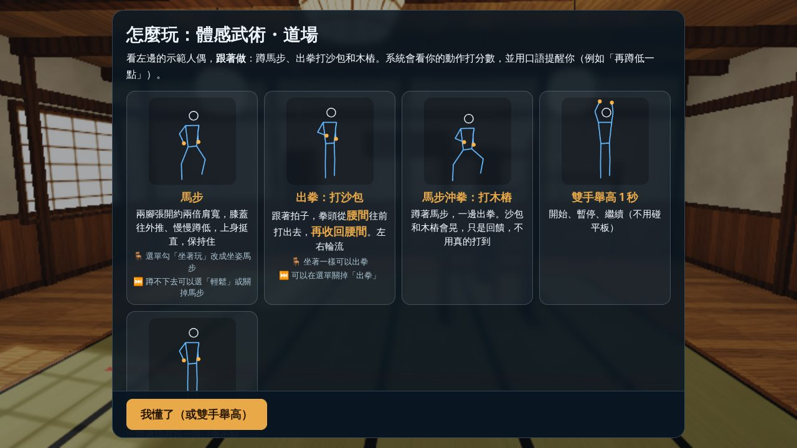
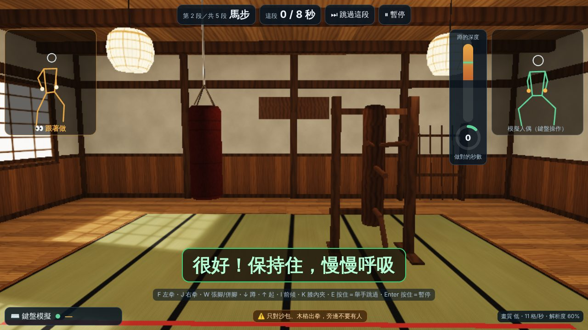
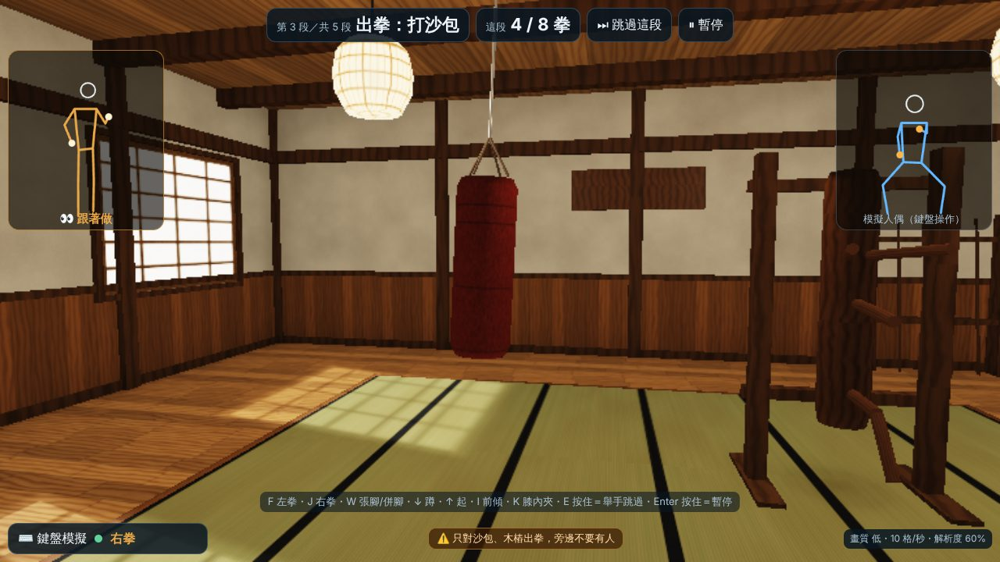
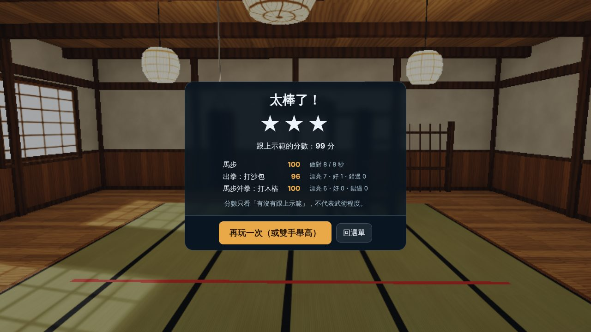
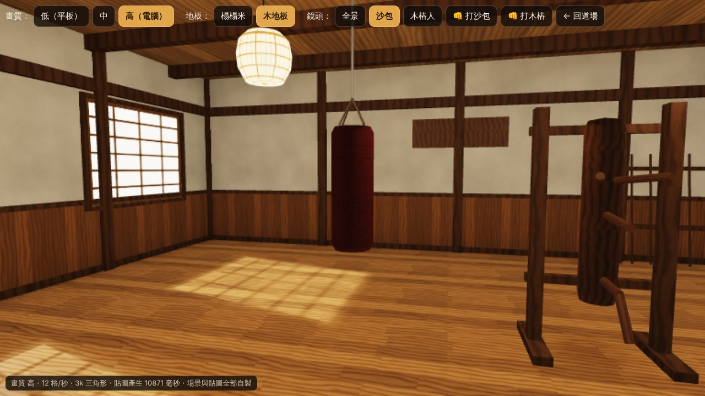

# 體感武術系列企劃：道場（可行性評估＋原型）

> 適用對象：國小中高年級（家庭也可用）　｜　設備：平板橫放（前鏡頭）或電腦鏡頭　｜　文件狀態：第一個場地「道場」有可玩原型，其他為企劃

---

## 一頁摘要（給校長與行政）

1. **做什麼**：在一間寫實的日式道場裡，學生看著示範人偶**跟著做**：蹲馬步、出拳打沙包和木樁人，系統依「有沒有跟上示範」打分數，並用口語提醒（例如「再蹲低一點」「膝蓋往外推」）。
2. **可行性結論**：單一平板鏡頭下，**馬步：可行、穩定**；**出拳：可行，但要搭配「跟拍子」的玩法**才穩；**踢擊：不穩，預設關閉**，先以「提膝」當實驗功能。
3. **安全**：開始前要打勾四項安全確認；有第二個人進入畫面會立刻暫停；只對畫面裡的沙包出拳、禁止對人出拳踢腿；可坐著玩、可選「輕鬆」、每一段都能跳過。
4. **不宣稱效果**：這是體感運動遊戲，動作經過簡化，**不是武術或功夫教學**，不宣稱任何訓練、健身或防身效果。
5. **隱私**：跟海洋系列一樣，鏡頭影像只在平板上即時分析，不錄影、不上傳。

---

## 1. 這一輪做了什麼

| 項目 | 位置 | 說明 |
|---|---|---|
| 道場遊戲（可玩原型） | `dojo/`（網址 `/dojo/`） | 準備 → 馬步 → 出拳打沙包 → 馬步沖拳打木樁 →（實驗：提膝）→ 收勢，一場約 1.5～3 分鐘 |
| 道場場景（可重用） | `src/dojo/scene.js`、`src/dojo/textures.js`；預覽頁 `dojo/scene.html` | 榻榻米或木地板、木牆裙＋灰泥牆、柱與樑、紙拉門窗（日光依窗格投在地上）、紙燈籠、地板站位線與紅色安全線、吊掛沙包、木樁人、棍架。三級畫質 |
| 武術動作辨識 | `packages/taikan-kit/martial/` | 加掛在原本輸入層上，**沒有改動**原本輸入層的任何檔案 |
| 打分流程 | `src/dojo/routine.js` | 不需要畫面就能測試 |
| 素材登錄表 | `dojo/ASSETS.md` | 這一輪全部是自製素材（程式畫的貼圖、程式組的模型、即時合成的音效） |
| 自動測試 | `tests/dojo.test.mjs`、`packages/taikan-kit/test/martial.test.mjs` | 見第 9 節 |

---

## 2. 動作辨識可行性評估（單鏡頭、平板）

### 2.1 前提：平板擺放與距離

- 馬步要看到**腳**，所以要**全身入鏡**：一般平板前鏡頭，玩家要站在約 **2.5～3 公尺**外（四年級學生身高約 135 公分，2.5 公尺時大約佔畫面高度的 6～7 成）。
- 平板**橫放、固定**在桌上或支架上，鏡頭高度約**腰到胸口**。太低會拍不到頭和舉起的手，太高會讓腳變小、深度不準。
- 這個距離剛好也讓**手腳碰不到平板**，是安全上需要的距離。
- 坐著玩時只需要上半身和雙手入鏡（約 1.5～2 公尺，跟海洋系列一樣）。

### 2.2 三類動作的評估

| | 🧍 馬步（姿勢維持） | 👊 出拳 | 🦵 踢擊 |
|---|---|---|---|
| 正面鏡頭看得到什麼 | 腳寬、骨盆下降、膝蓋往內或往外，都看得很清楚 | 手臂朝鏡頭伸，畫面上**手臂反而變短**；看得到的是「手腕從腰升到肩膀高度、手肘抬起」 | 前踢朝鏡頭，腳也會變短；側踢、迴旋踢會轉身，關節常互相擋住 |
| 動作速度 | 慢（維持姿勢），每秒 30 格綽綽有餘 | 快（約 0.15 秒打到底），每秒 15～30 格都抓得到 | 很快，腳踝在畫面上常常模糊、可信度掉很多 |
| 主要誤判 | 寬鬆褲子讓膝蓋位置偏；平板高度影響深度；上身前傾在正面訊號弱 | 把手舉到臉前、舉手經過肩膀高度、側平舉；手肘很低的出拳可能漏判 | 單腳站不穩會晃動被誤算；踢完落地時整個人移動；腳出畫面 |
| 我們的對策 | 用「骨盆下降量」而不是膝蓋角度；開始時自動記住「站直」；回饋一次只講一件事 | 要求手肘抬起＋維持 0.05 秒；拳頭要收回才算下一拳；**只在拍子附近才計分**，其他時間的出拳只讓沙包晃 | 只辨識「提膝」（踢腿的前半段），不辨識整個踢腿 |
| 難易度 | ★☆☆ 容易 | ★★☆ 中等 | ★★★ 困難 |
| 穩定度（推估） | 高 | 中～高（搭配拍子） | 低 |
| 安全風險 | 低（蹲太深會提醒） | 中（揮拳碰到人）→ 場地規範＋兩人入鏡就暫停 | 高（失去平衡、踢到人或平板） |
| **結論** | ✅ 可行，當主要玩法 | ✅ 可行，用「跟著拍子出拳」的玩法 | ⚠️ 不穩，**預設關閉** |

**為什麼出拳要用「跟拍子」的玩法**：單鏡頭只能「推測」拳頭是不是往前打出去，偶爾會把別的手部動作也算成出拳。如果遊戲在**每一拍的前後半秒**才計分，亂動被算錯的機會就小很多；學生也比較容易照著做。沙包和木樁的晃動只是回饋，**不做碰撞判定**（不需要真的「打到」沙包的位置），這也是原型的設計原則。

### 2.3 踢擊的建議

1. **預設關閉**。選單裡只有「🧪 提膝（實驗）」，勾了才會出現一段「提膝」。
2. 先只做**提膝**：膝蓋抬到腰的高度再放下，可以**扶椅背**。它是前踢的前半段，辨識穩定很多，也比較不會失去平衡。
3. **不做**側踢、迴旋踢、跳踢：會轉身（關節互相擋住）、需要更大空間、跌倒與踢到人的風險高。
4. 坐著玩時不出現提膝。
5. 若之後真的要做「前踢」，建議：(a) 只做模仿、不計分；(b) 先用平板實測錄骨架，確認腳踝在快速踢腿時的可信度；(c) 或改成側面再加一台鏡頭（成本與擺放都比較麻煩，不建議學校使用）。

### 2.4 整體結論

單鏡頭平板做「武術體感」**可行**，但應以**姿勢維持（馬步、平衡）＋跟拍子的上肢動作（出拳、格擋）**為主，**避開高速下肢動作（踢擊）**。這也剛好是對國小學生比較安全的方向。

---

## 3. 原型玩法：道場

### 3.1 流程（一場約 1.5～3 分鐘）

| 段落 | 學生要做 | 系統看什麼 | 怎麼算分 |
|---|---|---|---|
| 1. 準備 | 站到白線後、退到看得到全身 | 從髖到腳踝都入鏡、不會太近 | 不算分；站好 1.5 秒自動記住「站直」的樣子 |
| 2. 馬步 | 兩腳張開約兩倍肩寬，膝蓋往外，慢慢蹲低，上身挺直，保持住 | 腳寬、深度、膝蓋方向、上身 | 「做對的秒數」÷ 目標秒數 |
| 3. 出拳：打沙包 | 跟著拍子，左右輪流從腰間出拳再收回 | 每一拍前後 0.5 秒內有沒有出拳、哪一隻手 | 準（±0.25 秒）100、好 70、換錯手 30、錯過 0 |
| 4. 馬步沖拳：打木樁 | 蹲著馬步一邊出拳 | 同上＋出拳當下有沒有維持馬步 | 出拳 70%＋馬步 30% |
| 5.（實驗）提膝 | 左右輪流提膝 | 膝蓋抬到腰的高度 | 同出拳 |
| 6. 收勢 | 雙腳併攏、站直、深呼吸 4 秒 | — | 不算分（緩和） |

- 星星：80 分以上 3 顆、55 分以上 2 顆、完成就有 1 顆。**分數只代表「有沒有跟上示範」，不代表武術程度**（結算畫面也這樣寫）。
- 三級難度＝三種強度：🌱 輕鬆（高馬步、出拳慢、8 秒）／🥋 標準（中馬步、12 秒）／🔥 挑戰（低一點的馬步、出拳快、18 秒；**大腿不用低於水平**）。

### 3.2 即時回饋（口語、一次一件事）

順序：**安全 → 入鏡 → 腳寬 → 深度 → 上身**，同一句至少顯示 0.6 秒才換，避免一直跳。

| 情況 | 說的話 |
|---|---|
| 腳沒入鏡 | 往後退一點，讓腳也入鏡 |
| 膝蓋往內倒 | 膝蓋往外推，對準腳尖 |
| 蹲得比目標低很多 | 不用蹲那麼低，稍微起來一點 |
| 腳太窄 | 兩腳再張開一點（約兩倍肩寬） |
| 還沒蹲 | 膝蓋彎下去，蹲低 |
| 快到了 | 再蹲低一點 |
| 上身前傾 | 上身挺直，不要往前彎 |
| 做對了 | 很好！保持住，慢慢呼吸 |

坐姿版只看「背挺直」和「雙拳收在腰間」。

畫面上另有：左邊「👀 跟著做」示範人偶（從斜前方看，看得出拳頭往前打）、右邊「鏡頭看到的你」骨架（做對變綠色）、蹲的深度條（綠線＝目標）、做對的秒數圈、出拳的節拍圈（縮到中間時出拳，左拳橘色、右拳藍色）。

### 3.3 操作（不用碰平板）

- **雙手舉高 1 秒**：開始、暫停、繼續、關掉說明（跟海洋系列一樣）。
- **舉單手 1.5 秒**：跳過現在這一段（做不到、會痛就跳過）。
- 鍵盤模擬：F 左拳、J 右拳、W 腳張開／併攏、↓ 蹲、↑ 起、I 上身前傾、K 膝蓋內夾（後兩個用來測試提醒）、Z／X 提膝、E 按住＝舉單手、Enter 按住＝雙手舉高。

---

## 4. 安全設計

| 項目 | 做法 |
|---|---|
| 場地與距離 | 選單的安全規範在鏡頭模式**自動展開**；每次打開頁面第一次開始前，**四項安全確認都打勾才能開始**（平板距離 2.5～3 公尺、周圍 1.5 公尺沒人沒東西、排隊同學在後方 2 公尺外、只對沙包出拳） |
| 地板線 | 道場地上畫了白色站位線（含馬步腳位）和紅色安全線，讓學生理解「要站在哪裡」 |
| 禁止對人出拳踢腿 | 說明畫面、選單、安全確認、遊戲中底部提示都寫「只對沙包、木樁出拳，旁邊不要有人」 |
| 有人靠近 | 鏡頭看到第二個人超過 1 秒就**立刻暫停**（海洋系列只提示，道場比較嚴格），要確認後雙手舉高才繼續 |
| 看不到人 | 自動暫停；回來後倒數 3 秒才繼續 |
| 降低強度 | 🪑 坐著玩（坐姿馬步＋坐著出拳）、🌱 輕鬆難度、不做馬步、不出拳、每一段都能跳過 |
| 避免受傷姿勢 | 提醒「膝蓋往外推」「不用蹲那麼低」；挑戰級也不要求大腿低於水平；說明「出拳不用用力、手肘不要打到完全伸直」 |
| 踢擊 | 預設關閉；實驗功能只有提膝，可扶椅背；坐著玩時不出現 |
| 晃動與光線 | 有「減少晃動」選項；沒有閃光特效 |
| 不宣稱效果 | 說明畫面、選單、結算畫面都寫：體感運動遊戲、動作簡化、不是武術或功夫教學、不宣稱訓練／健身／防身效果 |

**給老師的上課前檢查（道場版）**：平板固定、離玩家 2.5～3 公尺；玩家周圍 1.5 公尺淨空；排隊區在玩家後方 2 公尺外（可用膠帶貼線）；地板不滑（運動鞋或赤腳，不要只穿襪子）；先示範一次「雙手舉高＝暫停」；每人連續不超過 5 分鐘。

---

## 5. 道場場景（可重用）與畫質分級

`createDojo(canvas, { tier, floor })` 會回傳一個場景物件：`hitBag(side, strength)`、`hitDummy(...)`、`focus('bag'|'dummy'|'room'|'both')`、`frame(dt)`。其他武術遊戲可以直接用同一個道場，只換玩法。

| | 低（平板） | 中 | 高（電腦） |
|---|---|---|---|
| 貼圖大小 | 512 | 地板 1024，其他 512 | 地板 2048，其他 1024 |
| 物體陰影 | 近似陰影（把沙包、木樁當膠囊算） | 陰影貼圖 1024、柔邊 3×3 | 陰影貼圖 2048、柔邊 5×5 |
| 表面凹凸（木紋、榻榻米編織） | 無 | 有 | 有 |
| 燈籠光源 | 2 盞 | 3 盞 | 4 盞 |
| 反鋸齒 | 無 | 有 | 有 |
| 起始解析度 | 70%，自動調整 | 100%，自動調整 | 最高 150%，自動調整 |

所有等級都有：窗格日光投影、房間角落柔和陰影、物體底下的接觸陰影、ACES 色調。
平板會自動選「低」；畫面卡頓時解析度會自動往下調（跟海洋系列同一套做法）。

---

## 6. 完整武術系列建議

原則：**姿勢維持＋跟拍子的上肢動作為主**；每款都能坐著玩、能跳過；不做對打、不做高速踢擊；分數只代表跟上示範。

| # | 遊戲（場地） | 玩法 | 主要動作（辨識難度） | 強度 | 坐著玩 | 建議 |
|---|---|---|---|---|---|---|
| 1 | **道場：馬步與沖拳**（本輪原型） | 跟示範蹲馬步、出拳打沙包與木樁 | 馬步★、出拳★★ | 中 | ✅ | 原型完成，先實測 |
| 2 | **節奏道場** | 配合音樂節拍出拳（類似節奏遊戲），左右拳、雙拳、蹲下閃躲 | 出拳★★、蹲低★ | 中 | ✅ | 下一個做：重用 #1 的出拳與場景，最有趣 |
| 3 | **木樁人反應** | 木樁的手亮燈 → 舉手「格擋」對應的位置（上、中）；練反應不練力量 | 格擋（前臂舉到臉前／胸前）★★ | 低 | ✅ | 第三個：新增「格擋」辨識，難度中等 |
| 4 | **太極慢動作** | 跟著示範做很慢的動作，系統比對姿勢相似度；適合暖身、全班跟大螢幕一起做 | 姿勢比對★ | 低 | ✅ | 第四個：最安全、最適合全班；也適合低強度需求的學生 |
| 5 | **金雞獨立（平衡）** | 單腳站（可扶椅背）維持姿勢，畫面上的燭火不能晃 | 提膝維持★★ | 低～中 | 部分 | 第五個：用本輪的「提膝」實驗結果決定 |
| 6 | **前踢模仿** | 只模仿、不計分，扶椅背 | 前踢★★★ | 高 | ❌ | 最後，且要先用平板實測確認穩定 |
| — | 腰帶進度（系統） | 完成各款解鎖不同顏色腰帶，只跟自己比，不排行 | — | — | — | 第二款之後加入 |

**不建議做**：兩人對打、對著鏡頭（人）踢擊、跳躍踢、需要器材（棍、拳套）的遊戲。

---

## 7. 開發順序與理由

1. **道場實測與調整**（下一步）：先用學校平板驗證馬步與出拳的門檻（見第 10 節），錄幾段骨架回來調整。若出拳在真人身上漏判太多，第 2 款就要改成以「格擋」或「姿勢」為主。
2. **節奏道場**：重用場景、出拳辨識、節拍判定，只加音樂與關卡；最能讓學生想一直玩。
3. **木樁人反應**：加一種新動作（格擋），鍛鍊反應；場景重用木樁人。
4. **太極慢動作**：加「姿勢相似度」比對；可做全班一起暖身的模式。
5. **金雞獨立**：依提膝實測結果再決定。
6. **共用外殼整理**：海洋、棒球、武術三套都穩定後，把選單、暫停、結算、畫質分級抽成真正共用的外殼（現在道場的外殼是另外寫的一份，見第 8 節）。
7. 前踢模仿：最後，視實測結果決定做不做。

---

## 8. 我做的決定與理由

| 決定 | 理由 |
|---|---|
| 道場放在新資料夾 `dojo/`、`src/dojo/`，輸入層用**加掛**的 `martial/` 子資料夾 | 棒球場正在另一個 session 開發；不改動首頁的遊戲卡、不改動海洋的共用外殼 `src/game/shell.js`、不改動輸入層原本的檔案，就不會互相衝突。 |
| 首頁只在「🧰 其他」加**一行連結** | 讓您找得到道場，又不碰遊戲卡片區（棒球場最可能改那裡）。等棒球場合併後，再把道場正式做成遊戲卡。 |
| 道場的遊戲外殼**另外寫一份**，但操作完全照海洋系列 | 海洋的外殼跟海面渲染器綁在一起，要共用就得改它，容易和其他開發衝突。學生看到的按鈕、雙手舉高、暫停倒數、畫質分級都一樣。之後再抽成共用（第 7 節第 6 點）。 |
| 原型玩法用「**跟拍子出拳**」而不是「打到沙包才算」 | 單鏡頭無法知道拳頭打到哪裡；「拍子＋左右手」穩定很多。您也指定沙包反應只當回饋。 |
| 馬步深度用「**骨盆下降量**」，不是膝蓋角度 | 正面鏡頭看膝蓋角度會被壓扁、算不準；骨盆下降在正面最清楚。 |
| 出拳要「**從腰間出拳、收回腰間**」（抱拳收腰） | 這是馬步沖拳的基本樣子，也讓「收回」有明確的位置，辨識更穩；從下巴前的防守姿勢出拳也能算（手肘垂下就算收回）。 |
| 示範人偶**從斜前方看** | 正面看不出「往前出拳」，學生會誤以為是舉手；斜 30 度手臂伸出去就看得出來。 |
| 第二個人入鏡就**暫停**（海洋只提示） | 揮拳時旁邊有人是最大的風險。 |
| 每次打開頁面要做**安全確認**（鏡頭模式） | 您要求「嚴格的場地與距離提醒」；打勾比只顯示文字更確定有人看過。只在鏡頭模式需要，鍵盤模擬不用。 |
| 挑戰級也**不要求大腿低於水平**、蹲太深會提醒 | 對國小學生的膝蓋比較安全。 |
| 場景、貼圖、音效**全部自製**（程式產生） | 符合 CC0／CC-BY／自製規則，不用另外找授權，也讓網站很小（不用下載圖檔）；缺點是低畫質平板第一次打開要約 2 秒產生貼圖（畫面會顯示進度）。 |
| 預設**榻榻米**，可切換木地板 | 您要求兩種都能用；榻榻米比較有「道場」的感覺。 |
| 一場只有 **1.5～3 分鐘** | 輪流玩時每人時間不會太長；馬步維持 8～18 秒對國小學生已經夠。 |

---

## 9. 自我測試結果（在雲端做的）

| 測試 | 方法 | 結果 |
|---|---|---|
| 武術辨識（13 項） | 全身模擬人偶（出拳朝鏡頭伸，跟真人正面一樣） → 辨識器 | ✅ 13/13：自動校準、深度準確（0.3／0.6／0.9 誤差都在 0.12 內）、回饋順序、蹲太低提醒、左右出拳各 5 下（每秒 30 格與 15 格都對）、快速連打 12 下不漏不重複、反應約 0.27 秒、馬步沖拳、坐著出拳、5 組亂數的抖動＋雙手舉高＋蹲下站起都**沒有誤判成出拳**、提膝開關、舉手開始／暫停不受影響 |
| 原本輸入層 | 原有 13 項 | ✅ 全部通過（沒有改動原本的檔案） |
| 道場流程（12 項） | 模擬學生看示範做動作 → 辨識器 → 打分 | ✅ 三級難度跟著做都拿 3 星；動作不準（時間誤差 ±0.35 秒、15% 出錯手、慢 2 秒才蹲）也至少 2 星；什麼都不做也會自動結束（1 星）；全部跳過也能結束；坐著玩三級都 3 星；選單開關會改變段落；提膝打開能完成；出錯手判「換另一隻手」 |
| 海洋系列 | 原有 28 項 | ✅ 全部通過 |
| 實際瀏覽器（雲端軟體繪圖） | 用鍵盤模擬玩一場 | ✅ 說明 → 選單 → 倒數 → 準備（自動記住站姿）→ 馬步（「膝蓋彎下去，蹲低」→ 蹲下後「很好！保持住」，做對秒數會累加）→ 出拳（節拍圈、沙包晃動、「漂亮！」）→ 結算；坐著玩；舉單手 1.5 秒跳過；沒有錯誤訊息 |
| 三級畫質 | 場景預覽頁截圖 | ✅ 低、中、高都正常；低畫質貼圖產生約 2 秒（雲端電腦） |

雲端只有軟體繪圖（沒有顯示卡），所以畫面每秒只有 10 多格，**不代表平板的速度**。











---

## 10. 雲端沒辦法驗證、需要您用平板實測的

1. **距離與入鏡**：在教室實際量 2.5～3 公尺，學生從頭到腳是否都在畫面裡？右上角「鏡頭看到的你」骨架有沒有腳？教室夠不夠大（加上排隊區約需要 4×5 公尺）？
2. **馬步深度準不準**：請學生慢慢蹲，看右上方深度條會不會跟著變；穿寬鬆褲子、運動褲各試一次。「再蹲低一點」「膝蓋往外推」的提醒時機是否合理？
3. **出拳會不會漏判**（最重要）：照節拍圈出拳，看左下角是否顯示「左拳／右拳」。特別注意**手肘很低**的出拳、**很小力**的出拳有沒有被算到。漏很多時先把靈敏度調「高」。
4. **出拳會不會誤判**：站著講話、整理頭髮、舉手時，左下角會不會跳出「左拳／右拳」？
5. **坐著玩**：坐在椅子上，「背挺直」「雙拳收腰」的判斷是否合理？坐著出拳會不會被桌子擋到？
6. **舉單手跳過**：舉單手 1.5 秒會不會太容易誤觸（例如出拳時）？
7. **兩人入鏡暫停**：請另一位同學走進畫面，是否會立刻暫停？
8. **平板順暢度**：右下角「格/秒」25 以上算順；用鏡頭時最吃力。第一次打開的「正在準備道場」要等多久？
9. **示範人偶看不看得懂**：學生不經講解，能不能看懂斜前方的示範人偶在「往前出拳」？
10. **提膝（實驗）**：如果想試，請勾選後讓學生扶椅背做，告訴我是否穩定、會不會晃到失去平衡。
11. 實測時建議在「輸入層測試頁」用「⏺ 錄製骨架 10 秒」錄 2～3 位學生的馬步和出拳（只有座標數字，沒有影像）回傳給我，我可以用來調整門檻。

---

## 11. 與其他開發並行的安排（避免合併衝突）

這一輪**改動既有檔案**只有一處：首頁 `index.html` 的「🧰 其他」清單加一行道場連結。其他全部是新檔案：

```
dojo/index.html, dojo/dojo.css, dojo/scene.html, dojo/docs.html, dojo/ASSETS.md
src/dojo/main.js, scene.js, textures.js, routine.js, howto.js
packages/taikan-kit/martial/（index、recognizer、puppet、keyboard、feedback、README）
packages/taikan-kit/test/martial.test.mjs
tests/dojo.test.mjs
docs/dojo-plan.md
```

道場只「讀取」既有的 `src/gl.js`（著色器工具）、`game/game.css`（樣式）、`src/game/howto.js`（說明卡片樣式）與 taikan-kit，沒有修改它們。
