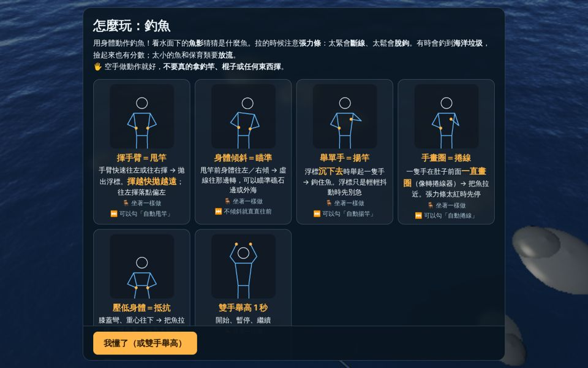
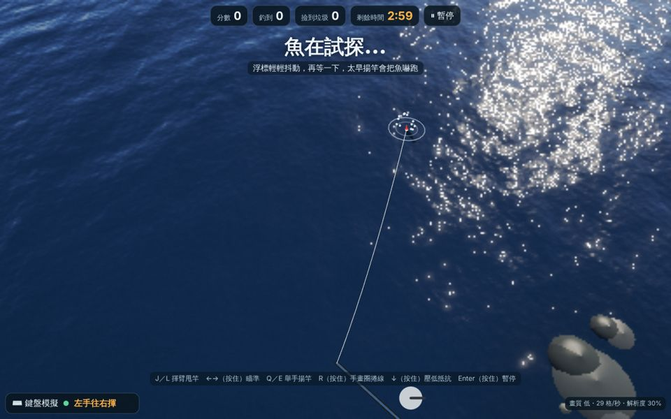
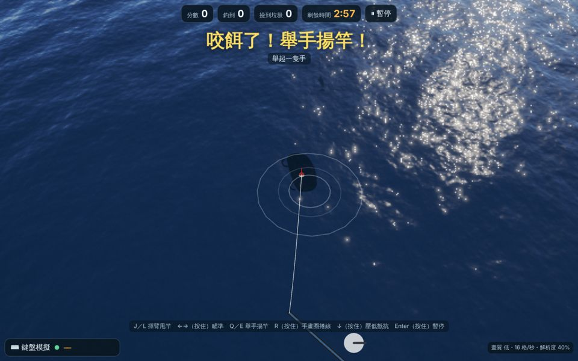
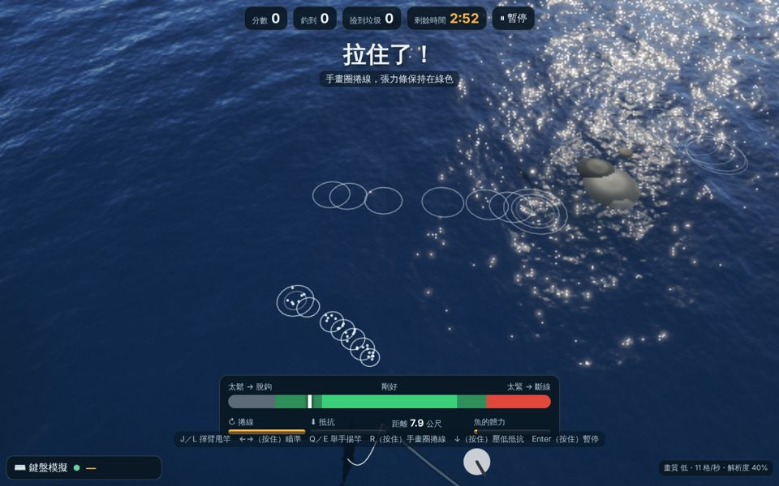
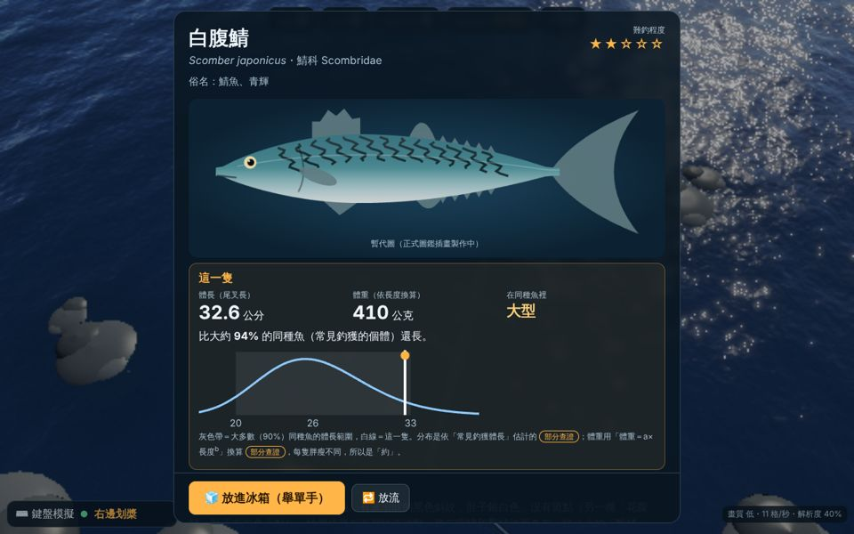
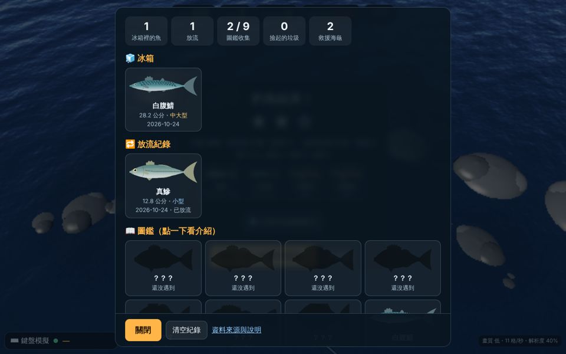

# 釣魚（台灣東北角）垂直切片：白話說明與自我測試結果

> 給老師看的「做了什麼、我替您做的決定、測了什麼、還要您用平板實測什麼」。
> 遊戲網址：網站首頁的「🎣 釣魚」卡片，或直接開 `fishing/`。

## 一、這一輪做了什麼

1. **釣魚遊戲（可以從頭玩到尾）**：甩竿 → 等魚 → 咬餌 → 揚竿 → 捲線與拉扯 → 釣上來 → 圖鑑卡 → 冰箱。一場 3 分鐘；時間到時如果魚正在線上，會讓您把最後一條釣完。
2. **畫面**：從岸邊上方往下看海面。水面下只看到**模糊的魚影**，魚影大小代表魚的大小，游法代表魚種：
   - 黑毛、白毛、黑鯛：游一下停一下（很警覺）；
   - 石狗公：幾乎不動，突然衝一下（埋伏型）；
   - 鯖魚、竹筴魚：快速衝刺；
   - 石鯛：先繞著餌轉幾圈才咬；
   - 臭肚、細刺魚：彎彎曲曲邊游邊啄。
   - 水面有波紋和水花；魚試探時浮標輕輕抖、咬餌時浮標沉下去；被拉起來那一刻才看到完整的魚。
3. **冰箱與圖鑑卡**：釣到的魚放進冰箱（存在這台平板的瀏覽器裡，不上傳）。點一下就看圖鑑卡：
   - 這種魚的介紹、棲息環境、吃什麼、習性、上鉤後的拉扯特性、難釣程度、東北角的月份表、安全提醒、保育資訊；
   - **這一隻**的體長與體重、在同種魚裡是小型還是大型（「比大約 X% 的同種魚長」），並畫出同種魚的體長分布圖，標出這一隻的位置；
   - 每個數據的**來源、授權、查證狀態**（已查證／部分查證／示意／遊戲設定）。
   - 卡片上的文字、數字、圖表全部由程式排版，圖片裡沒有文字。
4. **魚類資料庫**（`data/fishing/`）：一種魚一個檔，可以一直加新魚、新海域。格式說明在 `data/fishing/README.md`。
5. **首頁**多了一張「🎣 釣魚」卡片；遊戲一打開先出現「怎麼玩」動畫說明。
6. **繪圖清單** `docs/fishing-art-request.md`：15 張圖（9 種魚＋海龜＋5 種垃圾）的檔名、尺寸、視角、背景、風格與辨識特徵，可以直接拿去請 GPT 畫。

（雲端是用軟體模擬繪圖、低畫質截圖，所以海面比較粗糙；魚是程式畫的暫代圖。）

## 二、動作怎麼對應（都能用鍵盤模擬）

| 遊戲裡 | 身體動作 | 鍵盤 | 做不到時 |
|---|---|---|---|
| 甩竿 | 手臂快速往左或往右揮（越快拋越遠，往左揮落點偏左）；也可以由上往下甩（過頭拋投，直直往前） | J／L | 勾「自動甩竿」 |
| 瞄準 | 甩竿前身體往左／右傾，水面上的虛線會跟著轉 | ←／→ 按住 | 不傾斜就直直往前 |
| 揚竿 | 浮標沉下去時舉起一隻手 | Q／E | 勾「自動揚竿」 |
| 捲線 | 一隻手在肚子前面一直畫圈（像轉捲線器） | R 按住 | 勾「自動捲線」 |
| 抵抗 | 壓低身體（站著：膝蓋彎、重心往下；坐著：身體往前彎） | ↓ 按住 | 勾「不用壓低身體」 |
| 暫停 | 雙手舉高 1 秒 | Enter 按住 | 按畫面上的「暫停」 |

**張力條**：綠色是剛好；捲太快、壓太低、或魚在衝刺時會變紅，紅太久就**斷線**；什麼都不做、魚又不拉時會變灰，灰太久就**脫鉤**。魚衝刺時（水花＋「魚在衝刺！」）要先放鬆。

**失敗與意外**：斷線、脫鉤、太早揚竿把魚嚇跑（普通、挑戰）、咬餌後太晚揚竿（餌被吃掉）、釣到垃圾、誤釣到海龜。失敗都不扣分，收線後馬上可以再甩。

**安全**：「怎麼玩」、選單的安全檢查、甩竿提示都寫了「空手做就好，不要真的拿釣竿、棍子或任何東西揮」。其他規範與另外三款相同（可坐著玩、每個動作都能關、看不到人自動暫停、雷電關閉、一人一機）。

## 三、選了哪些魚、為什麼

選擇標準：①東北角岸釣（岩岸、漁港、堤防）真的常釣到；②動作與外形差異大，魚影和拉扯手感分得出來；③能帶出教學點（毒棘、性轉變、卵胎生、法規、保育）；④找得到可商用的資料來源。

| # | 魚 | 為什麼選 | 教學點 |
|---|---|---|---|
| 1 | 瓜子鱲（黑毛） | 東北角冬季磯釣代表魚（海保署圖鑑） | 浪越大越敢靠岸；臺灣已能人工繁殖 |
| 2 | 天竺舵魚（白毛） | 東北角冬季磯釣常和黑毛並提（**取代原本想放的黃錫鯛**，見決定 2） | 「同一個俗名可能指不同魚」 |
| 3 | 褐臭肚魚（臭肚） | 漁港、礁石邊最常見之一 | **毒棘**，認得才安全 |
| 4 | 黑棘鯛（黑鯛） | 漁港、河口、礁岩都有，釣友目標魚 | 年輕時多是雄魚，長大後變雌魚 |
| 5 | 條石鯛（石鯛） | 東北角「夢幻魚」，力氣最大、最難釣 | 鳥喙狀牙齒；7 條橫帶 |
| 6 | 褐菖鮋（石狗公） | 礁岩石縫的常客，新手常釣到 | **毒棘**；卵胎生；「石狗公」是好幾種魚的通稱 |
| 7 | 細刺魚 | 漁港最容易看到的小魚、最好釣 | 入門魚 |
| 8 | 白腹鯖 | 基隆一帶堤防、漁港的群游魚 | 漁船的體長規定與禁漁期；離水要冰存 |
| 9 | 真鰺（竹筴魚） | 漁港夜釣常見，有臺灣東北部的一手研究 | 稜鱗；東北部漁獲多是 0～1 歲的年輕魚 |
| 特別 | 綠蠵龜（誤釣） | 東北角沿岸常見，釣具纏繞是真實問題 | 保育類；**停止捲線、不自己拔鉤、請大人撥 118** |
| 垃圾 | 寶特瓶、塑膠袋、廢棄漁網和釣線、夾腳拖、鐵鋁罐 | 淨灘最常見的種類 | 海洋垃圾議題 |

## 四、我替您做的決定與理由

| # | 決定 | 理由 |
|---|---|---|
| 1 | **新內容全放在新資料夾**：`fishing/`（頁面）、`src/fishing/`（程式）、`data/fishing/`（資料庫）、`assets/fishing/`（圖檔）、`tests/fishing.test.mjs`。共用的外殼、輸入層、划舟衝浪帆船的檔案**一行都沒改**；首頁只加了一張卡片 | 避免和棒球場、道場、商用體檢的 session 衝突。釣魚頁重用共用外殼（選單、怎麼玩、暫停、結算、畫質分級、鏡頭跟隨），所以操作方式和另外三款一樣 |
| 2 | **黃錫鯛換成白毛（天竺舵魚）** | 查到的臺灣分布與研究都在西南部，偏好沙泥底與河口，不是東北角典型的浪區岩礁魚；1997 年東北角釣魚報導把「黑毛、白毛、臭肚」並列為冬季代表魚。但「白毛」到底是哪一種要請在地釣友確認 |
| 3 | **捲線（手畫圈）在釣魚資料夾裡自己判斷**，不改輸入層 | 輸入層沒有「畫圈」事件。我用輸入層已經提供的「手的位置」連續值計算：同一隻手往同方向轉約 1.2 圈才開始算捲線（單次揮手、划槳、小幅亂動都不會被當成捲線），之後就即時跟著手的快慢。鍵盤模擬一樣是讓模擬人偶真的畫圈（按住 R），走同一套判斷 |
| 4 | **「身體後仰或蹲低」做成「壓低身體」** | 平板鏡頭在正前方，單純往後仰時肩膀幾乎不動，看不準；輸入層已有的「蹲低」是看肩膀下降。站著時「膝蓋彎、往後坐」（像拔河）一定會讓肩膀下降，所以用它；坐著就是身體往前彎（和衝浪一樣） |
| 5 | **甩竿用既有的「揮臂」和「划槳（由上往下）」** | 揮臂的速度就是拋投距離；往左揮偏左、往右揮偏右；過頭往下甩直直往前。另外加上甩竿前的身體傾斜來瞄準，鍵盤玩家才有辦法控制方向（鍵盤的揮臂速度固定，永遠是最遠） |
| 6 | **揚竿用「舉單手」** | 動作最接近真的揚竿，也不會和「雙手舉高＝暫停」搞混 |
| 7 | **海龜的處理照官方原則**：停止捲線、不硬拉上岸、不自己拔鉤或剪線放走、請大人撥 118 | 研究時發現官方呼籲「不要自行拔鉤或直接放生」。所以遊戲裡誤釣海龜時，正確做法是**停止捲線、放鬆**，穩住後出現處理步驟卡；海龜不會被「拉出水面」，也不會放進冰箱 |
| 8 | **放流規則分成三種，卡片上寫清楚依據** | ①保育類（海龜）一律放流；②**鯖魚未滿 20 公分、竹筴魚未滿 17 公分放流**：比照《鯖鰺漁業管理辦法》對漁船的尺寸（休閒岸釣法規沒有要求，卡片寫明是「遊戲規則」）；③黑毛、臭肚、黑鯛、石鯛未滿初次成熟體長放流（遊戲規則，讓小魚長大）。**查不到任何休閒垂釣的法定最小尺寸**，所以沒有一條寫成「法規」 |
| 9 | **不使用 FishBase、不轉載維基百科** | FishBase 是 CC BY-NC（非商用），維基百科是 CC BY-SA。數值改用論文（只引用數值事實並註明出處）、政府網站、法令、TaiCOL（CC BY 4.0）。臺灣魚類資料庫的授權沒有寫明是哪一種 CC，所以也不當來源 |
| 10 | **找不到可靠來源的數字一律標「示意」** | 例如黑毛、白毛、石鯛、石狗公的體重公式都沒有找到一手論文，用「體重約和長度三次方成正比」的一般原則估計，卡片上標「示意」 |
| 11 | **魚影畫得比實物大（約 6 倍）** | 從岸上高處往下看，30 公分的魚只有幾個像素。同樣倍率放大，所以「大魚影＝大魚」的比較仍然成立 |
| 12 | **難度＝天氣＋魚的力氣** | 簡單：晴天、張力安全區寬、揚竿時間長、太早揚竿不會嚇跑魚。普通：多雲微風，太早揚竿有時嚇跑魚。挑戰：下雨、海水濁（魚影比較淡）、魚力氣大、斷線比較快 |
| 13 | **季節** | 預設依今天的月份決定哪些魚比較多（例如冬天黑毛多、夏天石鯛多）；選單可以改月份。不在季節的魚還是可能出現，只是很少 |
| 14 | **冰箱只存在這台裝置** | 不需要帳號、不上傳；換平板或清除瀏覽器資料就會不見。選單有「清空紀錄」 |
| 15 | **「怎麼玩」裡的「手畫圈」卡** | 共用的「怎麼玩」動畫沒有畫圈動作；我在釣魚程式裡另外讓同一個模擬人偶畫圈，不改共用檔案 |
| 16 | 其他三款遊戲選單的「其他遊戲」連結**沒有加釣魚** | 那需要改共用的 `game/index.html`，為了避免衝突先不改；首頁已經有入口。之後要加只是一行 |

## 五、資料查證：做法與限制（重要）

- 我請一個研究助手交叉查證每一種魚，完整筆記在 `docs/fishing-research-notes.md`（每個數值都有來源、授權、查證狀態）。
- **限制**：這次在雲端**沒辦法直接打開任何來源網頁**，只能讀到搜尋引擎的摘錄。所以：只有一個來源的數值都標「部分查證」；「已查證」只用在兩個以上來源一致的地方（例如臭肚有毒棘、海龜是一級保育類、118 專線）。
- 卡片上「📚 資料來源、授權與查證狀態」可以看到每個數字的出處。

## 六、需要您或專業人士確認的項目

**魚類與數據**
1. 「白毛」在東北角指的是哪一種魚（目前用天竺舵魚）？「黑毛」是否也包含細鱗的 *Girella leonina*？
2. 各魚種在東北角的**月份**（大多是示意），建議問在地釣具店。
3. 體重公式 a、b：請找人讀原文核對（特別是黑鯛論文的公釐／公分單位；兩篇鯖魚論文的作者還沒補上）。黑毛、白毛、石鯛、石狗公目前是示意值。
4. 各魚的 IUCN 等級（都沒能直接打開 IUCN 網站確認）。
5. 臭肚、石狗公被刺傷的處理方式目前參考澳洲衛教資料，請臺灣醫師或毒藥物防治中心確認。

**法規與保育**
6. 確認休閒垂釣**真的沒有**全國或新北市的最小尺寸、尾數限制。
7. 《鯖鰺漁業管理辦法》現行條文（20 公分、17 公分的規定），以及它只適用漁船。
8. 海保署《釣到海龜怎麼辦？》摺頁原文（例如是否要剪線、剪多長），遊戲的四個步驟是否要調整。
9. 新北市擴大保育區（3 浬）草案是否已經生效。遊戲場景是虛構岩岸；但野柳、基隆望海巷潮境保育區禁止垂釣，若要做「實地延伸」教學請注意。

**授權**
10. GPT 產生的圖：請確認您使用的方案允許商業使用，放圖時在 `assets/fishing/README.md` 登錄。
11. 臺灣魚類資料庫若確認是 CC BY，可以改當主要來源，查證會更完整。

## 七、自我測試結果（在雲端做的）

| 測試 | 方法 | 結果 |
|---|---|---|
| 資料庫完整性 | 自動檢查 9 種魚＋海龜＋5 種垃圾：每個數據都有來源、授權、查證狀態；引用的來源都存在；來源授權不是 NC／SA | ✅ 通過 |
| 體長與體重 | 百分位（中位數＝50%、p95＝95%）、抽出的體長都在合理範圍、體重隨體長增加、大小分級 | ✅ 通過 |
| 三種難度 | 模擬玩家（看張力條、反應 0.4 秒），每級 20 場 | ✅ 每場 2 星以上；平均每場釣到約 5～6 條魚、約 1 個垃圾 |
| 拉太猛會斷線 | 一直捲線＋一直壓低 | ✅ 10 場都斷線 |
| 太鬆會脫鉤 | 中鉤後什麼都不做 | ✅ 10 場都脫鉤 |
| 動作全部跳過 | 自動甩竿、揚竿、捲線、張力 | ✅ 三級都能釣到魚、拿到星星 |
| 誤釣海龜 | 中鉤後停止捲線、放鬆 | ✅ 出現海龜處理步驟卡 |
| 太早揚竿 | 簡單級不會嚇跑魚；挑戰級會 | ✅ 通過 |
| 甩竿 | 揮越快越遠（相差 15 公尺以上）；左右方向正確 | ✅ 通過 |
| 捲線判斷 | 模擬人偶畫圈 → 捲線；單次揮手、划槳、小幅亂動 → 不算 | ✅ 通過 |
| 原有遊戲與輸入層 | 划舟、衝浪、帆船、輸入層原有測試 | ✅ 全部通過（遊戲 28 項、輸入層 13 項） |
| 實際瀏覽器操作 | 雲端瀏覽器（軟體繪圖，每秒約 2 格，所以用 `?speed=6` 讓遊戲時間加快）：怎麼玩 → 選單 → 用鍵盤甩竿、揚竿、按住 R 捲線 → 圖鑑卡 → 放流／放進冰箱 → 誤釣海龜 → 結算 → 冰箱與圖鑑卡 | ✅ 整個循環正常、沒有錯誤訊息 |

模擬玩家沒有鏡頭延遲，表現比真的小朋友好，所以星星門檻在實測後可能要再調。

## 八、雲端沒辦法驗證、需要您用平板實測的

1. **手畫圈捲線**（最重要）：請學生一隻手在肚子前面畫圈，看張力條下方的「↻ 捲線」條會不會動。大約要轉 1 圈多才開始算，之後會即時跟著快慢。
   - 不容易觸發：圈畫大一點、靈敏度不影響這個判斷（請回報）；
   - 太容易觸發（沒畫圈卻在捲）：請回報是做了什麼動作。
2. **壓低身體抵抗**：站著「膝蓋彎、往後坐」或坐著「身體往前彎」時，「⬇ 抵抗」條會不會動？
3. **甩竿**：真的揮手時，拋投距離有沒有快慢之分（鍵盤永遠最遠）？往左揮會不會落在左邊？
4. **揚竿的時機**：鏡頭判斷「舉單手」大約要 0.35 秒，加上鏡頭延遲。簡單級咬餌後約有 2 秒可以揚竿、挑戰級約 1 秒，請看會不會太趕。
5. **魚影看不看得清楚**：在學校平板的螢幕上、教室光線下，學生看得到水面下的魚影嗎？分得出大小嗎？
6. **一場 3 分鐘、星星門檻**是否適合。
7. **順暢度**：右下角的「格/秒」25 以上算順；釣魚多了一層畫魚影的畫面，請特別看低階平板。
8. **圖鑑卡的文字量**：五年級學生是否讀得下去；卡片 25 秒後會自動繼續。
9. 正式圖放進去後，請到「🧊 冰箱與圖鑑」看去背邊緣是否乾淨。
