# 居家徒手訓練教練：白話說明

> 給「不熟前端程式的學校資訊人員」看：這款遊戲玩什麼、手機怎麼放、鏡頭怎麼判斷每個動作、做了哪些決定、哪些地方要用真機確認、之後怎麼加新動作。
> - **階段一**：動作分析核心 + 三個動作（深蹲、開合跳、側抬腿）+ 校正 + 除錯畫面 + 鍵盤模擬與自動測試（第一～十四節）。
> - **階段二**：冒險模式——關卡與技能、連擊與品質加成、暖身 → 主訓練 → 收操、示範人偶、每日任務與本機進度（第十五節）。

## 一、這是什麼

- 用手機、平板或電腦的**前鏡頭**做徒手重訓。手機立在地上、桌上或靠牆，人站在 2～3 公尺外。
- 鏡頭幫你**數次數**，在看得清楚的時候給**溫和的姿勢提示**（例如「再蹲低一點點」「胸口抬高」）。
- **看不清楚的項目會老實說「這個角度看不到」**，不會偷偷亂猜。
- 對象：成人與青少年自己在家練。**不是醫療或復健產品，不能取代教練或醫師。**
- 隱私：鏡頭畫面只在這台裝置上分析，**不錄影、不上傳**；校正與紀錄只存在這台裝置（瀏覽器的 localStorage）。

網址：`fitness/`（首頁「🏋️ 居家健身」那張卡片）。加 `?debug` 會多一個除錯畫面。

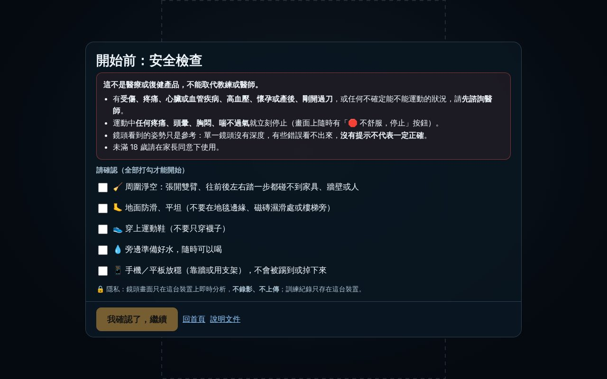

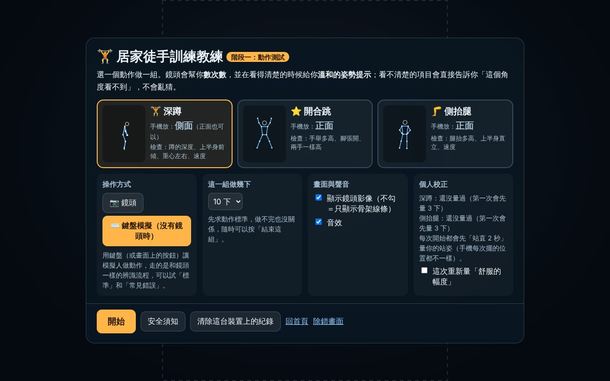

## 二、怎麼玩（階段一）

1. **安全檢查**：每次打開都要勾完 5 項（周圍淨空、地面防滑、穿鞋、準備水、手機放穩）才能繼續，並顯示醫療免責說明。
2. **選一個動作**、選「鏡頭」或「鍵盤模擬」、選這組做幾下。
3. **擺好手機**：畫面會說手機要放正面還是側面，並即時告訴你「腳沒入鏡」「請面向鏡頭」等。
4. **校正**：面向鏡頭站直不動 2 秒（量你的站姿）。深蹲、側抬腿第一次會再請你做幾下「舒服的幅度」。
5. **做一組**：大數字是次數；左邊是「姿勢檢查」清單，每一項都寫可信度；下方會跳出提示。隨時可以按「結束這組」或「🛑 不舒服，停止」。
6. **結果**：算到幾下、標準幾下、平均品質，以及每項檢查的平均分數與可信度。

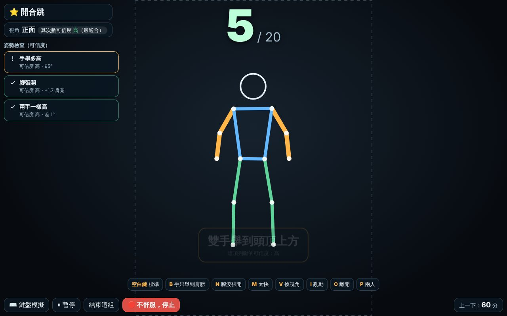

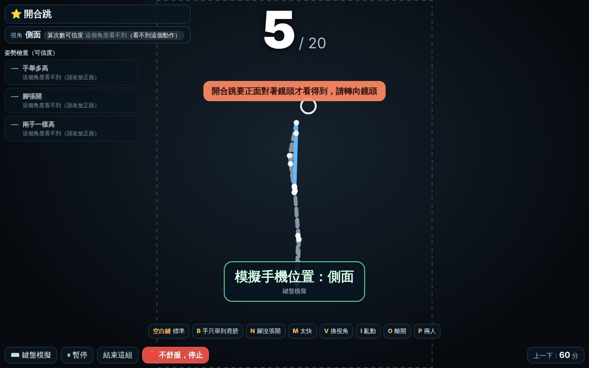

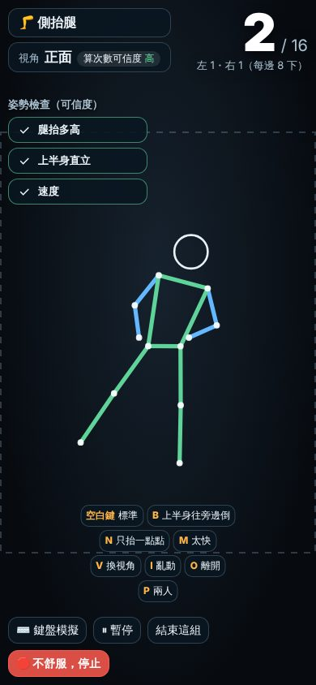

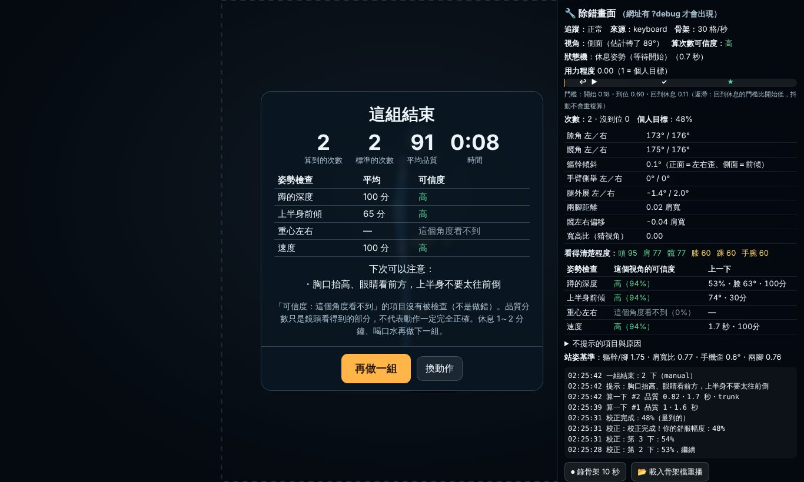

## 三、手機怎麼放

| 動作 | 最好的位置 | 也可以 | 為什麼 |
|---|---|---|---|
| 深蹲 | **側面**（或斜前方 45°），高度到膝蓋～腰 | 正面（能算次數，但看不到上半身前傾） | 蹲的深度（膝蓋角度）、上半身前傾都是「前後方向」的動作，側面看最清楚 |
| 開合跳 | **正面** | 斜角（可信度降低） | 手腳都是往左右張開，正面才看得到；側面幾乎看不出來，所以側面**不算**、請玩家轉身 |
| 側抬腿 | **正面** | 斜角（可信度降低） | 腿往旁邊抬、上半身往旁邊歪，都發生在正面的畫面平面上 |

共通：**從頭到腳都要入鏡**（手機直放比較容易）；離 2～3 公尺；光線從前面來、不要背對窗戶；只有一個人入鏡。

## 四、鏡頭怎麼判斷每個動作

### 共通做法（白話版）

1. **只拿骨架點**：從輸入層 `kit.on('pose')` 拿到 17 個關節點（鼻子、肩、肘、腕、髖、膝、踝），每點有位置和「看得清楚程度」。**沒有改** 共用的辨識器 `recognizer.js`（有別人正在改它的延遲）；這套分析是新增的獨立模組。
2. **先去抖動**：每個點取最近 3 格的中位數（偶發亂跳的一格會被去掉），再做平滑。
3. **換成以「身體」為尺**：用軀幹長或肩寬當單位，所以高矮、離鏡頭遠近都不影響。畫面不是正方形，算角度前先把寬高比換算回來（手機直放、橫放都對）。
4. **算一個「用力程度」**：0 = 休息姿勢，1 = 你的個人目標。例如深蹲 = 「髖到腳踝的高度」少了幾成。
5. **狀態機數次數**（有「遲滯」）：
   - 用力程度超過「開始」門檻 → 動作中；超過「到位」門檻 → 到位；回到比「開始」更低的「回到休息」門檻 → **算一下**。
   - 三條門檻分開，所以在門檻附近抖動不會來回跳、重複算。
   - 沒到位就回來 → **不算**，並提示（例如「再蹲低一點點（這下還沒算）」）。
   - 整下動作快到人做不到（深蹲少於 0.6 秒）→ 當作雜訊。
   - 中途看不到人超過 0.6 秒 → 這一下作廢，而且要先回到休息姿勢才開始算下一下（避免「中斷時蹲在下面，回來站起來就被算一下」）。
6. **速度用影格的拍攝時間**（`pose.t`），不是資料到達的時間；鏡頭延遲、卡頓不會讓「速度」判斷變錯。
7. **姿勢檢查**：每一下做完，依這一下記錄到的值打分數（0～100），並算出**這一項在目前視角下的可信度**。可信度「中」以上才會提示；一次只說一件事、同一件事不連續嘮叨，改善了會稱讚。

### 深蹲

| 檢查 | 怎麼量 | 正面 | 斜角 | 側面 |
|---|---|---|---|---|
| 算次數／蹲的深度 | 髖到腳踝的高度少了幾成，和你的「舒服深度」比；側面另外顯示膝蓋角度 | 中高 | 高 | 高 |
| 上半身前傾 | 蹲到最低時，肩—髖連線和垂直線的夾角（超過約 55° 開始扣分） | **看不到** | 中（只會少報、不會多報） | 高 |
| 重心左右 | 蹲下時髖的中心有沒有偏向某一腳 | 高 | **看不到** | **看不到** |
| 速度 | 一下花多久（少於約 1.2 秒提示放慢） | 高 | 高 | 高 |
| 膝蓋內夾、背部圓弧、腳跟離地 | **不檢查、不提示**（理由見第七節） | — | — | — |

另外：沒站直又蹲下（半途反彈）只算一下，並提示「每一下都要先站直」。

### 開合跳

| 檢查 | 怎麼量 | 正面 | 斜角 | 側面 |
|---|---|---|---|---|
| 算次數 | 「手舉起來的程度」和「腳張開的程度」取比較小的那個（**兩個都要做到才算**，伸懶腰不會被算） | 高 | 中 | **不算** |
| 手舉多高 | 手臂和身體側邊的夾角（兩手取低的那隻） | 高 | 中 | — |
| 腳張開 | 兩腳腳踝距離比站著時多幾個肩寬 | 高 | 中低 | — |
| 兩手一樣高 | 左右手最高點的角度差 | 高 | 低 | — |

不跳的「低衝擊版」（左右輪流踏出去）一樣會算。

### 側抬腿（站姿髖外展）

| 檢查 | 怎麼量 | 正面 | 斜角 | 側面 |
|---|---|---|---|---|
| 算次數／腿抬多高 | 抬起那隻腳（髖→腳踝）和垂直線的夾角，和你的舒服角度比；**左右分開計次** | 高 | 中 | **不算** |
| 上半身直立 | 肩中點—髖中點連線往旁邊歪了幾度（超過約 9° 開始扣分）。往另一邊倒是最常見的「偷抬高」 | 高 | 中 | — |
| 速度 | 抬起到放下少於約 1 秒提示放慢 | 高 | 高 | — |
| 腿往前踢 | **不檢查**：往前後偏是朝鏡頭方向，正面看不出來 | — | — | — |

手機放歪（不是人歪）不會被誤報：站直校正時會量「手機歪了幾度」並扣掉。

## 五、可信度：介面上怎麼誠實呈現

可信度 = **視角的可靠程度** × **相關關節看得清楚的程度**。

- 視角：每一項檢查都事先寫好「正面／斜角／側面」各有多可靠（上面三張表）。例如深蹲的上半身前傾，正面 = 0（看不到）。
- 關節清楚程度：MediaPipe 對每個點給一個 0～1 的「看得到嗎」。被身體擋住、超出畫面時會變低。
- 顯示成四級：**高**、**中**、**低**、**這個角度看不到**。
  - 「中」以上才會提示、才計入品質分數。
  - 「看不到」的項目在清單上是灰色虛線，寫「這個角度看不到（請改放側面）」；骨架上那一段也畫成灰色虛線。
  - 結果頁每一項都寫可信度，並說明「看不到的項目沒有被檢查（不是做錯）」。
- 「算次數」本身也有可信度，顯示在左上角視角旁邊；動作在這個視角看不到時（例如側面做開合跳）會**直接不算**並請玩家轉身，不會用比較差的方法偷偷估。

**視角判斷**：站著的時候，肩膀（和髖）左右寬度 ÷ 軀幹長，正對鏡頭約 0.75，側面接近 0。校正時用鼻子相對兩肩的位置估計玩家是不是剛好正對鏡頭，並換算回來。蹲下、彎腰時比例會暫時改變，所以只在休息姿勢時更新視角；在界線附近有遲滯、要持續 0.4 秒才切換。

## 六、個人校正

概念參考打擊練習的「揮棒測試」（PR #7）：先量你，再依你調整。

1. **站直量基準（每次都做，約 2 秒）**：面向鏡頭、全身入鏡、雙手放下、不動 → 記下身體比例、站直時髖到腳踝的高度、兩腳距離、手機歪斜。因為手機每次擺的位置都不一樣，這一步每次都量。
   - 沒入鏡、太遠、沒面向鏡頭、手沒放下、還在動，都會用一句話說明怎麼調整。
2. **舒服的幅度（深蹲、側抬腿，第一次做）**：用很低的門檻做 3 下（側抬腿左右各 2 下），記下每一下最深／最高到哪，**取中位數的九成當「個人目標」**，「算一下」的門檻是個人目標的六成。
   - 柔軟度比較差、膝蓋不舒服的人也能正常計次，不會被「標準深度」卡住一直沒算到。
   - 個人目標有上下限（深蹲 25%～55%、側抬腿 20°～45°），避免量錯時門檻離譜。
   - 量不到（40 秒內少於 2 下）就用預設值，並告訴玩家之後可以重新量。選單可以勾「這次重新量」。
3. 站著不動時，「站直的基準」會慢慢更新（玩家往前挪一步也跟得上）。

## 七、做了哪些決定與理由

> 標 ✏️ 的是**我的選擇，可以改**。

| 決定 | 理由 |
|---|---|
| ✏️ 第三個動作選**側抬腿** | 它的動作與最常見的錯誤（上半身往另一邊倒）都在正面的畫面平面上，單鏡頭量得最準，最能展現「可靠的姿勢檢查」。弓箭步要側面、前後腳會互相遮擋，放到階段三。 |
| 分析模組放在 `packages/taikan-kit/src/exercise/`（全部是新檔案） | 它只依賴輸入層的骨架格式，之後其他遊戲（例如道場）也能用；放在輸入層旁邊也方便一起測試（`cd packages/taikan-kit && npm test` 會一起跑）。原本的 `recognizer.js`、`index.js` 都沒改。 |
| 遊戲有自己的頁面 `fitness/`，**沒有掛在共用外殼 `shell.js`** 上 | 外殼是圍繞 3D 世界（海面、球場）設計的；健身需要的是鏡像畫面、安全檢查、校正、組數流程。另外外殼的「雙手舉高 1 秒 = 暫停」會和開合跳、伸展動作衝突。所以沿用外殼的外觀（`game/game.css`）與輸入層，流程自己寫，**共用檔案不用改**。 |
| 單鏡頭沒有深度：**膝蓋內夾、背部圓弧不提示** | 正面看膝蓋往內，可能是真的內夾，也可能只是髖轉動或鏡頭角度；只有肩和髖兩點也看不到脊椎彎曲。寧可不報也不亂報。除錯畫面的「不提示的項目與原因」有寫。 |
| 腳跟離地不檢查 | 輸入層目前只輸出 17 個點，沒有腳跟、腳尖（MediaPipe 其實有，但要改共用的 `pose.js`，這一階段不改）。 |
| 「品質」比「次數」重要，但**錯了也照樣算** | 姿勢明顯錯（例如上半身太前傾）照算一下，只是品質分數低、給一句溫和提示；不扣次數、不顯示紅色叉叉，避免挫折。只有「幅度不夠」（沒蹲下去）才不算。 |
| ✏️ 提示一次只說一件事；同一件事隔 2 下才再說，說過 3 次後隔 4 下 | 一直講同一件事很煩；改善了會稱讚「就是這樣！」。 |
| ✏️ 門檻數字（深蹲預設目標 40%、上半身 55° 開始扣分、側抬腿身體歪 9° 開始扣分、深蹲少於 1.2 秒算太快） | 依一般運動指導的經驗值與合成人體測試訂的，**還沒用真人資料調過**，請用真機錄骨架回來修正。 |
| ✏️ 一組最多 4 分鐘，時間到自動結束並建議休息 | 安全上限；階段二會加整次訓練的總時間與強度上限。 |
| 鏡頭影像預設顯示，可以關掉只看骨架 | 看到自己比較容易對照；家裡有其他人入鏡、或不想看到自己的人可以關掉。影像不論顯示與否都不會離開裝置。 |
| 本機儲存的鍵名用 `taikan.fitness.*` | 依平台化規劃（PR #3 的 `docs/platform-plan.md`，尚未合併）建議的命名，不綁「海洋」；選單有「清除這台裝置上的紀錄」。 |
| 音效全部用 Web Audio 即時合成 | 沒有任何外部音檔，沒有授權問題。 |

### 地板動作（伏地挺身、棒式、臀橋、仰臥起坐）的評估

- 手機要放很低、放側面，身體是橫的；MediaPipe 的人體偵測主要是用站著的人訓練的，橫躺、貼地時比較容易抓錯（例如左右手腳對調、手臂被身體擋住）。
- **我的評估**：臀橋、棒式、伏地挺身從側面看，主要動作（髖的伸展、身體是否成一直線、手肘角度）都在畫面平面上，**有機會做得可靠**，階段三會做成「實驗動作」：要求手機放側面、放低、全身入鏡，擺放不對就不計次，並在真機驗證通過前標示「實驗」。
- **仰臥起坐列為「之後再做」**：上半身捲起時常被腿擋住，而且做錯容易拉傷脖子，在家沒人看著的情況下風險比較高。

## 八、抖動、漏格、延遲

| 狀況 | 怎麼處理 |
|---|---|
| 骨架抖動 | 3 格中位數 + One Euro 平滑；門檻有遲滯 |
| 某一格亂跳 | 中位數會把單一格的異常值去掉；「用力程度」本身再取 3 格中位數 |
| 漏格（鏡頭偶爾沒偵測到） | 0.6 秒內的空檔直接跳過；超過就作廢這一下 |
| 格數不穩定（手機忙、每秒 10～30 格） | 所有時間都用影格時間計算；測試裡用每格間隔 33～83 毫秒亂跳 + 漏 15% 驗證 |
| 鏡頭延遲 | 計次與姿勢判斷不是搶時機，延遲只會讓「算一下」晚 0.1～0.2 秒出現；速度判斷用影格的拍攝時間，所以不受影響 |
| 兩個人入鏡 | 提示「請只留一位」並暫停計次 |
| 走近、走遠 | 用身體當尺，不會被當成蹲下（有測試） |

## 九、除錯畫面（網址加 `?debug`）

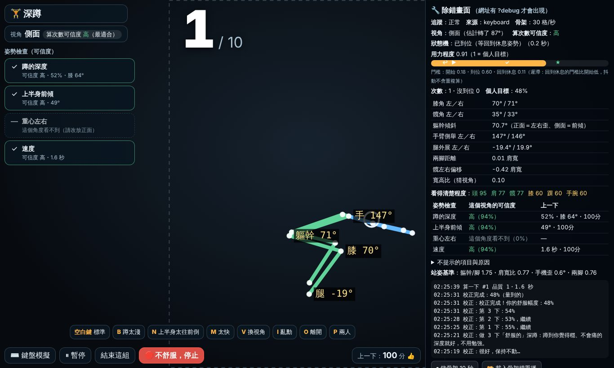

右側面板（由上到下）：

- **追蹤**：正常／看不到腳／視角不對……；**骨架**每秒幾格（用鏡頭時也顯示鏡頭格數與推論時間）。
- **視角**：正面／斜角／側面，以及估計轉了幾度；**算次數可信度**。
- **狀態機**：休息姿勢／動作中／已到位，以及停在這一步多久。
- **用力程度**橫條：上面有三個記號 ↩（回到休息）▶（開始）✓（到位），★ 是個人目標。看得出「是蹲不夠深，還是門檻設太高」。
- **即時角度**：膝、髖、軀幹、手臂、腿、兩腳距離……；骨架上也會直接標角度。
- **看得清楚程度**：每個部位 0～100。
- **姿勢檢查**：每一項在目前視角的可信度、上一下的值與分數。
- **不提示的項目與原因**。
- **最近事件**：算一下、沒到位、提示、視角變化。
- **⏺ 錄骨架 10 秒**：下載一個 `.json`（**只有座標數字，沒有影像**），可以寄給開發者重現問題；**📂 載入骨架檔重播**：把錄好的檔案拿來重播。

## 十、沒有鏡頭怎麼測

選單選「⌨️ 鍵盤模擬」。按鍵（或畫面上的按鈕）會讓一個「合成人體」做動作，**投影成假的鏡頭骨架**再交給同一套辨識流程，所以視角、校正、可信度都會跟真的一樣運作。

| 按鍵 | 動作 |
|---|---|
| 空白鍵 | 做一下標準動作（側抬腿自動左右輪流） |
| B | 常見錯誤 1（深蹲：蹲太淺／開合跳：手只舉到肩膀／側抬腿：上半身往旁邊倒） |
| N | 常見錯誤 2（深蹲：上半身太往前倒／開合跳：腳沒張開／側抬腿：只抬一點點） |
| M | 做太快 |
| V | 切換手機位置：正面 → 斜角 → 側面 |
| I | 亂動（抓頭、撿東西、伸懶腰、走一步） |
| O | 走出畫面／回來 |
| P | 第二個人入鏡／離開 |

自動測試（兩組都要通過）：

```bash
node --test tests/*.test.mjs              # 含 tests/fitness.test.mjs：鍵盤模擬 → 辨識結果、校正流程、本機儲存
cd packages/taikan-kit && npm test        # 含 test/exercise.test.mjs：動作分析核心
```

`test/exercise.test.mjs` 的內容（合成人體產生骨架）：

- 三個視角的標準深蹲各 10 下全部算到、品質好、沒有糾正提示
- 蹲太淺不算並提示；側面前傾會提示、正面不會（並標示看不到）；太快、重心偏一邊會提示；膝蓋內夾**不提示也不扣分**；半途反彈只算一下
- 三個動作各自：站著不動 60 秒（含抖動）0 次；抓頭、撿東西、伸懶腰、走一步 0 次；走近走遠 0 次；兩人入鏡不計次
- 每秒 12～30 格亂跳 + 漏 15% 的格 + 偶發亂跳，10 下深蹲仍全部算到、不重複；中途走出畫面那一下作廢
- 開合跳標準、低衝擊、手太低、腳沒開、側面、伸懶腰；側抬腿分邊計次、代償提示、抬太低、手機放歪不誤報
- 視角判斷 0°／15°／45°／80°／90°；手機放地上、橫放 16:9、放遠 3.5 公尺
- 校正：柔軟度有限的人目標會變低且之後能正常計次；看不到腳不會開始；側抬腿與開合跳的校正
- 預錄骨架檔（`fixtures/exercise/*.json`，和真機錄的格式一樣）重播結果符合預期

## 十一、只能用真機驗證的項目

1. **真人的門檻**：預設目標與扣分角度是經驗值 + 合成人體訂的。請找 3～5 位不同身材的人，每個動作錄一段骨架（除錯畫面「⏺ 錄骨架」），特別是：深蹲很標準的人、柔軟度差的人、常見錯誤（前傾、只蹲一半）。
2. **MediaPipe 在側面的表現**：側面時遠的那一側會被擋住；左右腳偶爾會對調。合成資料沒辦法模擬這種錯誤。
3. **視角判斷的數字**：真人的「肩寬 ÷ 軀幹長」可能和合成人體的 0.76 不同（體型、衣服）。
4. **手機的鏡頭畫面方向**：手機直放時前鏡頭給的畫面寬高比（程式會讀 `video.videoWidth / videoHeight`），以及各家手機鏡頭的視角大小。
5. **光線與衣服**：背光、昏暗、寬鬆衣服、長裙會讓關節點變不準。
6. **效能**：手機一邊跑姿態模型一邊顯示畫面時，每秒幾格（除錯畫面有寫）。低於 12 格時開合跳可能漏算。
7. **地面與空間**：一般家裡的客廳，2～3 公尺距離放不放得下、手機放地上會不會被踢到。
8. **提示的語氣與頻率**：真人覺得煩不煩、看不看得懂。

## 十二、之後怎麼加新動作

1. 在 `packages/taikan-kit/src/exercise/exercises.js` 加一筆，照現有三個的格式填：
   - `views`：正面／斜角／側面各有多可靠（0 = 這個視角不算）
   - `metric`：一格姿勢 → 用力程度（0 = 休息、1 = 個人目標）
   - `thresholds`：開始／到位／回到休息三條門檻、最短時間
   - `track`：動作中要記住的值（例如最低點的角度）
   - `checks`：每一項姿勢檢查的「怎麼量」、各視角可信度、分數公式、提示句與稱讚句
   - `calib`（需要的話）：個人幅度的預設值、上下限
2. 在 `synth.js` 的 `MOTIONS` 加這個動作的「標準」和「常見錯誤」版本（給測試與鍵盤模擬用）；在 `src/fitness/sim.js` 的 `VARIANTS` 對應按鍵。
3. 在 `test/exercise.test.mjs` 加：標準動作要算到、錯誤要被提示、亂動不能算、看不到的視角不能算。
4. 用真機錄幾段骨架放進 `fixtures/exercise/`，寫上 `expect`（應該算幾下、該出現哪些提示）。

## 十三、檔案位置

| 位置 | 內容 |
|---|---|
| `fitness/index.html`、`fitness/fitness.css` | 頁面 |
| `src/fitness/main.js` | 流程：安全檢查 → 選單 → 擺放與校正 → 做一組 → 結果 |
| `src/fitness/sim.js` | 鍵盤模擬 |
| `src/fitness/mirror.js` | 鏡像畫面：骨架依檢查結果變色 |
| `src/fitness/debug.js` | 除錯畫面 |
| `src/fitness/audio.js` | 合成音效 |
| `src/fitness/store.js` | 本機儲存 |
| `packages/taikan-kit/src/exercise/` | 動作分析核心：`features.js`（角度、平滑）、`counter.js`（次數狀態機）、`exercises.js`（動作定義）、`analyzer.js`（分析器、可信度、提示）、`calibration.js`（校正）、`synth.js`（合成人體） |
| `packages/taikan-kit/test/exercise.test.mjs`、`fixtures/exercise/` | 動作分析測試與預錄骨架檔（`tools/make-exercise-fixtures.mjs` 產生） |
| `tests/fitness.test.mjs` | 鍵盤模擬與流程測試；階段二的訓練結構、對戰、進度測試 |
| `src/fitness/levels.js`、`session.js`、`battle.js`、`progress.js` | 階段二：關卡資料、訓練結構（暖身／組／休息／收操）、對戰規則、本機進度（純邏輯） |
| `src/fitness/adventure.js`、`coach3d.js` | 階段二：冒險模式畫面、示範人偶與怪獸的 3D 小舞台 |

## 十四、我的建議：最值得做的方向與風險

**最值得做的方向**

1. **「誠實的教練」當賣點**：市面上很多 AI 健身 app 什麼都敢判斷。我們明確標出「這個角度看得到／看不到什麼」，加上不上傳影像，對家長、學校、注重隱私的人很有說服力。
2. **個人化幅度**比「標準動作」更適合大眾：柔軟度差、年紀大、剛開始運動的人不會一直被說「不夠深」而放棄。
3. **先把 5～6 個站姿動作做到真的可靠**，再加地板動作；動作數量不是重點，判斷準不準才是口碑。
4. 真機錄骨架的流程已經有了（只有數字、不含影像），**建議盡早收集 20～30 段真人資料**當測試集，每次改門檻都跑一次。

**風險**

1. **安全與法規**：這是運動指導，有人會在不適合的狀況下使用。已做了免責、安全檢查、停止鈕、時間上限；上架前建議請運動或醫療專業人員看過提示內容，並請法務確認免責文字與「健康」相關宣稱。
2. **誤判的信任成本**：一次「明明做對卻說錯」比十次正確更傷信任，所以寧可少提示；門檻一定要用真人資料再調。
3. **未成年使用者**：青少年也是對象，商用時要處理家長同意（目前不收任何個資、不需帳號，風險較低）。
4. **手機效能差異**：低階手機每秒格數不足時，快速動作（開合跳）會漏算；需要真機測試後決定最低規格或提供「慢速版」。
5. **地板動作**：可能做不到可靠，屆時寧可不上線。

## 十五、階段二：冒險模式（遊戲化）

選單上方切換「⚔️ 冒險模式」（預設）或「🎯 自由練習（單一動作）」。自由練習就是階段一的玩法，沒有暖身收操，畫面上有寫「請自己先熱身」。

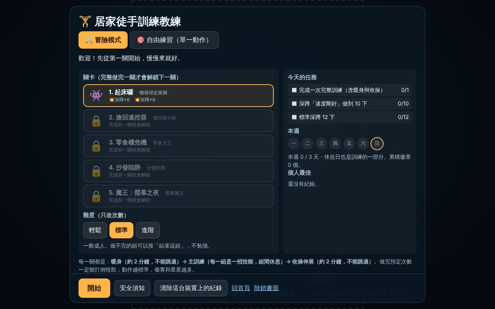

### 玩什麼

- **故事（✏️ 我的選擇，可以改）**：「沙發怪獸」是久坐習慣變成的小怪物——懶骨頭史萊姆、遙控器小妖、零食大王、沙發巨獸、螢幕魔王。第一章 5 關，第 5 關是魔王。走輕鬆幽默、不恐怖的路線，成人和青少年都能接受。
- **每個動作是一招技能**：
  - 💥 深蹲 =「大地重擊」：蹲下時畫面上的「蓄力」條會跟著深度變滿，站起來那一下釋放攻擊。
  - ⭐ 開合跳 =「星光連擊」：一下一顆星，連續標準就連擊。
  - 🌀 側抬腿 =「旋風踢」：左右輪流。
- **固定結構（每一關都一樣）**：
  1. **暖身**約 2 分鐘：原地踏步、手臂繞圈、慢速半蹲、側邊伸展。
  2. **主訓練**：每一組是一招技能，打怪獸；組與組之間有**休息倒數**（40～50 秒），畫面寫「休息一下、喝口水」和下一組是什麼。
  3. **收操**約 2 分鐘：慢走深呼吸、大腿前側（左右）、大腿後側、肩膀、深呼吸。做完收操才「封印」怪獸、發獎勵。
- **右上角**：怪獸的體力條、這一關的進度（暖身／第幾組／收操），以及 3D 小舞台：**示範人偶**做這一段的標準動作（深蹲從斜側面示範），旁邊是怪獸，攻擊時有光球飛過去、怪獸被打到會縮一下。
- **左邊**和階段一一樣：姿勢檢查清單（含可信度）；中間是鏡像畫面（骨架依對錯變色）。

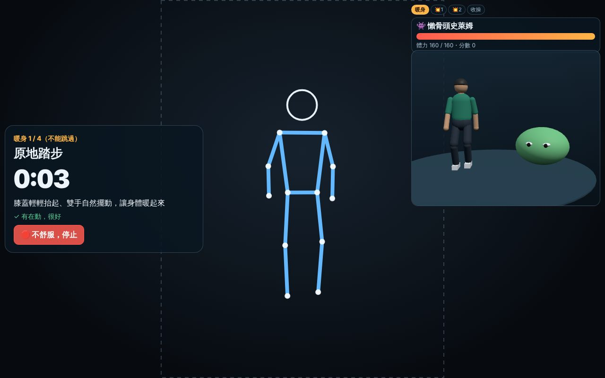

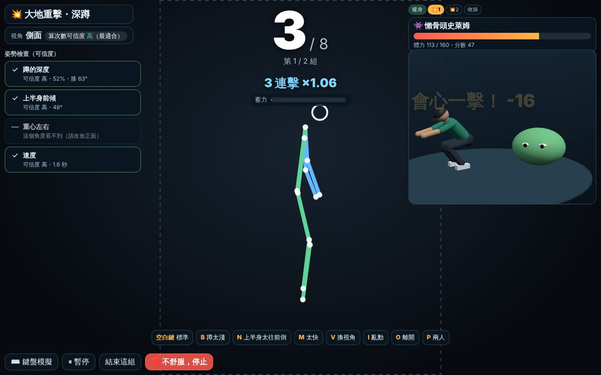

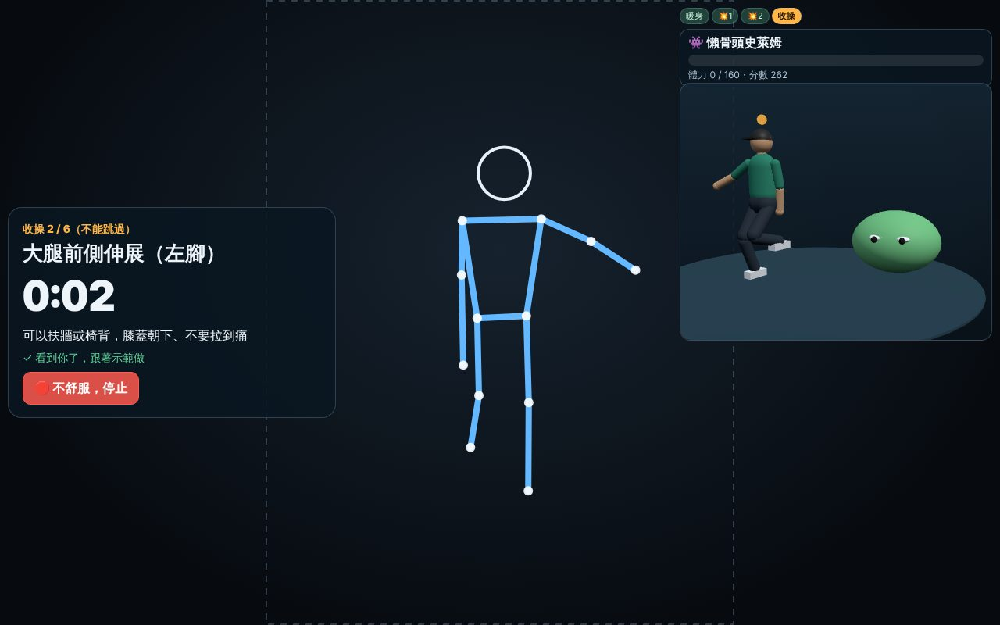


手機直放時的版面（選單、暖身、主訓練）：

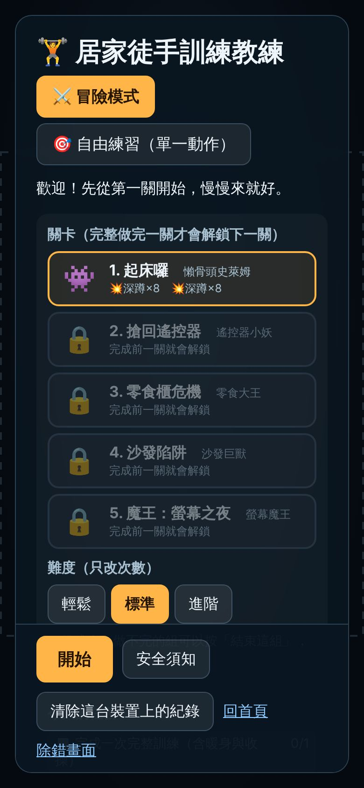 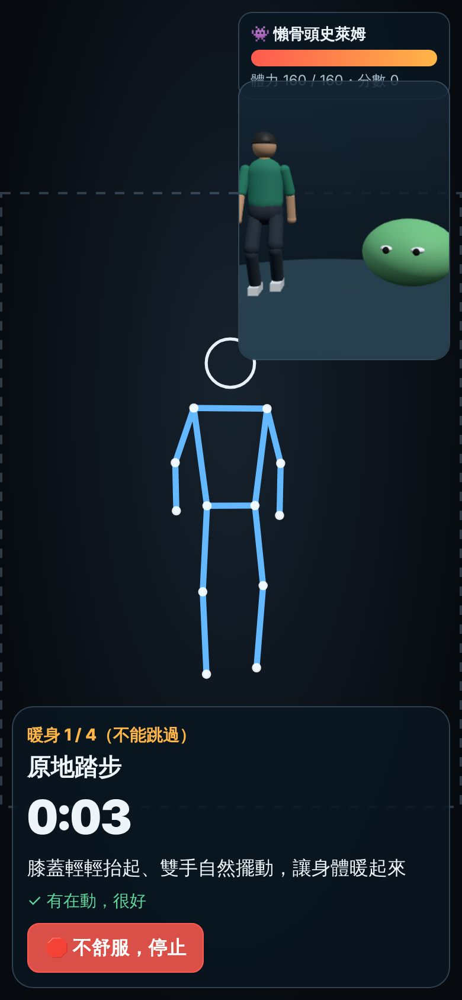 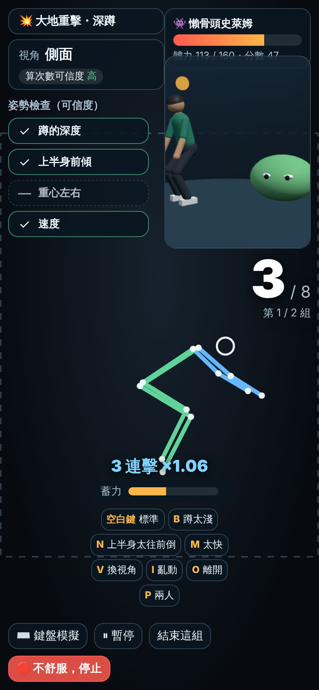

### 「品質比次數重要」但不讓人沮喪

| 規則 | 為什麼 |
|---|---|
| 每算一下至少 10 點傷害；怪獸體力 = 預定次數 × 10 | **做完預定次數一定打得倒**，不會因為姿勢不好而「輸掉」 |
| 品質越好傷害越高（最多 1.5 倍）；連續「標準」再加最多 30% | 標準的動作有明顯回饋（傷害數字變大、「會心一擊！」） |
| 不標準的一下：連擊**不加但也不歸零**；只有停下來超過 6 秒（或新的一組）才歸零 | 一下沒做好就整串歸零很挫折 |
| 星星看平均品質（85 分以上 3 顆、70 以上 2 顆），完成就至少 1 顆 | 鼓勵品質，但完成本身就值得肯定 |
| 姿勢提示沿用階段一：一次一件事、溫和語氣、改善了就稱讚 | 同上 |

### 安全與強度上限

- 暖身與收操**沒有跳過的按鈕**（程式裡也沒有跳過的方法，有測試確認）。用鏡頭時「看得到人」才會倒數。
- 「🛑 不舒服，停止」在暖身、休息、收操、主訓練畫面都看得到；按下立刻結束，結果頁寫休息與就醫建議，這次做到的都有記錄、**不扣任何東西**。
- 做不完的組可以按「結束這組」，不勉強。
- 組間休息至少 15 秒才能按「我準備好了」，也可以「多休息 15 秒」。
- **一次訓練最多 25 分鐘**：超過就取消剩下的組、直接收操。
- **一天最多 3 次**；第 2 次之後提醒「確定身體沒有痠痛或疲勞嗎？」；連續練 4 天以上建議安排休息日。
- 難度只改次數：輕鬆（×0.6）、標準、進階（×1.3）。（✏️ 數字可以改）

### 進度（全部存在這台裝置，不上傳）

- **解鎖**：完整做完一關（含收操）才解鎖下一關；新關卡會帶出新技能（第 2 關開合跳、第 3 關側抬腿）。**和連續天數無關**。
- **每日任務** 3 個：第一個固定「完成一次完整訓練」，另外兩個每天不同（例如「標準深蹲 12 下」「開合跳連擊達到 10」「側抬腿時上半身直立 10 下」「好好做完收操」）。只會出已解鎖動作的任務。完成得徽章。
- **本週活動天數**：選單上是一週七個圓點，目標每週 3 天，旁邊寫「休息日也是訓練的一部分」。
- **不製造連續天數壓力**：連續天數只在 2 天以上時順便提一下；斷了**不會**出現「中斷」「失敗」「可惜」，只說「歡迎回來！休息一陣子很正常，今天可以從輕鬆難度開始」（有測試檢查這些字不會出現）。
- **個人最佳**：記的是「一次訓練的**標準**次數」和最高連擊，不是總次數（鼓勵品質）。
- 選單「清除這台裝置上的紀錄」會清掉全部。

### 鏡像回饋與示範人偶

- 鏡像回饋沿用階段一：骨架依最近一下的檢查結果變色（綠＝好、橘＝有提示、灰色虛線＝這個角度看不到）。
- 示範人偶重用 `src/land/figure.js`（棒球場的球員人偶），**沒有改原檔**：在 `src/fitness/coach3d.js` 擴充它，讓腳可以抬起來（側抬腿、踏步、伸展）。
- 示範的動作直接來自「合成人體」（`synth.js`），和鍵盤模擬、自動測試是同一套動作，所以人偶示範的就是辨識器要看的標準動作。
- 怪獸全部用基本幾何形狀組成（球、方塊、圓錐），沒有任何外部模型或圖片；音效全部用 Web Audio 合成。
- 減少晃動：系統設定「減少動態效果」時，數字跳動、怪獸搖晃與發光會關掉（階段三會在選單加開關）。

### 階段二做了哪些決定與理由

| 決定 | 理由 |
|---|---|
| ✏️ 主題「沙發怪獸」（久坐習慣變成的怪物） | 和「在家動起來」直接相關、有點幽默、沒有暴力血腥；不模仿任何現有作品的角色。 |
| ✏️ 第一章 5 關、組數與次數（見 `src/fitness/levels.js`） | 第一關只有深蹲 2 組（約 8 分鐘含暖身收操），之後慢慢加動作與組數；魔王關約 15～18 分鐘，仍在 25 分鐘上限內。 |
| 每一下都會傷害怪獸、做完一定打得倒 | 遊戲化的目的是讓人想動，不是考試；姿勢只影響分數與星星。 |
| 暖身與收操用「時間＋看得到人」而不是計分 | 伸展動作（尤其從單一鏡頭）很難可靠判斷做得對不對；誠實的做法是示範、倒數、確認有在畫面裡（暖身另外看得出「有沒有在動」）。 |
| 解鎖靠「完成關卡」，不是連續天數 | 連續天數容易造成壓力或硬撐受傷。 |
| 冒險模式的流程寫在新檔案（`adventure.js`、`session.js`、`battle.js`、`progress.js`、`levels.js`、`coach3d.js`） | 訓練結構、對戰、進度都是純邏輯，可以在 node 裡測試；畫面只負責顯示。 |
| 測試用網址參數 `?speed=10` | 暖身、休息、收操的倒數快 10 倍，只給雲端測試與截圖用（主訓練的次數不受影響）。 |

### 階段二的測試（`tests/fitness.test.mjs`）

- 每一關的結構一定是「暖身 → 組／休息交錯 → 收操」
- 暖身、收操不能跳過；用鏡頭時看不到人不倒數；沒有 `skipWarmup`／`skipCooldown` 這種方法
- 休息至少 15 秒才能跳過、可以多休息
- 5 關都打完：品質好 → 3 星；品質差 → 一樣打得倒、1 星、連擊為 0
- 連擊：不標準不歸零、停太久才歸零
- 超過時間上限 → 取消剩下的組、直接收操
- 不舒服停止 → 記為「停止」、不解鎖、不扣東西
- 進度：解鎖、任務（沒解鎖的動作不出任務）、個人最佳、重新打開後還在、只用一個儲存鍵
- 活動天數：連續 4 天提醒休息日；斷了說「歡迎回來」且不出現責備字眼；一天第 2 次提醒、第 3 次之後擋下

無頭瀏覽器實際跑完第一關（鍵盤模擬、`?speed=10`）：校正 → 暖身 → 兩組深蹲 → 收操 → 結果 → 解鎖第二關，沒有任何錯誤訊息；桌機與手機直放都有截圖。

### 階段二只能用真機驗證的項目

1. **暖身／收操的「有沒有在動」判斷**：真人踏步、繞手臂時夠不夠明顯（門檻是手腳 0.8 秒內移動超過軀幹長的 12%）。
2. **轉身**：同一關裡深蹲要轉側身、開合跳要面向鏡頭，真人會不會覺得麻煩、提示夠不夠清楚。
3. **3D 小舞台的效能**：手機一邊跑姿態模型、一邊畫 3D 人偶與怪獸，每秒幾格（除錯畫面有寫）。太慢的話可以改成只在休息時畫。
4. **一關的時間與累不累**：第 1 關約 8 分鐘、魔王關約 15～18 分鐘是否合適；三種難度的次數。
5. **休息時間**：40～50 秒對一般人夠不夠。
6. **音效**在手機喇叭上的音量。
