# ✈️ 體感飛行（模擬器系列第一款）：白話說明

> 給學校資訊人員與老師看的「做了什麼、怎麼看、我替您做的決定、測了什麼、還要您用平板實測什麼」。
> 這份文件隨著三個階段更新，最新的在最上面：**階段三 飛行與降落**（本版）、階段二 起飛、階段一 駕駛艙與儀表板。

## 階段三：飛行與降落

### 一、玩什麼

選單最上面多了「**任務**」：

| 任務 | 內容 | 時間 |
|---|---|---|
| 🛫 起飛 | 階段二的內容 | 約 1～2 分鐘 |
| 🛬 降落 | 從跑道外 **1.8 公里、約 350 呎**的「最後進場」開始：對準跑道 → 控制下降與空速 → 50 呎以下收油門、**拉平** → 接地 → 自動煞車、保持在中心線 → 停下來 | 約 1.5 分鐘 |
| 🔄 起降連飛 | 起飛到 500 呎 → **左轉回頭**（180°）→ **順風邊**（畫面快轉 4 倍）→ **再左轉 180° 對準跑道** → 接上面的降落 | 約 4 分鐘（玩完請休息） |

**降落怎麼看**（用中文提示＋兩種指示）：

- **PAPI 燈**（跑道左邊的四個燈，真的機場都有）：**兩白兩紅 = 剛好**；白燈多 = 太高、紅燈多 = 太低。
- 畫面左邊的「**進場指示**」：粉紅色菱形往上 = 太高；藍色菱形往左 = 跑道在左邊。菱形都在中間 = 剛好。
- 離地面 35 呎時會提示「**收油門、拉平！雙手慢慢抬高**」：讓機頭抬起一點，飛機會「飄」一下再輕輕落地。離地 5 公尺以內有**地面效應**（機翼下的空氣被墊住，升力變大一點），這也是真的物理。

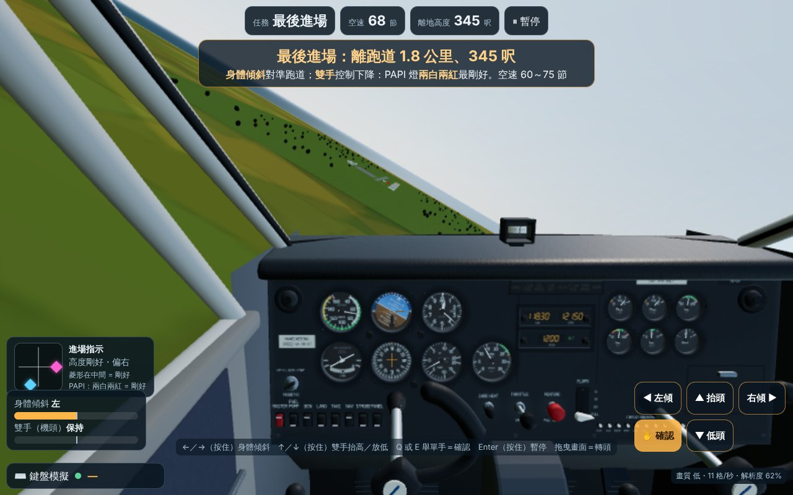

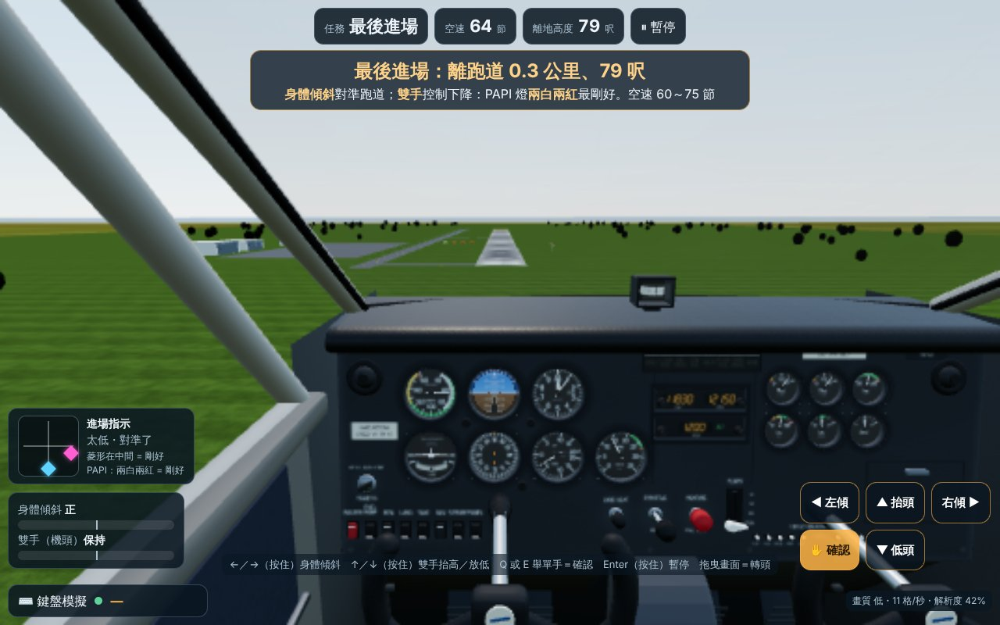

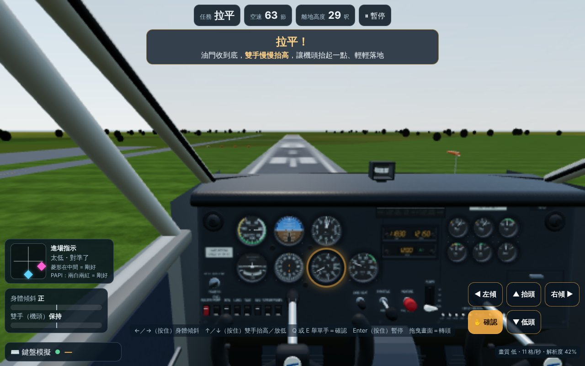

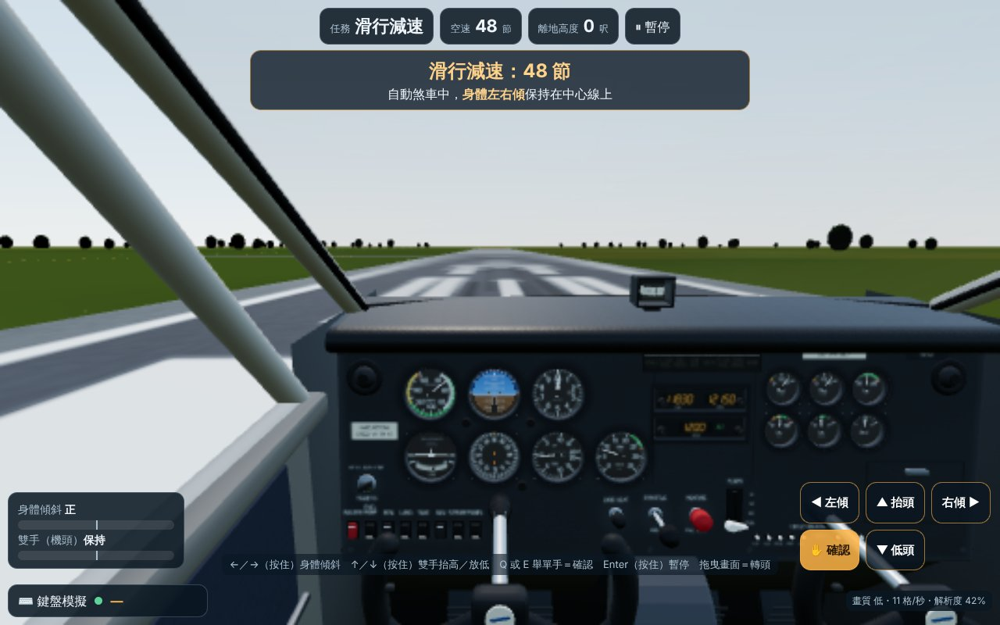

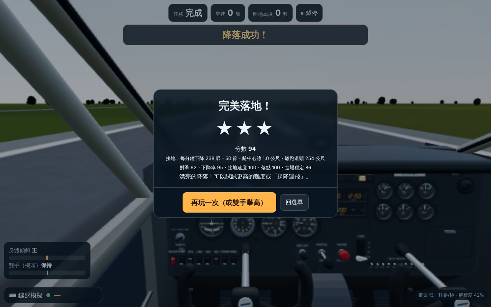

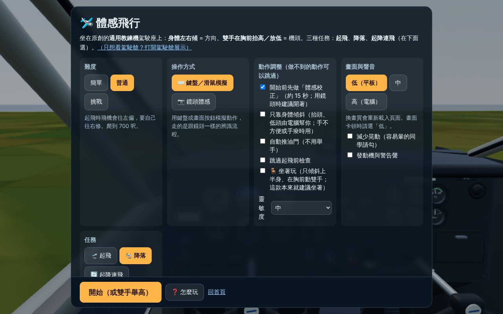

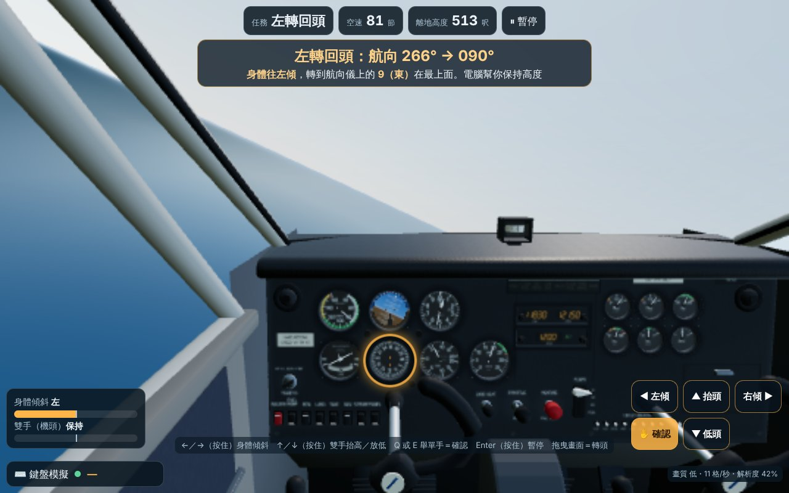

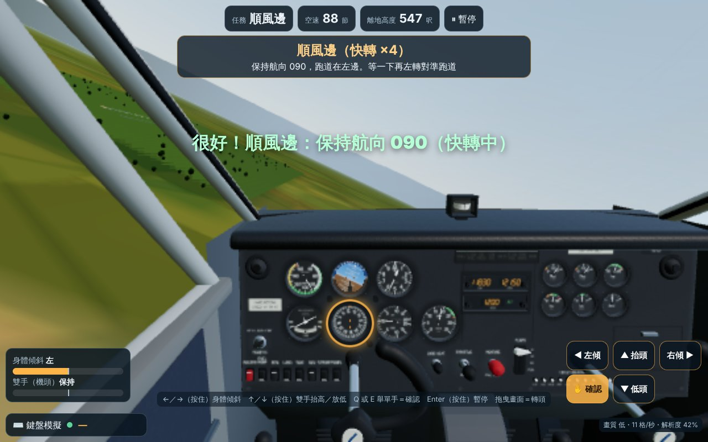

### 二、失敗很溫和：「重飛」而不是墜毀

| 狀況 | 會發生什麼 |
|---|---|
| 200 呎以下進場不穩定（太高／太低超過限度、太快、太慢、沒對準） | 先提示「進場不穩定！修正，不然要重飛」；持續 2.5 秒（普通、挑戰）就**自動重飛** |
| 60 呎以下還沒對準跑道、25 呎以下還沒到跑道、40 呎以下還離跑道頭超過 520 公尺（太晚，剩下的跑道不夠停） | 一定重飛（三種難度都是），**飛機永遠不會在跑道外接地** |
| 玩家覺得不對勁 | **舉單手 = 重飛**（真的飛行員也是這樣：重飛是好決定，不是失敗） |
| 重飛時 | 電腦加滿油門、抬頭爬升到 300 呎，然後重新從最後進場開始（扣 8 分） |
| 重飛 3 次 | 結束這次練習，畫面建議試「簡單」或「只靠身體傾斜」，不會出現「墜毀」 |
| 重落地（每分鐘下降 800 呎以上） | 提示「重落地！」、扣分，但飛機正常停下來 |

### 三、評分與星星（✏️ 數字都可以改）

| 項目 | 比重 | 滿分條件 |
|---|---|---|
| **對準度** | 30% | 接地時在中心線上（每偏 1 公尺扣 8 分）、機頭和跑道同方向（偏超過 3° 開始扣） |
| **下降率** | 30% | 接地時每分鐘下降 200 呎以內（越重扣越多，900 呎以上幾乎 0 分） |
| **接地速度** | 20% | 45～62 節（剛好在失速速度上面一點；太快會「飄」很久、太慢會失速） |
| 落點 | 10% | 離跑道頭 120～450 公尺（接地區） |
| 進場穩定 | 10% | 最後進場時高度剛好、速度 58～78 節、對準的時間比例 |

扣分：重飛每次 8 分、滑出跑道 15 分、前輪先著地 10 分。**80 分以上 3 顆星、55 分以上 2 顆星**，安全停好至少 1 顆星；重飛 3 次結束的練習是 0 顆星。起降連飛的分數 = 起飛 35% + 降落 65%。

### 四、難度（降落的部分）

| | 簡單 | 普通 | 挑戰 |
|---|---|---|---|
| 進場起點 | 正對跑道 | 偏 45 公尺、機頭偏 4° | 偏 90 公尺、機頭偏 8° |
| 油門 | **自動保持 65 節** | 固定進場油門，速度要用機頭控制 | 同普通 |
| 電腦幫忙 | 對準跑道、下降、拉平各幫一部分 | 對準幫一點點 | 不幫 |
| 亂流 | 無 | 無 | 有 |
| 不穩定時 | 只有一定要重飛的情況才重飛 | 2.5 秒自動重飛 | 2.5 秒自動重飛（標準比較嚴） |
| 起降連飛的繞場 | 電腦保持高度、幫忙轉彎 | 電腦保持高度 | 自己保持高度 |

### 五、這一階段的決定與理由

| 決定 | 理由 |
|---|---|
| 降落任務**直接從最後進場開始**，起降連飛的順風邊**快轉 4 倍** ✏️ 可以改 | 每次任務要短（手會累、要輪流）。真實的航線一圈要 6～8 分鐘，快轉後約 4 分鐘；只想練降落就選「降落」，1.5 分鐘。 |
| 起降連飛用「**左轉 180° → 順風邊 → 再左轉 180°**」 | 最簡單的航線：只有兩個轉彎，學生只要「身體往左傾，看航向儀轉到目標」，電腦（簡單、普通）幫忙保持高度，同時只控制一件事。 |
| 降落時**油門**：簡單模式自動、其他固定 | 照您「避免同時控制太多東西」的原則。普通以上用機頭控制速度：機頭抬高變慢、放低變快，這本身就是很好的教學。 |
| 拉平用「**雙手慢慢抬高**」 | 和起飛抬頭是同一個動作，學生不用學新動作。 |
| 加了**進場指示**（菱形）和 **PAPI 燈** | PAPI 是真實機場的設備，能讓學生「看窗外」判斷；菱形是給還看不懂 PAPI 的學生。 |
| 重飛用「舉單手」，也會自動 | 把「重飛」教成好決定。自動重飛保證不會在跑道外落地，也不會出現墜毀畫面。 |

### 六、自我測試結果

| 測試 | 方法 | 結果 |
|---|---|---|
| 降落（三種難度） | 模擬玩家（反應慢 0.35 秒）看下滑角與中心線修正、35 呎拉平 | ✅ 都落地停好、3 顆星；下降率 < 450 呎/分、接地 42～66 節、離中心線 < 4 公尺、2 分鐘內 |
| 只靠傾斜 | 同上，但機頭全部由電腦控制 | ✅ 三種難度都至少 2 顆星 |
| 溫和失敗 | 一直往下壓、一直往右偏、主動舉單手重飛 | ✅ 都變成重飛，沒有在跑道外接地；重飛 3 次後結束練習（0 顆星）；重飛後重新進場 |
| 評分 | 同一個好的接地，分別改成重落地、偏 8 公尺、75 節 | ✅ 都扣 10 分以上；好的接地 3 顆星 |
| 起降連飛 | 模擬玩家三種難度 | ✅ 都完成，至少 2 顆星 |
| 實際瀏覽器玩（雲端，鍵盤模擬人偶） | 降落（普通）、起降連飛（簡單），從選單一路玩到結算 | ✅ 降落 94 分（每分鐘下降 238 呎、50 節、離中心線 1.0 公尺）；起降連飛 98 分；沒有錯誤訊息 |

### 七、需要您用平板實測的項目

1. **拉平的手感**（最重要）：鏡頭的延遲對「拉平」影響最大。如果學生常常重落地，我可以把「拉平」提示提早（現在是 35 呎），或在普通模式也幫一點忙。
2. **對準跑道**：最後進場時用小小的傾斜修正，會不會太敏感、左右來回晃？
3. **PAPI 燈與進場指示**：學生看不看得懂？平板上 PAPI 燈夠不夠大？
4. **起降連飛的長度**：約 4 分鐘會不會太久、手會不會痠？
5. **快轉時會不會暈**：順風邊快轉 4 倍，請容易暈的同學試試看（可以勾「減少晃動」）。

### 八、之後可以做的事

- 加**側風**（降落時要「迎風修正」）、加**更多機場**（山邊、離島）。
- 加**直升機**：照第六節（階段一）的方式換機艙規格與飛行模型。
- 把「拉平」的時機做成跟棒球一樣的「**個人延遲測試**」：量出每台平板的延遲，自動提早提示。

---

## 階段二：起飛

### 一、玩什麼

首頁「✈️ 模擬器系列」→「體感飛行：起飛」，或直接開 `flight/`。打開會先出現「怎麼玩」動畫，然後是選單（難度、操作方式、時段、動作調整）。

**一次起飛約 1～2 分鐘**：

1. **體感校正**（用鏡頭時，約 15 秒）：坐好不動 → 往左傾到最大 → 往右傾 → 雙手抬到下巴 → 放到肚子。每個人的身體不一樣，量完之後小動作也能控制。結果存在這台平板上，可以在選單「清除校正」。
2. **起飛前檢查**：畫面轉向儀表板，用橘色圈把儀表一個一個圈起來，用中文說明（空速表、姿態儀、高度表…；難度越高介紹越多）。看懂了就**舉單手**。
3. **加油門**：舉單手，油門推到底，煞車放開。
4. **滑跑**：飛機會往左偏（螺旋槳的效應，真的飛機也是），**身體往右傾**修回來，保持在跑道中間的白線上。
5. **抬頭**：空速表到 **55 節**時，**雙手在胸前一起往上抬**，機頭抬到姿態儀第一條線（約 10°）就把手放回胸前。
6. **離地、爬升**：保持空速 65～85 節（太慢就雙手放低一點）。200 呎時電腦幫你**收襟翼**。這架教練機的**起落架是固定的**（很多教練機都是），所以「收起落架」這一步改成收襟翼，畫面上會說明。
7. 爬到指定高度（簡單 500、普通 700、挑戰 1000 呎）就完成，出現分數與星星。

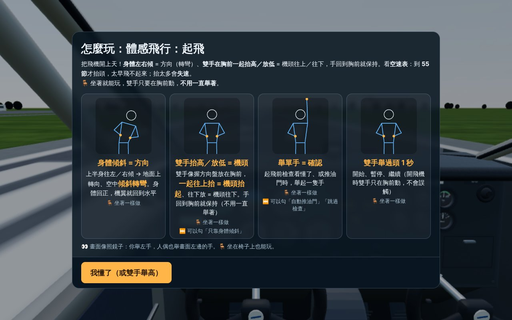

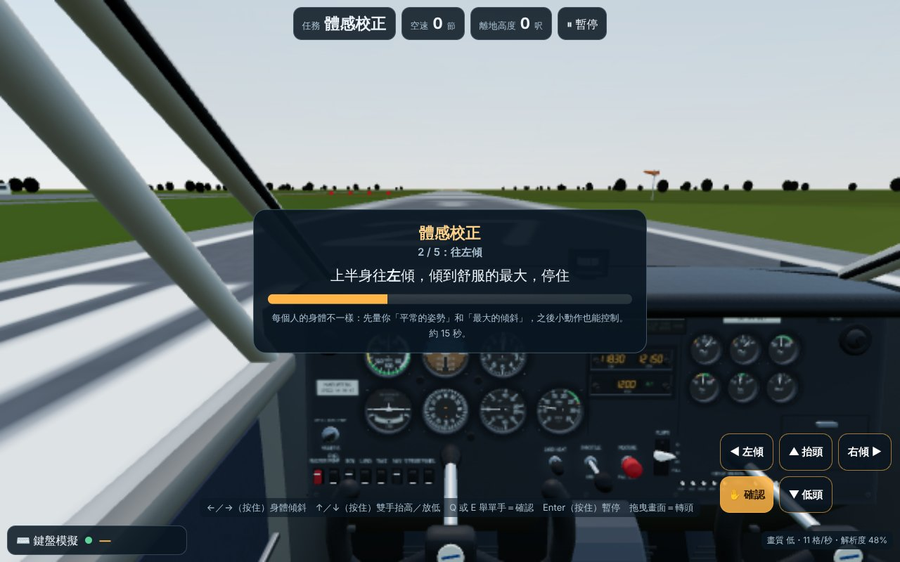

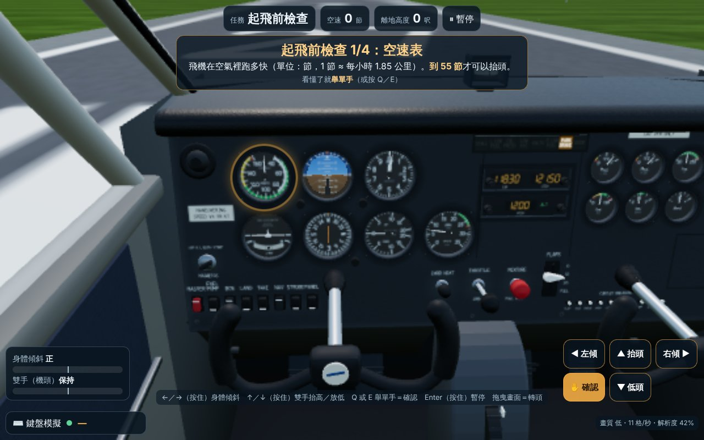

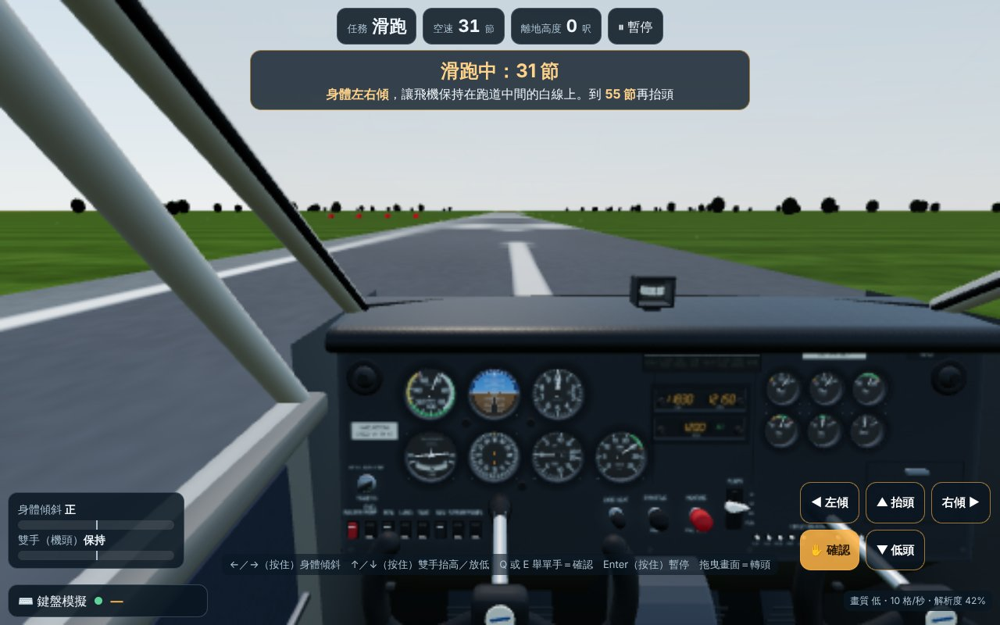

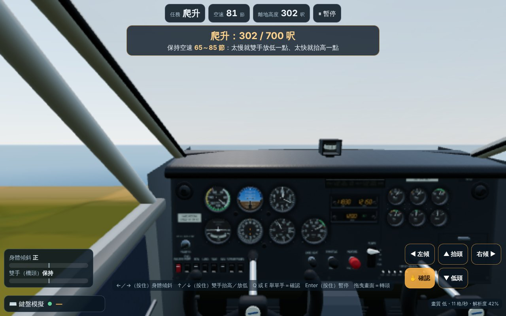

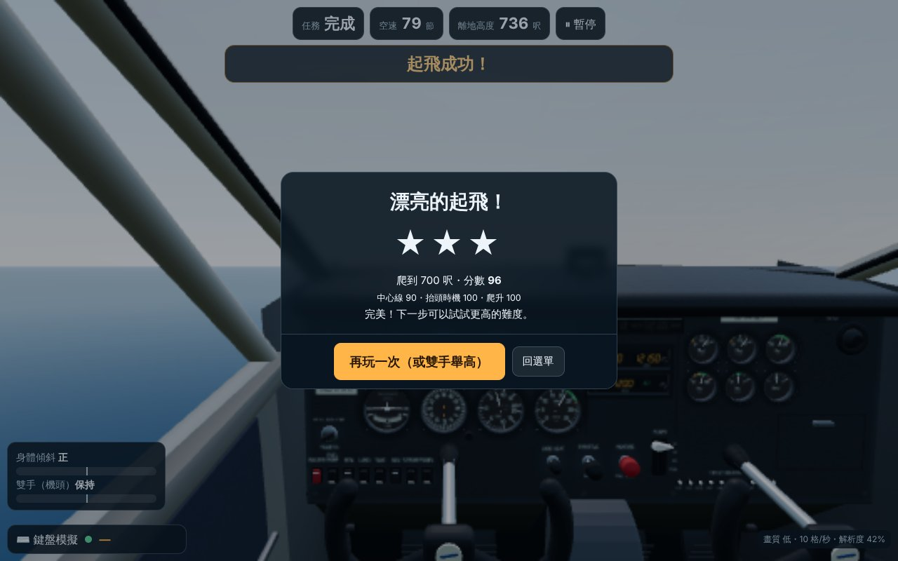

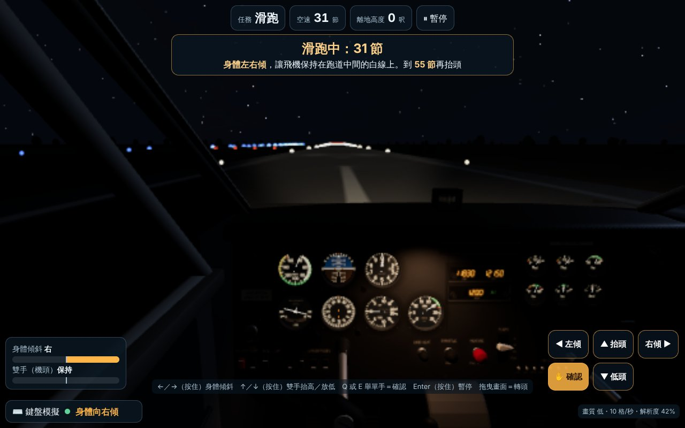

### 二、體感操作（我的設計，可以改）

| 遊戲裡 | 身體動作 | 鍵盤 | 平板沒有鏡頭時 | 做不到時 |
|---|---|---|---|---|
| 方向（地面轉向、空中傾斜轉彎） | 上半身往左／右傾 | ← →（按住） | 畫面右下「◀ 左傾」「右傾 ▶」按住 | —（這是主要操作） |
| 機頭往上／往下 | 雙手在胸前**一起**抬高／放低；手回到胸前 = 保持 | ↑ ↓（按住） | 「▲ 抬頭」「▼ 低頭」按住 | 勾「只靠身體傾斜」：電腦控制機頭 |
| 確認（檢查、推油門） | 舉單手 | Q 或 E | 「✋ 確認」 | 勾「自動推油門」「跳過起飛前檢查」；不確認 9 秒後也會自己往下走 |
| 暫停 | 雙手舉過頭 1 秒 | Enter（按住） | 「⏸ 暫停」 | — |

**我推翻／修改了原本建議的地方，理由如下**：

| 決定 | 理由 |
|---|---|
| 身體傾斜 = 滾轉／轉彎（**照您的建議**） | 坐著也做得到，而且是「持續」的動作，比抓時機更不怕鏡頭延遲。 |
| 雙手抬高／放低 = 機頭，但改成「**抬一下、放回來就保持**」（不是「手舉多高、機頭就多高」） ✏️ 可以改 | 如果手的高度直接等於機頭角度，爬升時雙手要一直舉著，很快就累。改成「手在上面時機頭慢慢往上轉、回到胸前就保持現在的角度」（像有自動配平），雙手只要動一下。這也是很多新式飛機的操縱方式。 |
| 雙手的範圍是「**胸前到下巴**」，不舉過頭 | 雙手舉過頭 1 秒是共用外殼的「暫停」，兩個動作不會混在一起。 |
| 手放在腿上（比校正的「放低」還低很多）**當作中間** | 小朋友累了把手放下時，飛機不會一直低頭往下衝。 |
| 油門用「**舉單手**」推一次，之後自動 ✏️ 可以改 | 避免同時控制太多東西；推油門是一個明確的時刻，用一個動作最清楚。 |
| **只靠傾斜模式** | 手不方便、手痠或坐輪椅的同學：機頭由電腦控制（到抬頭速度自動抬頭、爬升時自動保持速度），只用身體傾斜控制方向，一樣能完成、一樣有分數。 |
| 校正：**站好中立姿勢 → 最大傾斜量 → 雙手範圍**，用鏡頭時預設每次都做 ✏️ 可以改 | 跟棒球「揮棒測試」同一個概念。坐著的人傾斜很小（5°～10°）、站著的人可以 20° 以上；不校正的話，小動作的人永遠轉不夠。鍵盤模擬的人偶動作範圍固定，不需要校正。 |

**連續控制的處理（讓操作不會「肉」）**：

- **自己算傾斜**：輸入層原本的傾斜值在玩家不動時會慢慢「重新歸零」（適合衝浪的短暫傾斜），但轉彎時要一直傾斜好幾秒，所以飛行改用校正時量到的中立姿勢當零點，不會漂（`src/flight/controls.js`，共用輸入層沒有改）。
- **死區**：傾斜 12%、雙手 20% 以內當作 0，鏡頭的小抖動不會讓飛機晃。
- **平滑**：One Euro 濾波（不動時很穩、動得快時跟得上，輸入層原本就用這個）。
- **預測**：鏡頭模式往前推 0.1 秒（用最近的移動速度推算），抵銷鏡頭與姿態辨識的延遲；最多只推 20%，不會亂衝。自動測試（模擬人偶開始往右傾）：到達一半的時間從約 0.2 秒縮短到約 0.13 秒。
- **曲線**：中間細、推到底時跟線性一樣（小動作好微調）。
- **上限**：傾斜最多 25°（簡單）／30°（普通）／35°（挑戰）；身體回正，機翼就回到水平。
- **看不到人**：操作慢慢回到中間（不會突然翻過去），外殼也會自動暫停。

### 三、飛行模型（簡化但有教育意義）

不追求擬真，追求**可預測、手感好**，但每個現象都是真的物理（`src/flight/fdm.js`）：

- **升力 = ½ × 空氣密度 × 速度² × 機翼面積 × 升力係數**。速度不夠時，機頭抬再高也飛不起來；30 節以下升降舵根本抬不起機頭（地面上會提示「太早了」）。
- **失速**：機頭和前進方向的夾角（攻角）超過 15° 升力會突然變小。超過 12.5° 時「STALL」警示燈亮、發出警告聲。簡單模式有失速保護；普通、挑戰模式失速持續 1.5 秒或高度太低時，電腦會幫忙把機頭放低（溫和失敗，不會墜毀）。
- **用高度換速度**：機頭抬高 → 爬升、速度變慢；放低 → 速度變快。
- **轉彎**：飛機要傾斜才會轉彎，轉彎率 = g·tan(傾斜角) ÷ 速度（自動測試驗證過）。
- **起飛往左偏**：全油門、低速時最明顯（簡單 0.3、普通 0.7、挑戰 1.2 倍）。
- 數字是一般單發教練機的量級：約 **58 節離地、滑跑約 290 公尺、爬升每分鐘約 500～600 呎**。
- 側風先省略（照您的說明）。

### 四、難度（✏️ 數字都可以改）

| | 簡單 | 普通 | 挑戰 |
|---|---|---|---|
| 爬升到 | 500 呎 | 700 呎 | 1000 呎 |
| 起飛前檢查 | 3 個儀表 | 4 個 | 6 個 |
| 往左偏 | 很小，電腦還會幫忙修一半 | 要自己修 | 更明顯 |
| 失速 | 有失速保護 | 有警告，電腦幫忙救 | 有警告，太低時才幫忙 |
| 提示 | 最多（方向、速度、儀表圈） | 方向與速度 | 很少 |
| 最大傾斜 | 25° | 30° | 35° |
| 超過抬頭速度 8 節還沒抬頭 | 電腦幫你抬（分數打折） | 不幫 | 不幫 |

**溫和的失敗**：偏出跑道、跑道快用完還沒離地 → 收油門停下來，自動回到跑道頭再試一次（扣一點分，不會墜毀）。

**評分**：中心線（40%）、抬頭時機（25%）、爬升時保持速度與方向（35%），擦機尾、失速警告、重來會扣分。80 分以上 3 顆星、55 分以上 2 顆星，完成就至少 1 顆星。

### 五、機場（程式產生）

跑道「27」長 800 公尺、寬 23 公尺（標線、跑道號碼、接地區、瞄準點、斑馬線、輪胎痕），平行滑行道與聯絡道、等待線、停機坪、兩座機棚、塔台、風向袋、跑道邊燈（白）、跑道頭（綠）／尾（紅）、滑行道邊燈（藍）、進場坡度指示燈 PAPI（階段三用）、一團一團的樹、西邊 1.4 公里外是海岸與海、東邊遠山。天空與時段沿用 `src/land/` 的天空程式與時段設定。夜間有著陸燈照亮跑道。

### 六、改到的共用檔案

- `src/game/shell.js`：**加了 6 行**，讓遊戲可以自己帶 3D 世界（`mode.createWorld`）。沒有這個函式的遊戲（海洋四款、打擊練習、釣魚）走原本的路，完全不受影響。
- `index.html`：首頁的卡片從「駕駛艙展示」改成「體感飛行：起飛」，展示頁移到「其他」。
- 輸入層 `taikan-kit` **沒有改**。

### 七、自我測試結果

| 測試 | 方法 | 結果 |
|---|---|---|
| 飛行模型 | 自動測試：正常抬頭的離地速度與滑跑距離；太早拉桿抬不起機頭；升力隨速度、失速後升力下降；普通難度一直拉會失速警告、簡單模式有保護；傾斜轉彎率符合公式；身體回正機翼回平；手在中間機頭保持；儀表單位換算 | ✅ 通過 |
| 身體控制 | 自動測試（模擬人偶，含骨架雜訊）：中立 = 0、左右傾 = ±1、雙手抬高放低 = ±1、手放腿上 = 中間；有預測比沒預測反應快、不超過上限；校正量到個人範圍，坐著傾斜很小的人校正後也能滿格 | ✅ 通過 |
| 起飛任務 | 模擬玩家（反應慢 0.35 秒）三種難度都完成、3 顆星、2 分鐘內；抬頭太早會扣分但能完成；只靠傾斜模式三種難度都能完成；簡單模式什麼都不做也會完成；偏出跑道會停下來重來、回到跑道頭 | ✅ 通過 |
| 實際瀏覽器玩（雲端，鍵盤模擬人偶） | 怎麼玩 → 選單 → 校正（`?calib=1` 強制）→ 檢查 → 油門 → 滑跑 → 抬頭 → 爬升 → 結算；白天普通、黃昏簡單、夜間挑戰 | ✅ 都完成：白天普通 96 分、黃昏簡單 98 分、夜間挑戰 79 分（雲端很慢，鍵盤操作慢半拍，出現一次失速警告，電腦提示後恢復）；沒有錯誤訊息 |
| 其他遊戲 | 原有全部測試 | ✅ 見 PR 說明 |

### 八、需要您用平板實測的項目

1. **校正與傾斜（最重要）**：用鏡頭、**坐著**玩一次。校正後，小小的傾斜能不能讓飛機轉？會不會太敏感（一直左右晃）？坐著與站著都試。
2. **雙手抬高／放低**：在胸前上下動，鏡頭抓得到嗎？手放回胸前時飛機有沒有「保持」？會不會被誤認成舉單手（確認）或雙手舉高（暫停）？
3. **延遲感**：操作會不會覺得「肉」（慢半拍）？如果覺得慢，我可以把預測時間從 0.1 秒調高。
4. **手痠**：一次起飛玩完，手會不會累？「只靠身體傾斜」模式好不好玩？
5. **順暢度**：遊戲中右下角的「格/秒」（30 以上達標）。機場比展示頁多一些東西。
6. **學生看不看得懂**：起飛前檢查的說明、「55 節抬頭」、畫面上的提示字。
7. **難度與時間**：三種難度的星星數、一次約 1～2 分鐘是否合適。

### 九、下一步

- **階段三：飛行與降落**（進場、對準跑道、控制下降與空速、拉平、接地、滑行停止、評分；失敗用「重飛」）。PAPI 燈已經放在跑道旁，降落時會用到。
- 我覺得最值得先做的是**真機確認校正與雙手的手感**（第八節 1～3）：這是整個遊戲的基礎，降落比起飛更需要細的控制。

---

## 階段一：駕駛艙與儀表板

### 一、這一版做了什麼

這一階段只做「看」的部分，先讓您驗收**精緻度**：

1. **駕駛艙展示頁**：網站首頁「✈️ 模擬器系列」→「體感飛行：駕駛艙」，或直接開 `flight/cockpit.html`。
   - **拖曳畫面**（滑鼠或手指）轉頭看四周；滾輪可以拉近。
   - 上方按鈕可以切換**時段**（白天、黃昏、夜間）、**視角**（駕駛座、儀表特寫、看左右上下）、**畫質**（低／中／高）。
   - 「🔆 警示燈測試」讓 8 個警示燈全亮 2 秒；「💡 頂燈」開關機艙頂燈；「🧍 體感轉頭」用鏡頭（沒有鏡頭就用鍵盤 ←→）身體往左右傾就轉頭看左右。
   - 儀表由「假資料」驅動：飛機在 1500 呎附近慢慢轉彎、爬升、下降，**每一個指針都會動**，窗外的地平線也跟姿態儀一致。
2. **駕駛艙**（全部用程式產生，沒有任何外部模型或圖片）：
   - 儀表板（深灰霧面漆，有使用磨損、分板縫、螺絲、所有開關的白色絲印文字、小牌子）
   - 皮革包覆的遮光罩、擋風玻璃（淡淡的天空反射；逆光時會看到灰塵、水痕、擦拭留下的細刮痕；夜間玻璃下緣有儀表的倒影）
   - 左右兩個羊角式操縱盤（會跟著假資料轉動、前後移動）、油門（黑）／混合比（紅、有紋路）／化油器加溫把手、襟翼開關、配平輪、燃油選擇器、方向舵踏板
   - 開關列、點火鑰匙、斷路器、無線電與應答機（七段顯示器）、出風口、置物箱
   - 座椅（布面＋皮革側邊、安全帶）、門板（扶手、門把、布面飾板）、頂棚（頂燈、地圖燈、開關、遮陽板、天窗）、地毯
   - 窗外看得到上單翼、支柱、主輪（從側窗看）
3. **儀表**：完整的基本六表加發動機儀表與警示燈：

| 儀表 | 位置 | 說明 |
|---|---|---|
| 空速表 | 上排左 | 白色弧（可放襟翼）、綠色弧（正常）、黃色弧（小心）、紅線（不可超過） |
| 姿態儀 | 上排中 | 藍天褐地的球會依飛機的俯仰、滾轉移動；外圈是傾斜刻度 |
| 高度表 | 上排右 | 三根針（百呎、千呎、萬呎）、氣壓撥定窗 |
| 轉彎協調儀 | 下排左 | 小飛機傾斜到 L／R 記號 = 標準轉彎（2 分鐘轉一圈）；下方的小球看有沒有側滑 |
| 航向儀 | 下排中 | 轉動的羅盤刻度盤 |
| 爬升率表 | 下排右 | 每分鐘爬升（UP）或下降（DOWN）幾百呎 |
| 轉速表 | 六表右邊 | 發動機每分鐘轉速，綠色弧與紅線 |
| 小儀表 6 個 | 右側 | 左右油量、油溫、油壓、真空、電流 |
| 警示燈 8 個 | 上方中央 | 失速、左右低油量、油壓、真空、電壓、駐車煞車、艙門 |
| 磁羅盤 | 遮光罩上 | 浮在液體裡的刻度盤，轉彎後會來回擺幾下（真的羅盤也這樣） |

4. **三個時段**：白天、黃昏（低角度暖色陽光）、夜間（月光很暗，**儀表背光亮起**、儀表板泛光燈打在面板上）。天空與時段沿用陸地系列 `src/land/` 的天空程式與時段設定。

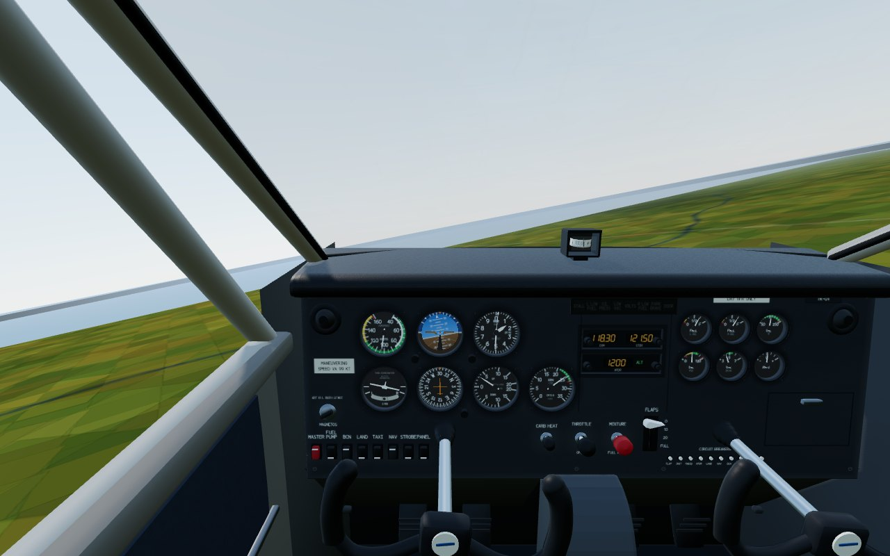

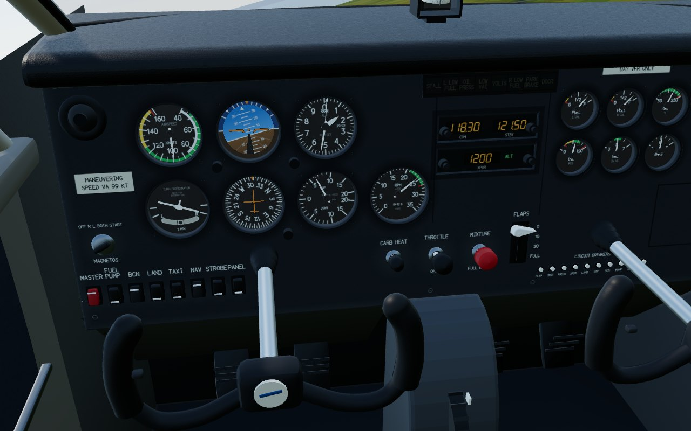

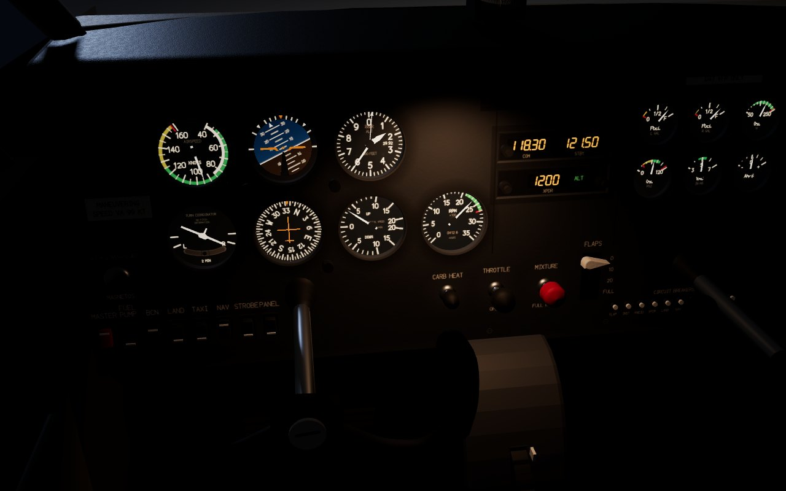

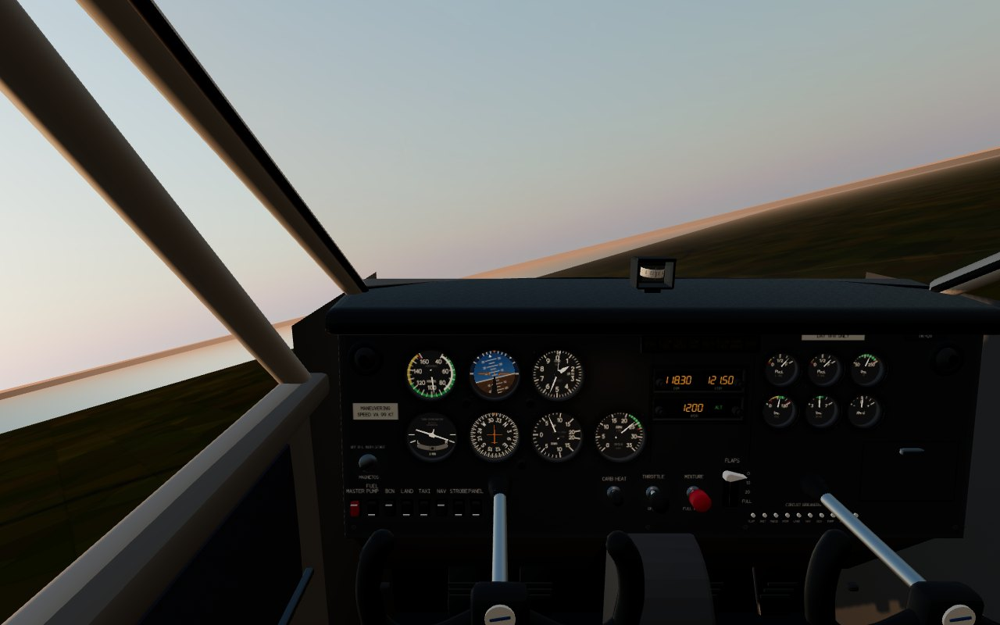

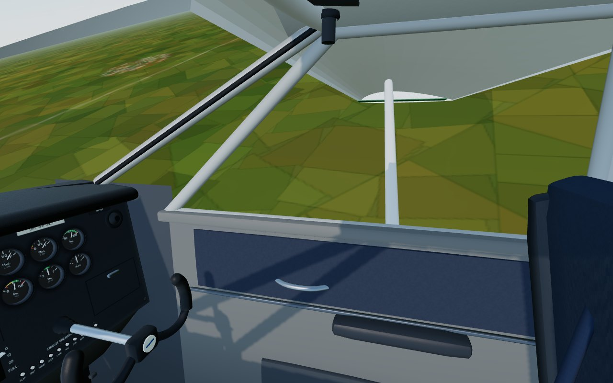

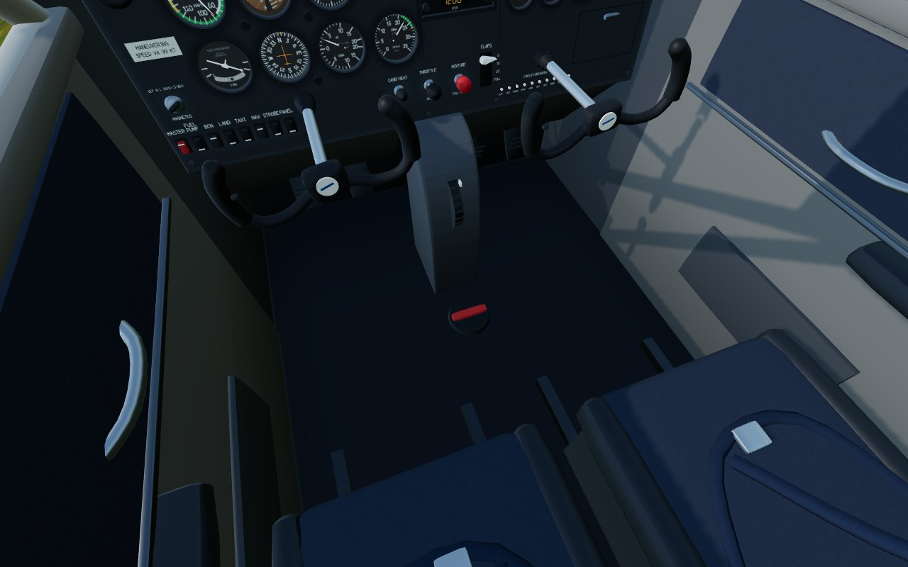

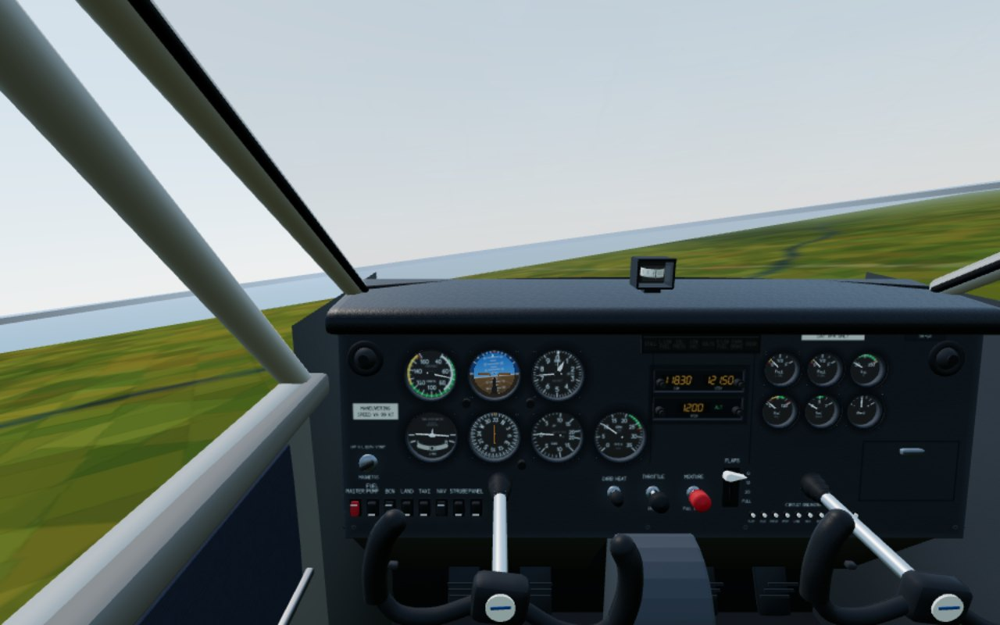

### 二、我替您做的決定與理由

標「✏️ 可以改」的都是我的選擇，您覺得不合適請直接告訴我。

| 決定 | 理由 |
|---|---|
| 機型：**原創的「通用教練機」**（並排雙座、上單翼、固定起落架、單發螺旋槳），機尾編號 `TK-01` 是自訂的 ✏️ 可以改 | 最常見的初級教練機型式，學生最容易聯想到「小飛機」。外形與儀表配置只用所有教練機共通的慣例（「T 字」六表），沒有使用任何真實機型的名稱、外形特徵、塗裝或商標。 |
| **儀表比真實大約 1.25 倍** ✏️ 可以改 | 真實的 3⅛ 吋儀表在平板上只有一個指甲大，刻度看不清楚。放大後配置仍是標準六表，看起來仍然真實。 |
| 儀表用航空的**原文單位**（節、呎、呎/分）與英文縮寫；中文說明放在畫面文字 | 這就是真實儀表的樣子，也是教學內容（例如「1 節 ≈ 每小時 1.85 公里」）。之後的起飛檢查會用中文一個一個介紹。 |
| 錶面文字用**自己畫的線條字型** | 倉庫裡沒有 OFL 字型；為了完全沒有字型授權問題，我把數字與英文字母一筆一筆用路徑畫出來（`src/flight/glyphs.js`）。中文一律用網頁文字，不畫進 3D 貼圖。 |
| **指針有「慣性」**（彈簧＋阻尼），爬升率表故意慢約 1.5 秒、磁羅盤會擺 | 真實儀表就是這樣；也讓輸入有雜訊時指針不會抖（自動測試量過：輸入 ±2 的雜訊，指針只動 1.6 以內）。 |
| 時段只做白天、黃昏、夜間三種 | 跟陸地系列一致，共用同一套天空設定。 |
| 窗外這一版只有簡單的田、河、村莊、海 | 階段一的重點是駕駛艙；階段二會加機場（跑道、滑行道）。 |

### 三、精緻度與效能的取捨（平板 Chrome、低畫質，目標每秒 30 格以上）

| 手法 | 白話說明 |
|---|---|
| **材質合併** | 駕駛艙的幾百個零件，依材質合併成 **14 個網格**。整個畫面約 **48 次 draw call、6.6 萬個三角形**（平板一般可以輕鬆處理 300 次、30 萬個）。 |
| **錶面圖集** | 所有錶面、刻度、指針、警示燈、無線電顯示畫在**同一張貼圖**（低畫質 1024×1024，中高畫質 2048×2048），共用一個材質。 |
| **頂點顏色代替多種材質** | 黑色旋鈕、灰色飾板、紅色把手共用同一個「塑膠」材質，只是頂點顏色不同。 |
| **先算好的陰暗（烘焙環境遮蔽）** | 腳下、儀表板下方、角落比較暗，在產生時就算進頂點顏色，所以**低畫質不開即時陰影**也有立體感。中、高畫質才開即時陰影（只罩住機艙約 3 公尺，陰影很清楚又便宜）。 |
| **小貼圖＋法線圖** | 皮革、布料、頂棚、地毯、塑膠的質感用很小的貼圖（低畫質 256 px）＋法線圖做出凹凸，記憶體很省。 |
| **兩段式繪圖** | 先畫外面的世界、再畫駕駛艙，避免遠近差太多造成的閃爍。 |
| **地面兩層貼圖** | 大範圍的土地利用圖（低畫質 512 px）× 會重複的田的圖樣（轉角度疊兩層看不出重複）。產生只要幾十毫秒。 |
| **三種畫質** | 低（平板）：解析度 75%、不開即時陰影、小貼圖；中：100%、1024 陰影；高：最高 150%、2048 陰影。平板會自動選低。 |
| **反鋸齒** | 三種畫質都開。平板的繪圖晶片（多半是 tile-based）做反鋸齒幾乎不花額外頻寬，而錶面的細刻度沒有反鋸齒會很難看。若平板實測太慢，第一個關掉它。 |

**雲端實測（沒有顯示卡，用 CPU 模擬繪圖，只能看相對值）**：

| 項目 | 低畫質 | 中畫質 |
|---|---|---|
| 每秒格數（1280×800 視窗，雲端軟體繪圖） | 約 49～54 格 | 約 11～19 格 |
| draw call／三角形 | 48／6.6 萬 | 48／6.6 萬 |
| 打開頁面到駕駛艙產生完成 | 約 0.8 秒 | 約 2 秒 |
| 錶面圖集 | 1024² | 2048² |

雲端的「低畫質」在**沒有顯示卡**的情況下都有約 50 格/秒，所以我預期平板在低畫質能達到 30 格/秒以上；但這一定要真機確認（見第五節）。

### 四、自我測試結果

| 測試 | 方法 | 結果 |
|---|---|---|
| 儀表換算 | 自動測試：空速表刻度單調、重要速度的角度、高度表三根針、爬升率表對稱、轉速表、轉彎協調儀、姿態儀、航向盤、小儀表 | ✅ 通過 |
| 指針慣性 | 自動測試：跳到新數值不會過衝超過 2%、4 秒內收斂、有雜訊不會抖、掉格（每格 0.25 秒）也穩定、航向 350°→10° 走最短方向 | ✅ 通過 |
| 機艙規格 | 自動測試：13 個儀表、無線電、警示燈、操縱桿孔互不重疊，都在儀表板範圍內；V 速度順序合理；每個警示燈都對應到飛行狀態 | ✅ 通過 |
| 錶面圖集 | 自動測試：低畫質剛好 1024²、中高畫質剛好 2048²，各格不重疊 | ✅ 通過 |
| 其他遊戲 | 原有全部測試 | ✅ 遊戲 57 項（含新增 9 項）、輸入層 15 項全部通過 |
| 畫面 | 無頭瀏覽器截圖：三種時段 × 各視角 × 低／中畫質 | ✅ 見上方截圖。沒有錯誤訊息 |

### 五、需要您用平板實測的項目

1. **順暢度（最重要）**：在學校平板用 Chrome 打開「體感飛行：駕駛艙」，看右下角的「格/秒」。**30 以上**算達標。三個時段各看一次（夜間多一盞燈）。
2. **看不看得清楚**：儀表上的數字、刻度在平板上看得清楚嗎？學生坐在 1.5～2 公尺外看得到指針在動嗎？（看不清楚我可以再放大儀表或加粗字）
3. **夜間會不會太暗**：教室開燈時，夜間的儀表背光與機艙夠不夠亮？
4. **擋風玻璃的髒污**：逆光（黃昏）時看起來像「有一點髒的真實玻璃」還是「畫面有雜點」？
5. **觸控轉頭**：手指拖曳轉頭會不會太敏感或太慢？
6. **打開需要幾秒**：從點卡片到看到駕駛艙要多久（雲端約 1 秒）。
7. **學校網路**：第一次打開會下載約 0.7 MB 的 three.js（與棒球場相同），請確認沒有被擋。

### 六、之後怎麼加新機型（例如直升機）

駕駛艙做成「**機艙規格＋元件**」兩層：

- **元件**（不用改）：每個儀表是獨立元件（`src/flight/gauges/instruments.js`），只讀一個「飛行狀態物件」（`src/flight/state.js`：空速、高度、姿態、航向、轉速、油量…）。刻度換算在 `scales.js`，錶面畫法在 `faces.js`。
- **機艙規格**（每種機型一個檔）：`src/flight/aircraft/trainer.js` 寫了機艙尺寸、儀表板上每個儀表的位置、開關與把手、警示燈、小儀表的刻度、空速限制、顏色、操縱桿種類。

要加直升機：複製 `trainer.js` 改成 `helicopter.js`，改儀表配置（例如加旋翼轉速表、移除襟翼）、操縱桿種類、機艙造型；要新的儀表種類，就在 `instruments.js` 加一個元件、在 `faces.js` 加一個錶面。駕駛艙產生器（`cockpit.js`）會照規格把東西放好、合併材質。

### 七、授權

- 3D 程式庫 three.js r180（MIT），沿用倉庫已自架的 `vendor/three/`。
- 駕駛艙幾何、所有貼圖（漆面、皮革、布料、玻璃髒污、地面）、錶面與文字（自己畫的線條字型）全部由本專案程式產生。**沒有使用任何外部圖片、模型、字型或 CC BY-SA／CC BY-NC 素材。**

### 八、下一步

- **階段二：起飛**（簡單機場、起飛前檢查、加油門、滑行保持直線、抬頭、爬升、體感校正、三種難度）。
- 我覺得最值得先確認的是第五節第 1、2 點（平板格數、儀表看不看得清楚）：這決定階段二要不要再降低駕駛艙的細節或再放大儀表。
