# 🎤 體感闖關問答：白話說明

> 給老師與學校資訊人員看的「這是什麼、怎麼用、題庫怎麼寫、每一關的規則和為什麼這樣設計、做了哪些決定、還要用真機測什麼」。
> 遊戲網址：首頁的「🎤 體感闖關問答」卡片，或直接開 `quiz/`。題庫編輯器：`quiz/editor.html`。
> 三個階段都已完成：題庫、編輯器、**8 種關卡**、連擊與復活、舞台氣氛與音效、**團體模式（分組對戰、全班合作、接力）**、投影與教室版面、AI 轉題的格式與提示詞、效能與無障礙。

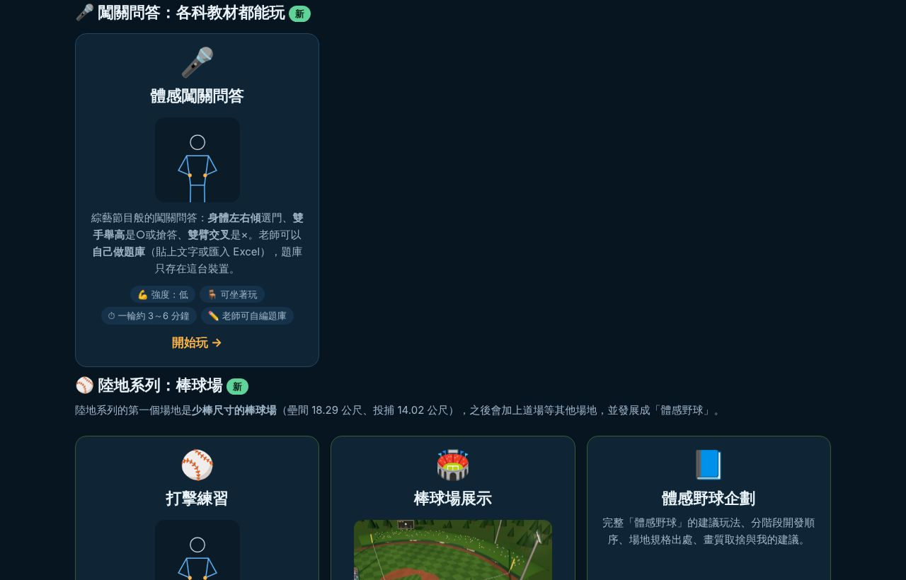

## 一、玩什麼

像電視綜藝節目一樣的**闖關問答**，但學生不用按按鈕，而是用**身體**回答：

| 動作 | 意思 | 鍵盤模擬 |
|---|---|---|
| 身體往左／右傾（坐著只歪上半身） | 選左邊／右邊 | ←／→ 按住 |
| 雙手舉高（像一個大圓圈） | 是非題的「○ 對」、搶答 | Enter 按住 |
| 雙臂在胸前交叉 | 是非題的「× 錯」 | X 按住 |
| 舉一隻手 | 確認答案；平衡橋上舉左手＝A、舉右手＝B | Q／E |
| 蹲低（坐著不用） | 穿牆的矮洞、閃過橫桿 | ↓ 按住 |
| 小跳一下（坐著不用） | 跳過低欄 | 空白鍵 |
| 雙手前後擺動（像跑步，腳不用動） | 原地衝刺 | R 按住 |

- 一輪由好幾**關**組成，每一關玩法不一樣（目前 8 種），老師可以選要哪些關、順序、每關幾題、難度。
- 題目來自**題庫**：內建 6 份原創範例（英文、數學、國語、唐詩、自然、社會），老師也可以自己做。
- 答錯不會被淘汰，也不會被嘲笑：會滑進**泡泡池**、被泡泡噴一下，主持人「答答」會說「沒關係，看看正確答案」。每一題答完都會顯示正確答案和解說，最後有整輪的**答案與解說清單**，當作複習。
- 主持人是本專案原創的角色「答答」（用陸地系列的人偶做的），舞台、燈光、彩帶、音效全部用程式產生。

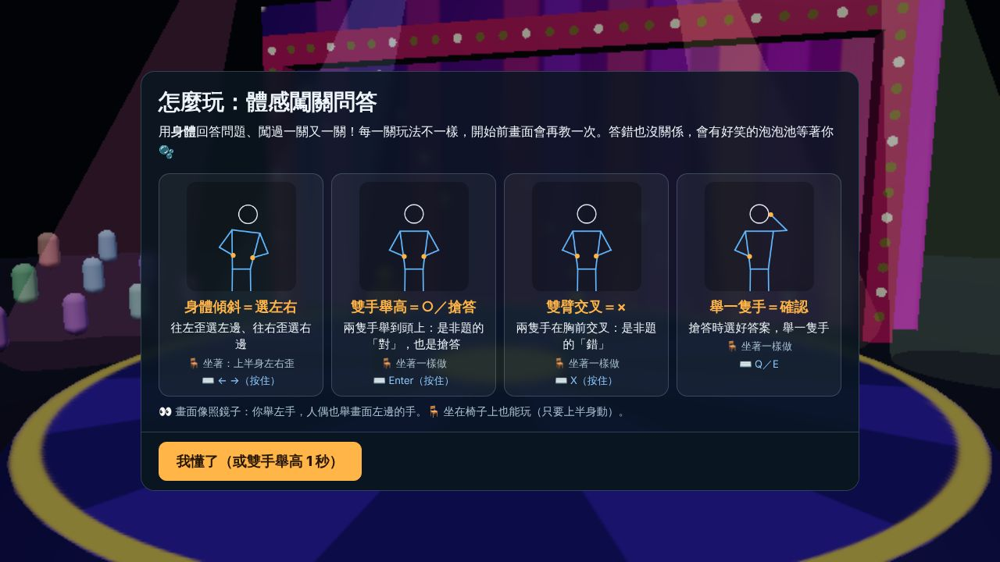

## 二、老師怎麼用（5 分鐘上手）

1. **選題庫**：打開遊戲 → 選單「① 題庫」選一份。可以只出某些主題（例如只考「顏色」）。
2. **排關卡**：「② 關卡」打勾要的關，▲▼ 調順序、選題數。也可以直接按現成的組合：「⚡ 快速（約 3 分鐘）」「⭐ 標準（約 5 分鐘）」「🏃 動態（約 5 分鐘）」「👾 挑戰 Boss（約 6 分鐘）」。
3. **難度**：簡單（時間長，第一次玩用）、普通、挑戰（時間短、速度加分多）。
4. **玩家**：可以填座號或暱稱（**不要填真實姓名**），成績紀錄會用它。
5. **操作方式**：沒有鏡頭時選「⌨️ 鍵盤模擬」；有鏡頭選「📷 鏡頭體感」。
6. 按「開始」或學生**雙手舉高 1 秒**。玩完可以看「📊 成績紀錄」，也能下載成 CSV。

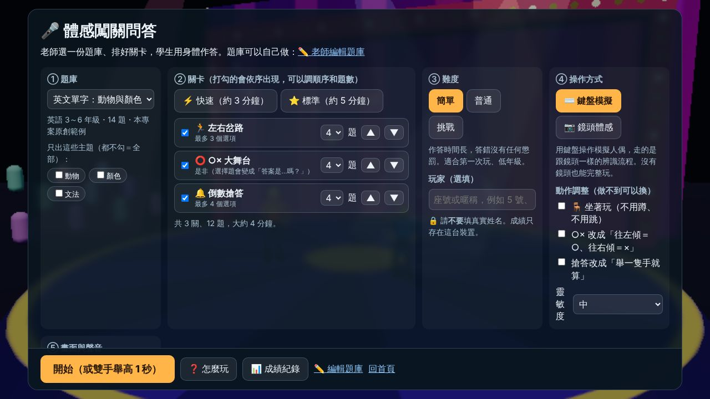

**自己做題庫**：選單上的「✏️ 編輯題庫」。

- **最快的方法：貼上文字**。從 Word、記事本、Google 文件貼進來，按「檢查」：有問題的題目會用白話告訴您是**第幾題、第幾行、哪裡不對**，沒問題的題目一鍵加入。
- **用 Excel／Google 試算表**：下載「CSV 範本」照著填，另存成 CSV 匯入；或在試算表選好整個表格直接複製，貼到「貼上文字」也可以。
- **一題一題做**：「＋ 新增一題」，選題型後填空，下面會即時顯示有沒有問題。
- **圖片**：在「🖼️ 圖片」上傳（會自動縮小），題目裡寫圖片檔名就好。也有本專案用程式畫的**內建圖庫**（時鐘、分數圓餅、形狀、顏色、動物、天氣、植物生長、水的三態、月相、點點數數），可自由使用。
- **分享給別的老師**：「⬇ 匯出 .json（含圖片）」，對方在編輯器「📂 匯入檔案」。
- **備份**：題庫只存在這台裝置的瀏覽器裡，換電腦或清除瀏覽器資料就會不見，請定期匯出。

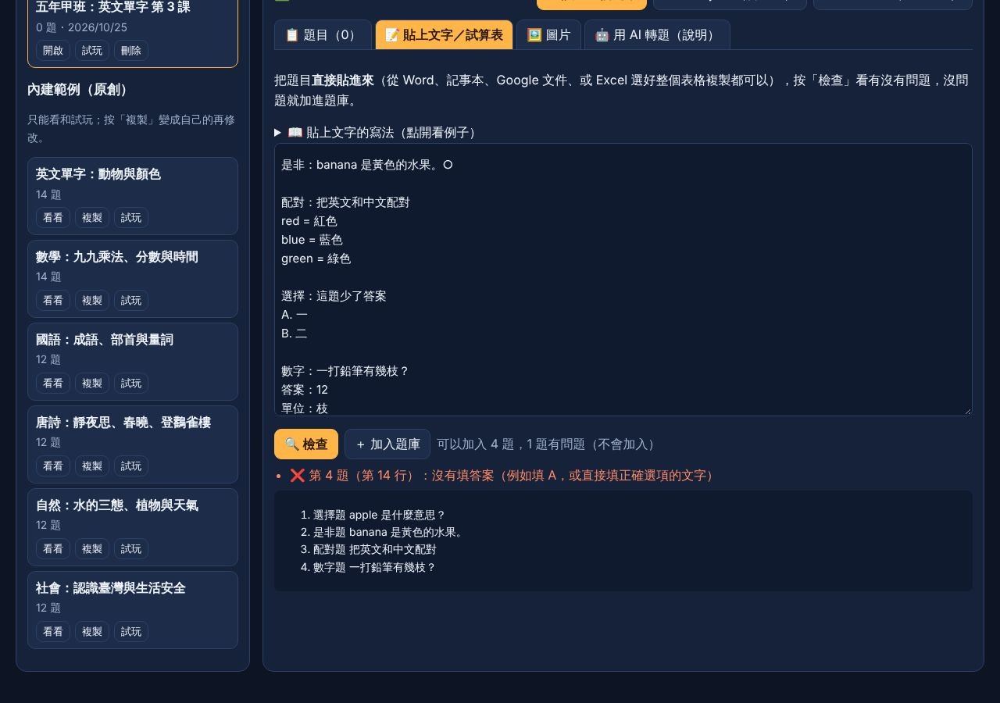

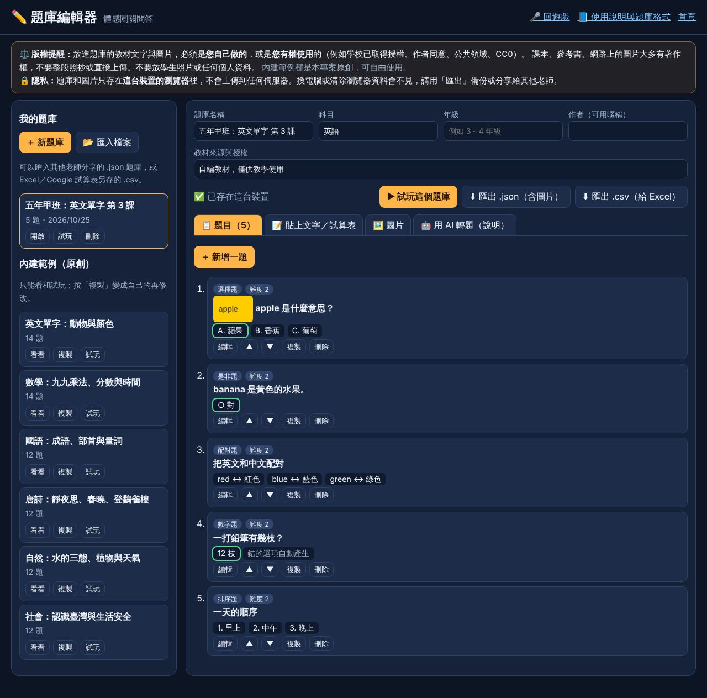

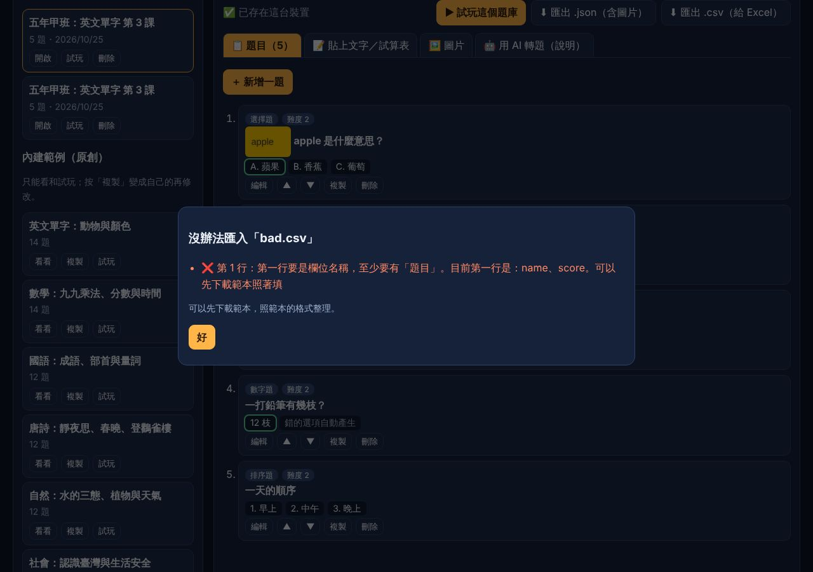

> ⚖️ **版權提醒**（編輯器最上面也一直顯示）：放進題庫的文字與圖片要是您自己做的、或您有權使用的。課本、參考書、網路圖片大多有著作權，不要整段照抄或直接上傳；不要放學生照片或個人資料。上傳圖片和匯入別人的題庫前，編輯器會請您勾選確認。內建範例都是本專案原創（唐詩的詩句本身是唐代作品，屬公共領域；題目是原創的）。

## 三、題庫格式（給老師看的版本）

### 6 種題型

| 題型 | 怎麼寫 | 遊戲裡怎麼玩 |
|---|---|---|
| **選擇題** | 2～4 個選項，標出正確的 | 依關卡：選門、搶答後選，或變成「答案是…嗎？」的是非題 |
| **是非題** | 一句話＋ ○ 或 × | ○× 姿勢；在選門的關卡變成「○ 對／× 錯」兩道門 |
| **排序題** | 2～6 個項目，**照正確順序寫**（遊戲會打亂） | 一格一格問：「第 1 個是？」「第 2 個是？」 |
| **配對題** | 2～6 組「左＝右」 | 一組一組問：「『cat』配哪一個？」 |
| **圖片題** | 題目或選項放圖片的選擇題 | 同選擇題，圖片顯示在題目旁或選項卡上 |
| **數字題** | 答案是一個數字（可加單位） | 遊戲自動出幾個接近的錯誤選項（也可以自己寫） |

每一題都可以加：**提示**（作答時顯示）、**解說**（答案揭曉時顯示）、**難度**（1 簡單、2 普通、3 困難；也可以寫 易／中／難）、**標籤**（用頓號分開，例如「動物、顏色」，可以在選單只出某些標籤）、**圖片**。

**為什麼選項最多 4 個？** 身體動作能穩定分出來的選擇，大約就是左、中、右，再加上「移動選框＋確認」最多 4 個。超過 4 個時編輯器會提醒。

### 貼上文字的寫法

```
1. cat 是什麼意思？
A. 貓 *
B. 狗
C. 鳥
提示：會喵喵叫
解說：cat 就是貓。

是非：太陽從東邊升起。○

配對：把英文和中文配對
cat = 貓
dog = 狗

排序：由小排到大
1/4
1/2
3/4

數字：7 × 8 = ？
答案：56
標籤：乘法
```

- 每題中間**空一行**；題號可寫可不寫。
- 正確選項後面加 `*`，或另外寫 `答案：B`（也可以寫正確選項的文字）。
- 是非題的答案可以寫 ○ × O X 對 錯 是 否。

### CSV（Excel）欄位

第一行是欄位名稱：`題型, 題目, 選項A, 選項B, 選項C, 選項D, 答案, 提示, 解說, 難度, 標籤, 圖片, 單位`（也接受英文欄名 type, question, a, b, c, d, answer…；排序、配對題最多可以多加「選項E、選項F」）。

- 配對題的選項格寫 `cat=貓`；排序題的選項照正確順序填，答案空白。
- Excel 另存新檔選「CSV UTF-8」，中文才不會變亂碼。

### JSON（給資訊人員、AI 工具、分享檔）

```json
{
  "format": "taikan-quiz", "version": 1,
  "title": "英文單字：動物", "subject": "英語", "grade": "3～4 年級",
  "author": "王老師", "license": "自編教材，僅供教學使用",
  "questions": [
    { "type": "choice", "q": "cat 是什麼意思？", "options": ["貓", "狗", "鳥"], "answer": "A", "hint": "會喵喵叫", "explain": "", "difficulty": 1, "tags": ["動物"] },
    { "type": "tf", "q": "太陽從東邊升起。", "answer": "○" },
    { "type": "order", "q": "由小排到大", "items": ["1/4", "1/2", "3/4"] },
    { "type": "match", "q": "配對", "pairs": [["cat", "貓"], ["dog", "狗"]] },
    { "type": "image", "q": "這是幾點？", "image": "art:clock:3:00", "options": ["3 點", "9 點"], "answer": "A" },
    { "type": "number", "q": "7 × 8 = ？", "answer": 56, "options": [54, 63], "unit": "" }
  ],
  "images": { "i1": { "name": "apple.jpg", "data": "data:image/jpeg;base64,…" } }
}
```

- `answer`：選擇／圖片題寫字母（A～D）、選項文字，或數字（從 1 開始數）。
- 選項可以是文字，或 `{ "text": "…", "image": "…" }`。
- `image`：`art:…`（內建圖庫）、`img:<id>`（檔案裡 `images` 的圖片）、或上傳時的檔名。
- 匯出的 JSON 會把用到的圖片一起放進去，所以一個檔案就能分享。
- 程式：`src/quiz/bank.js`（解析、檢查、轉成遊戲步驟），測試：`tests/quiz.test.mjs`。

## 四、關卡類型（8 種）

**共同原則**（每一關都遵守）：

- **只用輸入層既有的動作**（傾斜、舉手、雙手舉高），另外兩個姿勢（雙臂交叉、原地擺手）是在本遊戲資料夾裡用「手的位置」判斷的，**沒有改共用的辨識器**。
- **對鏡頭延遲不敏感**：答案都是「**保持一個姿勢**」或「**在一段時間內做一次動作**」，不是「在某一瞬間做對」。鏡頭慢 0.1～0.6 秒都不影響對錯（有自動測試，見第七節）。
- 題目長，作答時間自動變長（大約每秒讀 6 個字，1.5～6 秒），國語、唐詩這種字多的題目不會來不及看。
- 答錯不扣分；沒有淘汰；每關 2～6 題、約 1～1.5 分鐘。

### 🏃 左右岔路（2～3 選 1）

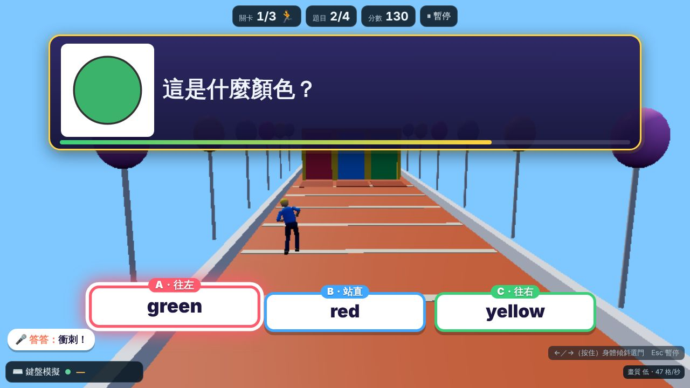

- **玩法**：人偶在跑道上跑向 2～3 道紙門，門上（和畫面下方同顏色的卡片）是選項。身體**往左傾**跑左門、**往右傾**跑右門；三道門時**站直**就是中間。
- **判定**：跑到門口時，**最後 0.5 秒大部分時間在哪一道**就是答案。
- **數字**：到門口的時間＝ 7 秒 × 難度倍數（簡單 1.3、普通 1、挑戰 0.8）＋ 閱讀時間。往左或右**穩穩保持 1.5 秒**，人偶會「衝刺」提早到門口（+30 分），讀得快的學生不用乾等。
- **答對**：衝破紙門、彩帶。**答錯**：門前的地板翻開，滑進泡泡池（軟軟的、好笑的，不是失敗畫面）。
- **題目怎麼放進來**：4 個選項的題目會留下正確答案＋2 個錯的；是非題變成「○ 對／× 錯」兩道門。
- **為什麼這樣設計**：「身體歪向答案」是最直覺、最不需要教的動作，坐著也能做；每道門前都有翻板，所以從場景看不出哪道是對的。

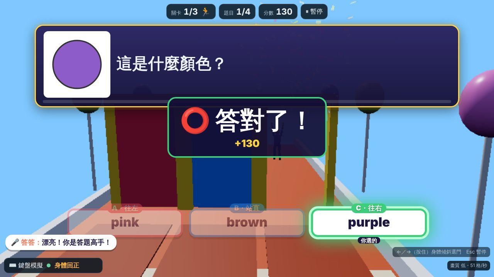
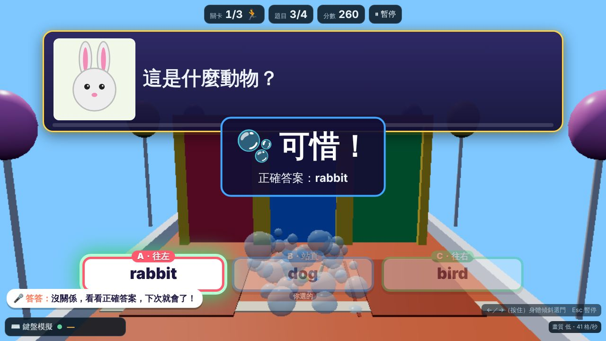

### ⭕ ○× 大舞台（是非）

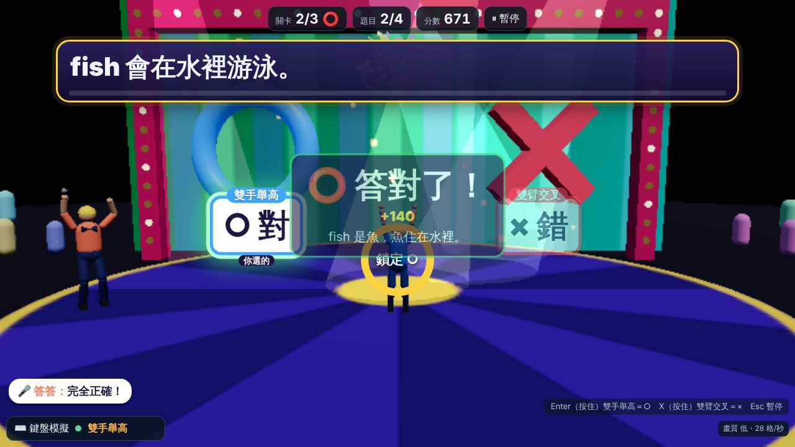

- **玩法**：舞台上出現一句話。覺得**對**：雙手舉高在頭上圍成 **○**；覺得**錯**：雙臂在胸前交叉成 **×**。
- **判定**：姿勢**保持 0.5 秒**（中間的圈圈會填滿）就**鎖定**，鎖定後不能改。路過的手、一瞬間的動作不會被當成答案。
- **數字**：作答時間 8 秒 × 難度倍數＋閱讀時間。越早鎖定加分越多（最多 +50）。
- **選擇題也能玩**：會變成「答案是『貓』嗎？」，一半機會是對的、一半是錯的；錯的時候會告訴學生正確答案。
- **做不到的替代**：選單勾「○× 改成往左傾＝○、往右傾＝×」。
- **為什麼用 ○ 和 ×**：這是台灣學生最熟悉的對錯符號，用全身「畫」出來很有綜藝感；雙手舉過頭、雙臂交叉都是鏡頭很好分辨的大姿勢，而且兩個姿勢差很多，不會互相誤認。

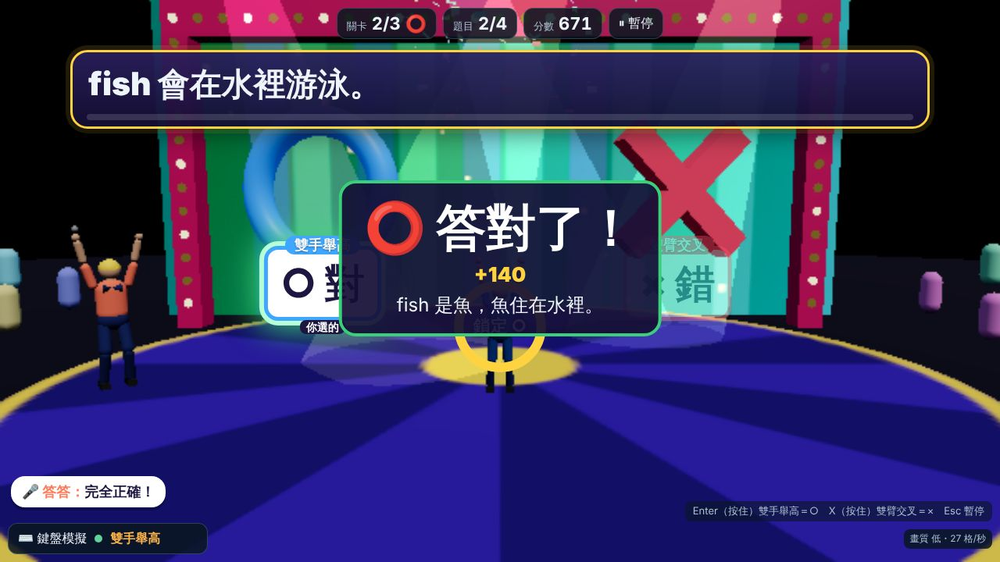

### 🔔 倒數搶答

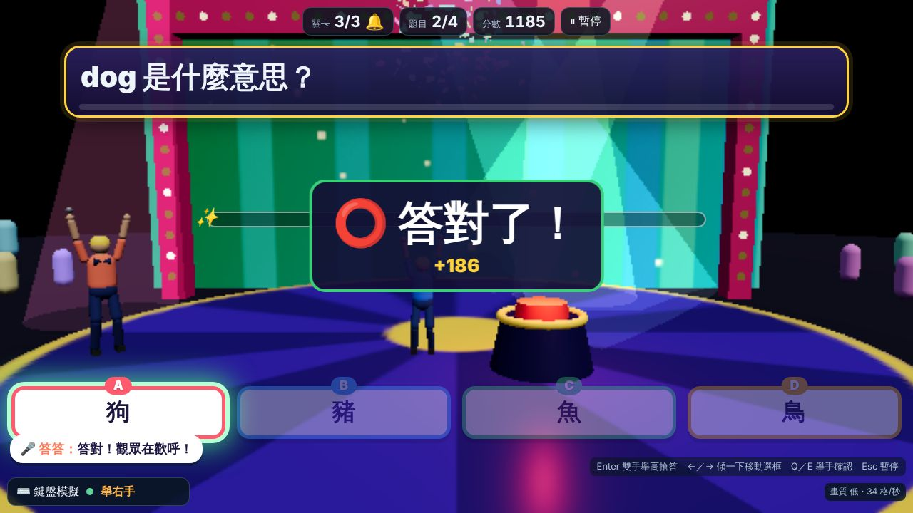

- **玩法**：題目和選項一出現，**導火線**就開始燒。知道答案就**雙手舉高**搶答。搶到後，身體**傾一下**選框就往左／右移一格（回正再傾，再移一格），停在答案上**舉一隻手**確認。
- **數字**：導火線 9 秒 × 難度倍數＋閱讀時間；選答案 8 秒 × 難度倍數。分數＝ 100 ＋ 剩下的導火線比例 × 100。
- **延遲**：加分是隨導火線「慢慢減少」，所以鏡頭慢 0.3 秒只會少幾分，不會從滿分變零分。
- **時間到**：導火線燒完沒搶，就揭曉答案（0 分，沒有其他懲罰）；選答案的時間到了，就用選框目前停的那一個。
- **做不到的替代**：選單勾「搶答改成舉一隻手就算」（選答案的時間也多 2 秒）。
- **為什麼不是「看到選項立刻選」**：先搶答再選，讓學生有「按下按鈕」的緊張感；而「傾一下移一格＋舉手確認」可以穩定選 4 個選項。

### 🧱 穿牆姿勢

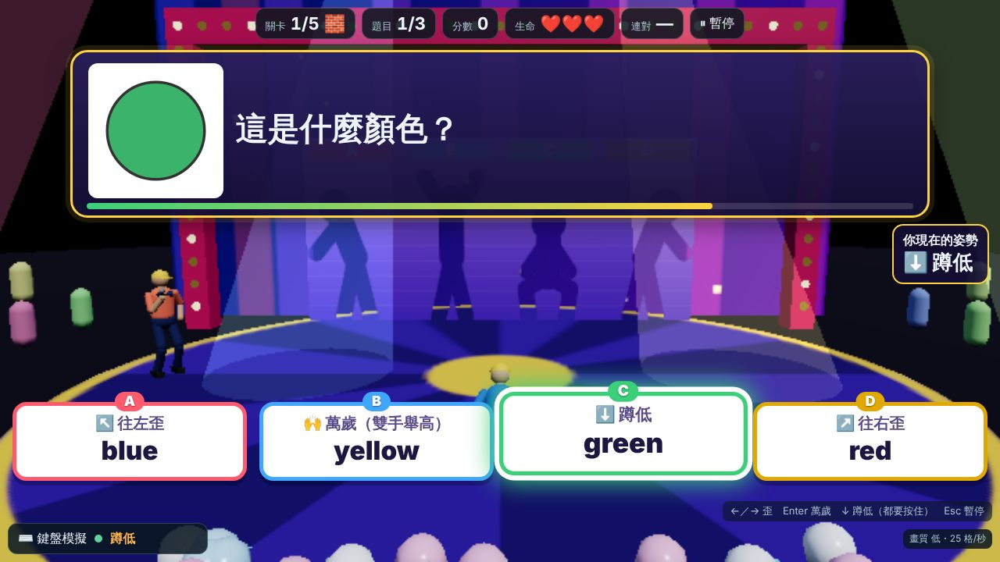

- **玩法**：一面牆朝玩家滑過來，牆上有 2～4 個**人形洞**，每個洞是一個答案。擺出答案那個洞的姿勢就能穿過去。
- **姿勢**（由左到右固定排列，所以洞在哪邊、姿勢就往哪邊）：**往左歪**、**萬歲（雙手舉高）**、**蹲低**、**往右歪**。2 個答案只用左歪／右歪；3 個答案時隨機拿掉萬歲或蹲低。
- **判定**：牆到的時候，看**最後 0.6 秒大部分時間**是哪個姿勢（姿勢保持住就好，不用抓瞬間）。
- **數字**：牆到的時間＝ 8 秒 × 難度倍數＋閱讀時間。畫面右邊會一直顯示「你現在的姿勢」。
- **答錯**：牆停在面前輕輕把人偶推回泡泡池（不是撞飛）。

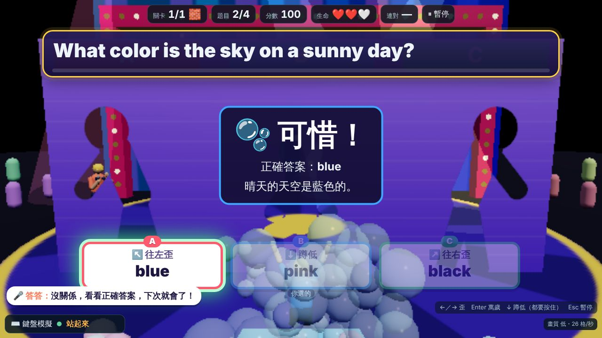
- **坐著玩**：沒有「蹲低」的洞（3 個姿勢，最多 3 個答案）。
- **為什麼是這 4 個姿勢**：都是鏡頭最好分辨、彼此差很多的大姿勢，而且輸入層原本就會判斷（傾斜、雙手舉高、蹲低），不用新增辨識。

### 🌉 平衡過橋

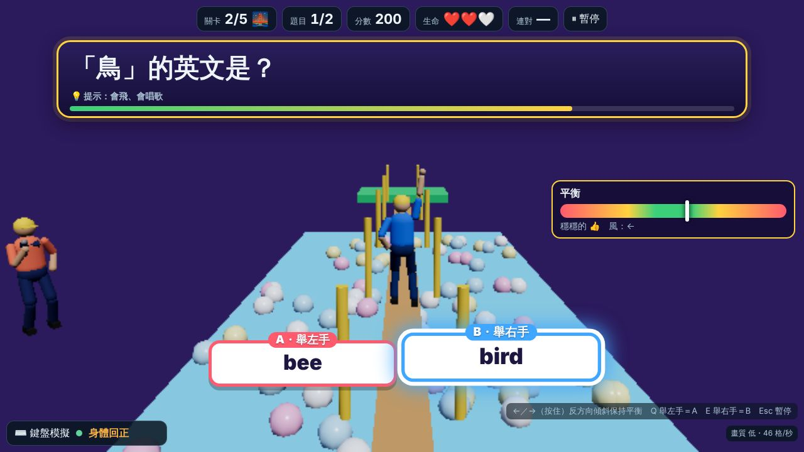

- **玩法**：人偶走在泡泡池上方的獨木橋，風會把它吹歪。看右邊的**平衡指針**，往**反方向**傾斜保持平衡；走的同時，答案 A **舉左手**、答案 B **舉右手**（第一次舉的算）。走到對岸揭曉答案。
- **掉下去**：指針到邊緣就掉進泡泡池，**扣 20 分**、同一題從橋頭重新走（答案也要重選）。**掉兩次之後就沒有風了**（「答答幫你擋風」），不會卡在同一題。
- **數字**：過橋 9 秒 × 難度倍數＋閱讀時間；風力 簡單 0.22、普通 0.34、挑戰 0.46（傾斜的力量是 0.75，所以一定扳得回來）。
- **延遲**：指針倒下要好幾秒，是「穩穩地傾斜」不是「快速反應」，鏡頭慢 0.6 秒的模擬學生在挑戰級 10 次只掉 0～3 次。

### 🚧 閃避障礙搶分

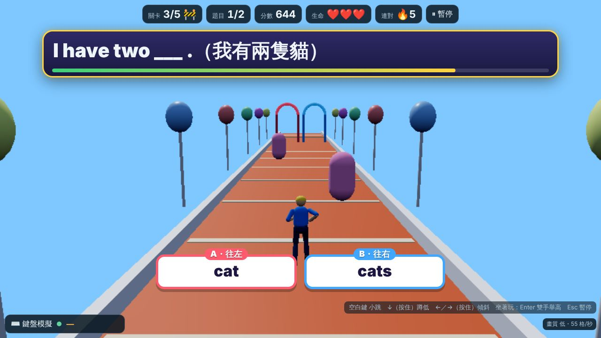

- **玩法**：人偶一路往前跑，題目出現的同時會來 2 個障礙：**低欄（小跳一下）**、**橫桿（蹲低）**、**軟墊（從哪邊來就往另一邊歪）**。閃過一個 +20 分；撞到只會踉蹌一下，**不影響答題**。最後兩道答案門，往左或往右傾選答案。
- **時間很寬鬆**：障礙前 1.8 秒畫面就出現橘色提示；動作只要在障礙前後大約 1 秒內做到就算（小跳：前 1.1 秒到後 0.35 秒）。
- **坐著玩**：低欄改成**圓環（雙手舉高）**、橫桿改成**軟墊（傾斜）**，不用跳也不用蹲。
- **跳的安全**：只要「小跳一下」、雙腳離地一點點；不想跳就勾「坐著玩」。

### ⚡ 原地衝刺

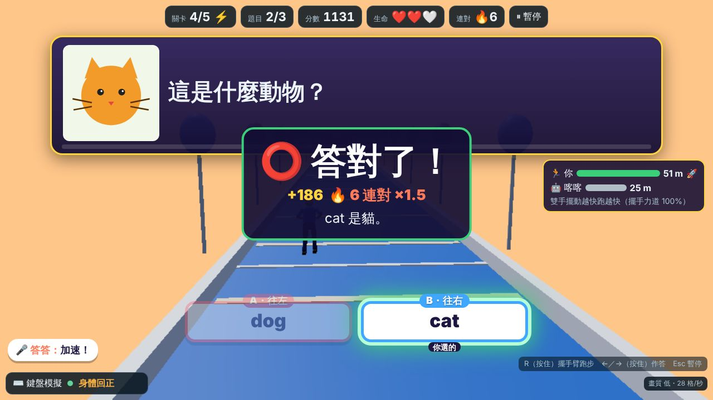

- **玩法**：和原創的機器人「閃電喀喀」賽跑。**雙手一上一下擺動**像在跑步（腳不用動，坐著也可以），擺越快跑越快。題目出現時**往左或往右傾、保持 0.6 秒**作答；答對**加速 3 秒**。整關結束時跑得比喀喀遠，+150 分。
- **數字**：速度＝ 1.2 ＋ 4.8 × 擺手力道（0～1）公尺／秒，加速時再 +2.5；喀喀 簡單 3.0、普通 3.6、挑戰 4.1 公尺／秒。擺手力道大約 0.5 以上就跑得贏簡單的喀喀。
- **延遲**：擺手力道是 0.6 秒內的平均，所以和鏡頭延遲、每秒幾格都無關。
- **「擺手」怎麼判斷**：在本資料夾用兩隻手腕的上下速度計算（左右手方向相反才算滿分），沒有改共用辨識器。鍵盤按住 R，模擬人偶就會擺手。

### 👾 Boss 題

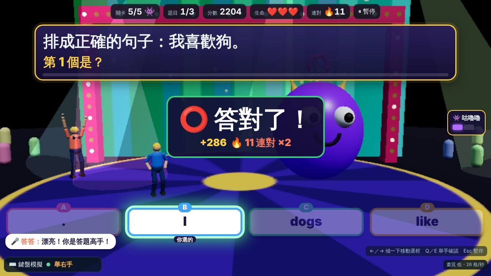

- **玩法**：原創的問號怪獸「**咕嚕嚕**」帶著題庫裡**最難的題目**出現。在 Boss 蓄力完之前：傾一下移動選框、舉一隻手確認（和搶答的選法一樣）。答對＝打中 Boss；答錯＝ Boss 噴泡泡（扣一顆生命）。
- **血量**：題數的 6 成（例如 5 題要打中 3 次），打倒 +300 分，剩下的題目就不用答了。題目用完還沒打倒，Boss「逃走了，下次再挑戰」，**沒有失敗畫面**。
- **數字**：蓄力時間 11 秒 × 難度倍數＋閱讀時間。
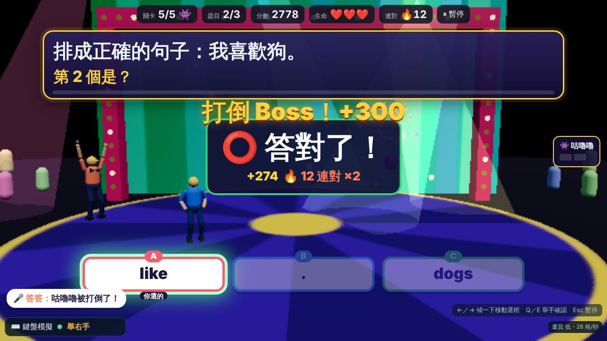

- **為什麼放最後**：很適合當一輪的結尾高潮，也能讓老師把「大家最常錯的題目」設成難度 3 給 Boss 用。

### 🔥 連擊加成、❤️ 生命與復活

- **連擊**：連續答對 3 題起每題 ×1.2、5 題 ×1.5、8 題 ×2；答錯就重新算。達到新的倍數時畫面會出現「🔥 5 連對！」。
- **生命**：一開始 3 顆 ❤️，答錯（或沒作答）少一顆。**生命用完不會出局**，而是馬上出現「**復活挑戰**」：12 秒內做一個小動作（輪流左右傾 4 次／雙手舉高 2 次／原地擺手 3 秒），做到就回滿 3 顆並 +50 分；沒做到「答答」也會送 2 顆，繼續玩。
- **為什麼這樣設計**：綜藝問答最怕「被淘汰後在旁邊看」，對小學生尤其無聊又難堪。復活挑戰把「答錯」變成一段好笑的身體小活動，也順便讓學生動一動、重新專心。分組模式（第三階段）會加上「隊友幫忙復活」。
- 選單可以分別關掉「連擊加成」「生命與復活」。

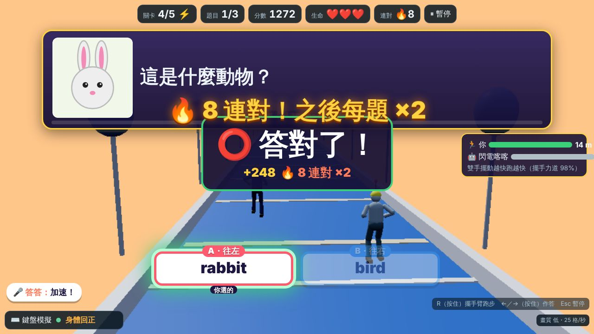
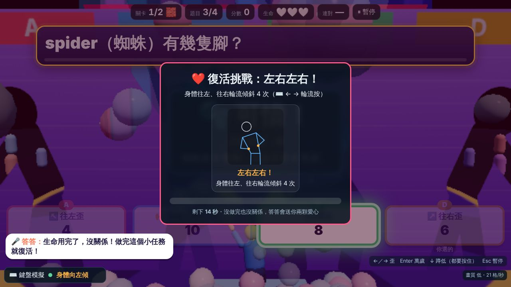

### 🎪 舞台氣氛與音效

- 出題時聚光燈會轉到玩家身上、背景燈牆變色；答對觀眾跳起來歡呼、彩帶；答錯泡泡噴出、主持人做出「哎呀」的動作。
- 音效全部即時合成：答對的鈴聲、柔和的答錯聲、搶答鈴、鎖定聲、鼓聲、閃過障礙的金幣聲、連擊音、Boss 登場的低音。背景節奏依關卡換：一般關卡輕快、賽跑類比較快、Boss 關是小調。
- 主持人「答答」的字幕在左下角（例如「衝刺！」「掉進泡泡池了！」），開啟「唸出題目」時會用裝置內建語音讀題目。
- 「減少閃爍與晃動」會停止燈光掃動、彩帶動畫與字幕彈跳。

## 四之二、團體模式（教室裡一台鏡頭、投影給全班看）

選單「⑥ 玩法」選擇。**每次只有一位同學在鏡頭前**（輸入層一次只追蹤一個人），其他同學在後面看投影、幫忙加油；每位同學玩**一關**（約 1 分鐘）就換人。

| 玩法 | 怎麼玩 | 適合 |
|---|---|---|
| 🆚 **分組對戰** | 2～4 隊（紅、藍、綠、黃）輪流派人上場：紅隊第 1 位 → 藍隊第 1 位 → … → 紅隊第 2 位…。每隊有自己的分數、連對和生命。最後依總分排名，而且**每一隊都會得到一個獎**（總分冠軍、答對率最高、最長連對、最會復活、最佳鬥志）。 | 複習課、班際活動 |
| 🤝 **全班合作打大 Boss** | 全班對抗一隻大魔王，畫面左邊一直顯示牠的血條。**不管誰答對，都打掉一格血**；血量是總題數的 6 成。全班共用生命。 | 班級向心力、不想讓學生互相比較時 |
| 🏃‍♀️ **接力** | 第 1 棒、第 2 棒…依序上場，全班一起累積答對題數和時間，挑戰**這台裝置上的班級紀錄**（同一份題庫）。 | 定期複習、看班級進步 |

- **換人畫面**：每一棒結束會顯示「剛才答對幾題」「下一位：🔵 藍隊第 2 位」「這一棒玩哪一關、怎麼玩」和目前比分。下一位站好後**雙手舉高 1 秒**，或老師按**空白鍵**開始。
- **同一場不會出重複的題目**（整場共用一副牌，題庫用完才會重來）。
- **全隊復活**：生命用完時，復活挑戰會寫「全隊一起做！」。鏡頭只看得到台上的同學，所以老師看到全隊都做完，可以按 **Y** 直接算成功。
- **只記隊名與棒次**，不記姓名。成績紀錄會存每一隊的總分。
- 老師鍵盤：**空白鍵**＝下一棒開始、**Esc／P**＝暫停、**Y**＝全隊復活完成；暫停畫面可以「跳過這一關」或「結束比賽」（直接看結果）。

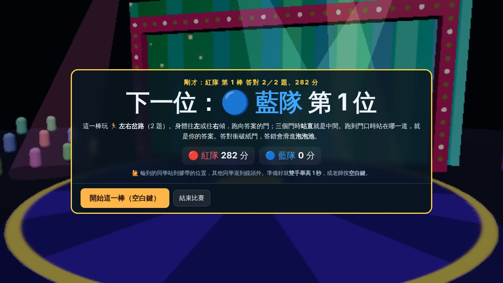
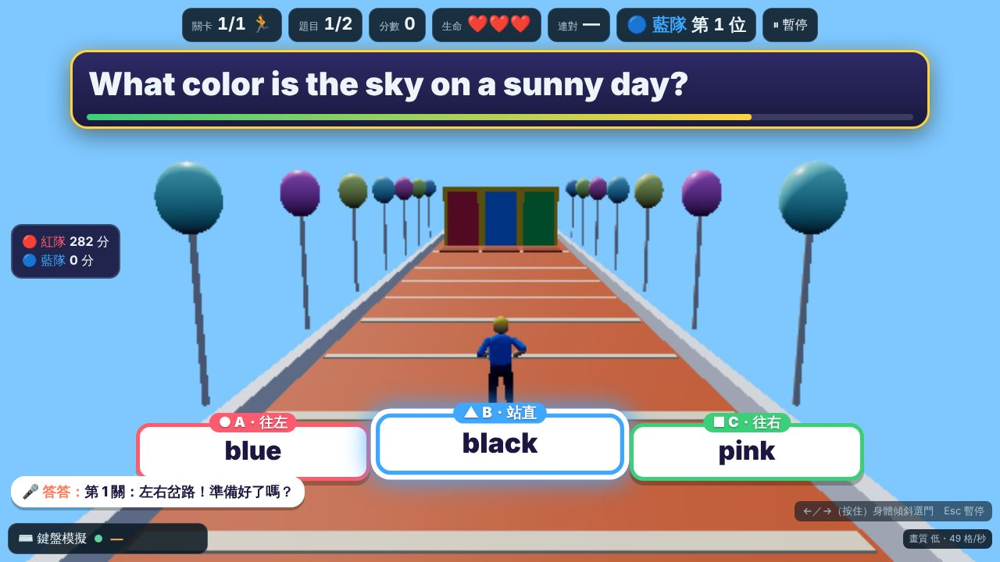
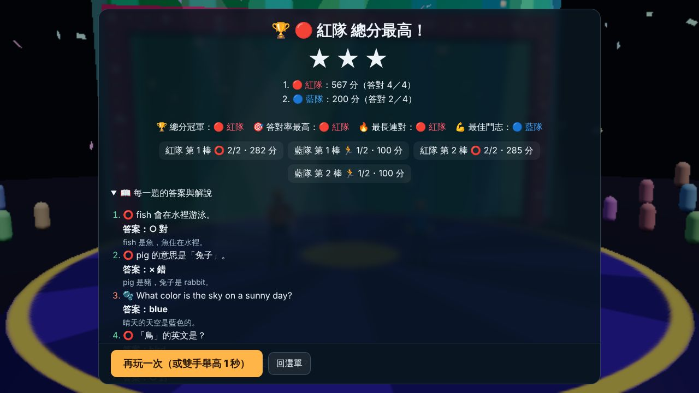
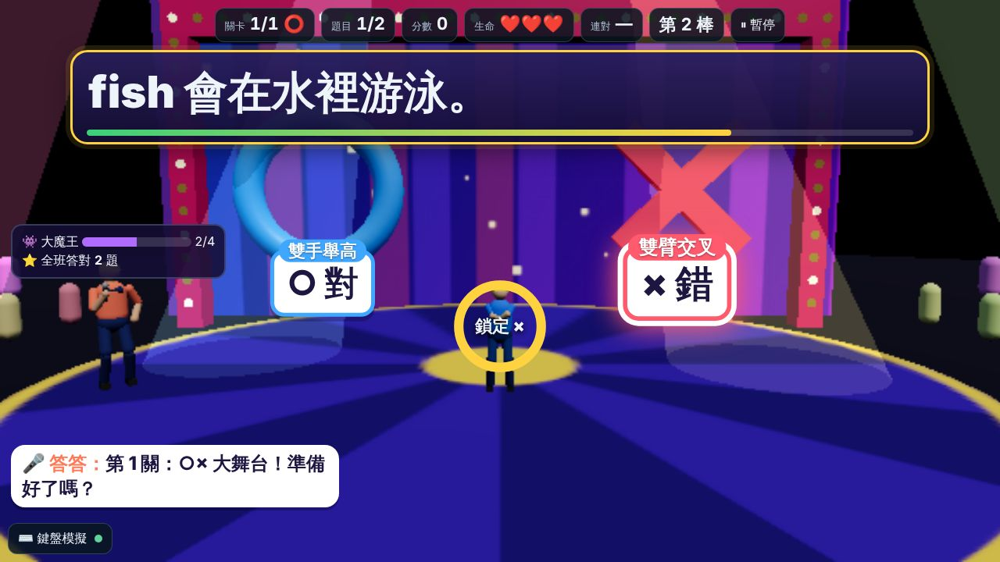

### 🏫 教室怎麼擺

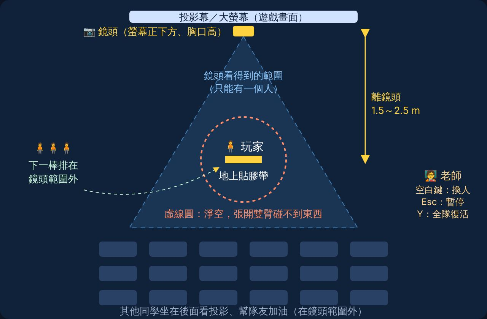

- **鏡頭放在投影幕／大螢幕正下方**、約胸口高度，對著玩家。這樣玩家看畫面時也正對鏡頭。
- 地上貼一條**膠帶**標出玩家位置（離鏡頭約 2 公尺），周圍張開雙臂碰不到東西。
- **排隊的同學站在鏡頭範圍外的兩側**（鏡頭看到兩個人時，輸入層會提示「請只留一位玩家」）。
- 其他同學坐在後面看投影。老師在旁邊用鍵盤（空白鍵、Esc、Y）。
- 選單「⑥ 玩法」底下也有這張圖（「🏫 教室怎麼擺」）。

### 📽️ 投影大字、◐ 高對比

- **投影大字**：題目、選項、主持人字幕放大，隱藏「格/秒」、按鍵說明這些小字，最後一排也看得清楚。
- **高對比**：深色底白字、面板不透明、選項框更粗、答錯的選項加刪除線（不只靠顏色）。

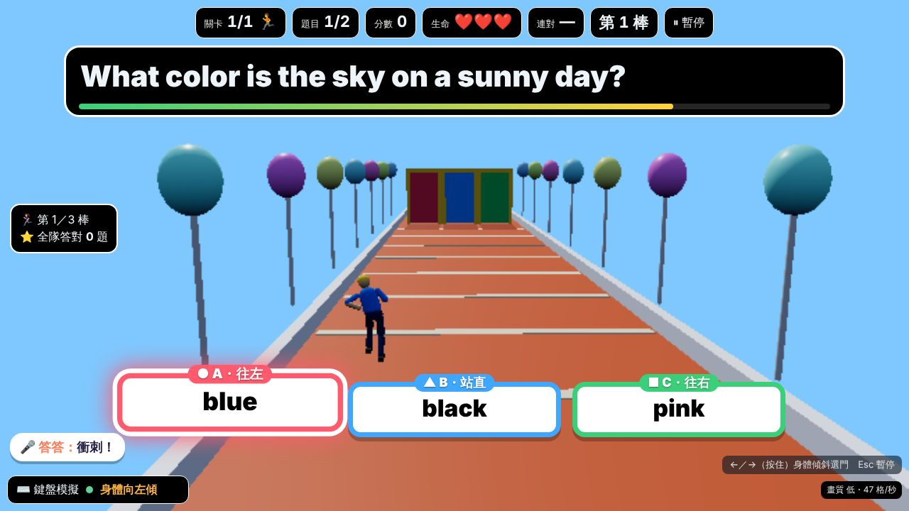

## 四之三、AI 轉題（只做格式與提示詞，沒有串接）

編輯器的「🤖 用 AI 轉題」分頁：貼上教材 → 產生提示詞 → 老師複製到**自己選用的 AI 工具** → 把回覆貼回來，編輯器會找出 JSON、用同一套規則檢查並加入題庫。**網站不會把教材送到任何地方。** 完整說明、提示詞範本、JSON Schema 與之後串接學校自己 AI 服務的接口，見〈[用 AI 把教材轉成題目](quiz-ai.md)〉。

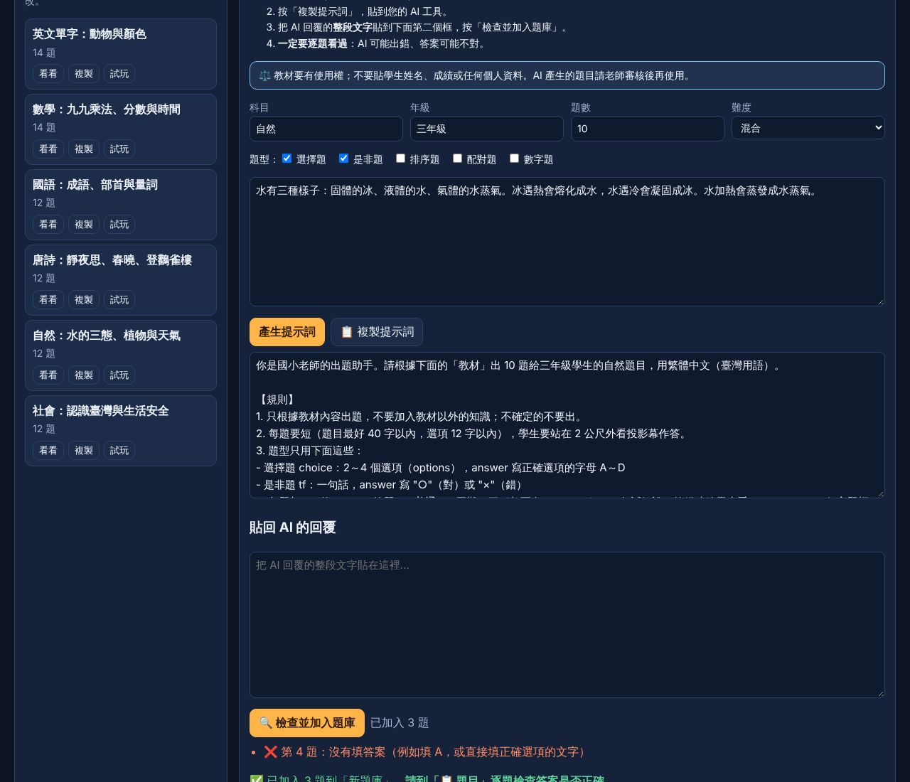

## 四之四、效能與無障礙

**效能**

- 3D 場景全部是簡單幾何形狀；平板自動用「低」畫質（不開反鋸齒、觀眾和彩帶數量減半、解析度 75%），並依實際格數自動調整解析度（和其他遊戲一樣）。
- 舞台背景燈牆的貼圖在平板上每秒只重畫 15 次；觀眾只有在歡呼時才更新位置；沒有彩帶、泡泡在飛的時候特效完全不計算。
- 各關卡的場景第一次用到才建立；題庫範例和圖片都是小檔案（6 份範例共約 30 KB，內建圖庫是程式畫的）。

**無障礙**

- 每個需要動作的地方都有替代：坐著玩（不用蹲、跳）、○× 改成左右傾、搶答改成舉一隻手；平衡橋掉兩次就沒有風；生命用完不出局。
- 選項除了顏色，還有**形狀 ●▲■★ 和字母 A～D**，色盲的同學也分得出來。
- 「減少閃爍與晃動」：停止燈光掃動、彩帶與字幕動畫；裝置有開「減少動態效果」時**預設就會打開**。
- 投影大字、高對比（見上）。
- 唸出題目時也會唸選項（「A，貓。B，狗」）；不依賴語音，所有字都在畫面上。
- 題目區有朗讀器用的即時區塊（螢幕報讀軟體會唸出新題目與答對答錯）；所有按鈕都能用鍵盤 Tab 操作，焦點有明顯的黃框。

## 五、做了哪些決定（標 ✏️ 的是「這是我的選擇，可以改」）

| # | 決定 | 理由 |
|---|---|---|
| 1 | ✏️ 遊戲名稱「體感闖關問答」、主持人「答答」、舞台與造型全部原創 | 依需求不使用、不模仿任何現有節目的名稱、標誌、角色、主持人、布景或音樂；只借「玩法機制」（選門、○×、搶答）。 |
| 2 | **本款有自己的流程控制**（`src/quiz/game.js`），**沒有掛在共用外殼 `src/game/shell.js` 上** | 外殼的設計是「一場連續的比賽＋一個 3D 世界（海或球場）」，而且外殼把「雙手舉高 1 秒」固定成暫停；問答遊戲需要多關卡流程、題庫選單、編輯器，而且雙手舉高是**作答**。為了不改共用檔（避免和其他人衝突），本款另寫流程，但沿用相同的習慣：先出現「怎麼玩」、雙手舉高 1 秒＝開始／繼續、暫停後倒數 3 秒、看不到人自動暫停、同一套鍵盤模擬與人偶、同一份樣式（`game/game.css`）、同樣的畫質分級。 |
| 3 | ✏️ 遊戲中**暫停**用畫面上的「⏸ 暫停」、Esc 或 P 鍵，或離開鏡頭 | 因為雙手舉高在遊戲中是作答。暫停畫面裡仍然可以雙手舉高 1 秒繼續。 |
| 4 | **不改共用辨識器**：「雙臂交叉」在本遊戲資料夾裡用輸入層提供的「手的位置」判斷 | 依需求（有人在改辨識器的延遲）。做法跟釣魚的「手畫圈」一樣。鍵盤模擬時按住 X，模擬人偶真的會交叉手臂，走同一套判斷。 |
| 5 | ✏️ 選項最多 4 個 | 身體動作能穩定分辨的上限。 |
| 6 | ✏️ 排序、配對題拆成一格一格問 | 用身體一次排 4 個項目很難；一格一格問，每一步都是 2～4 選 1，所有關卡都能玩。 |
| 7 | ✏️ 數字題自動出錯誤選項（接近的數、位數錯、數字對調） | 老師只要寫答案就好；自己寫的錯誤選項優先使用。 |
| 8 | 題庫與圖片存在**瀏覽器的 IndexedDB**，設定存 localStorage | 不需要伺服器、不上傳；容量比 localStorage 大很多，放得下圖片。無痕視窗不能長期保存時，編輯器會警告。 |
| 9 | ✏️ 上傳的圖片自動縮成最長邊 800 像素的 JPEG | 一份 50 張圖的題庫大約只有幾 MB，匯出的檔案可以用 email 傳。 |
| 10 | ✏️ 星星：答對 80% 以上 3 顆、50% 以上 2 顆，**其他至少 1 顆** | 玩完就值得鼓勵，不讓學生難堪。 |
| 11 | ✏️ 計分：答對 100 分＋速度加分（搶答最多 +100、○× 最多 +50、岔路衝刺 +30、Boss 最多 +50），答錯 0 分、不倒扣；唯一會扣分的是平衡橋掉下去（−20） | 「掉下去」是身體動作的結果，扣一點點分讓平衡有意義，但不會扣到負分。 |
| 17 | ✏️ 穿牆的 4 個姿勢固定「左歪、萬歲、蹲低、右歪」由左到右排列 | 洞的位置和姿勢方向一致，不用記；都是輸入層原本就會判斷的大姿勢。 |
| 18 | ✏️ 平衡過橋掉兩次後就沒有風 | 避免動作比較不協調的學生卡在同一題、一直掉。 |
| 19 | ✏️ 閃避的「小跳」可以用坐著玩取代 | 需求提到跳與蹲；教室裡跳躍有風險，所以只要求小跳，並提供完全不用跳的替代。 |
| 20 | ✏️ 原地衝刺用「擺手」而不是「抬腿」判斷跑步 | 平板鏡頭在胸口高度、常常拍不到腳，坐著的學生也沒辦法抬腿；擺手站著坐著都能做。 |
| 21 | ✏️ 生命用完不出局，改做「復活挑戰」；沒做到也送 2 顆 | 需求：不淘汰到無聊、可以靠小任務復活。 |
| 22 | ✏️ Boss 自動挑題庫裡難度最高的題目 | 老師不用另外設定；想讓某題當 Boss 題，把難度設成 3 就好。 |
| 23 | ✏️ 主持人與對手都是原創：「答答」（主持人）、「閃電喀喀」（賽跑機器人）、「咕嚕嚕」（Boss） | 不模仿任何現有節目或作品的角色。 |
| 24 | ✏️ 團體模式每人玩「一關」再換人，而不是每題換人 | 每題換人（約 10 秒）在教室會太亂；一關約 1 分鐘，換人時間佔比合理，排隊也不會等太久。 |
| 25 | ✏️ 分組對戰「每一隊都有獎」 | 小學生的比賽重點是參與；只有冠軍有獎，最後一名的隊伍會很難過。 |
| 26 | ✏️ 全班合作的大魔王血量是總題數的 6 成 | 全班答對六成就能打倒，讓大家有成功經驗；想更難可以用「挑戰」難度或多一點題目。 |
| 27 | ✏️ 接力紀錄只存在這台裝置、依題庫分開 | 不需要帳號或伺服器；換題庫就是新的挑戰。 |
| 28 | 全隊復活由老師按 Y 確認 | 鏡頭一次只追蹤一個人，看不到台下同學；與其假裝偵測，不如讓老師判斷。 |
| 29 | **AI 只提供提示詞和格式，不串接** | 依需求；也避免教材和學生相關資料在學校不知情下送到外部服務。接口已預留（`generateWithAI`），沒有設定就完全不會送出。 |
| 30 | ✏️ 真正「同時搶答」（兩個人同時在鏡頭前）**沒有做** | 輸入層一次只追蹤一個人；要做需要每隊一台裝置或改輸入層。分組對戰改成輪流上場、比速度加分。 |
| 12 | 語音朗讀用**瀏覽器內建語音**，預設關閉 | 有些平板沒有中文語音；遊戲完全不依賴它，所有字都在畫面上。 |
| 13 | 字型只用**系統字型** | 倉庫裡目前**沒有任何 OFL 字型檔**，所以不放字型檔；Windows、iPad、Chromebook 的內建中文字型都能正常顯示。 |
| 14 | 音效全部用 **Web Audio 即時合成** | 依需求，不用任何錄音或外部音效。答錯的聲音刻意做成柔和的卡通「啵～」，不是刺耳的錯誤聲。 |
| 15 | 成績紀錄只存「座號或暱稱」，可以清除、可以下載 CSV | 學生是未成年人，不存姓名；選單上提醒不要填真實姓名。 |
| 16 | 首頁只加一張卡片（和一個小標題），`docs/index.html` 加一個「闖關問答」分頁 | 依需求盡量不改共用檔，改動只有這兩處，見 PR 說明。 |

## 六、隱私與安全

- **鏡頭畫面只在裝置上分析**，不錄影、不上傳（和其他遊戲同一套輸入層）。
- **題庫、圖片、成績都只存在這台裝置**，程式裡沒有任何上傳的功能。
- 安全提示（選單裡「開始前安全檢查」）：鏡頭在胸口高度、玩家離 1.5～2.5 公尺、周圍淨空、一次一人、可以坐著玩（只動上半身）、**這款不需要跑和跳**、每輪 3～6 分鐘、每人連續玩不超過 5 分鐘。
- 選門用「身體傾斜」而不是「真的往旁邊跑」，教室裡比較安全。
- 會用到大一點動作的只有：閃避障礙的**小跳**和**蹲低**、穿牆的**蹲低**。都可以勾「坐著玩」完全換掉。
- 原地衝刺只擺手臂、腳不動；擺手時兩側要淨空（手臂會往前後擺）。

## 七、自我測試結果（在雲端做的）

| 測試 | 方法 | 結果 |
|---|---|---|
| 6 份範例題庫 | 自動檢查格式、授權欄、涵蓋 6 種題型 | ✅ 全部正確、沒有任何警告 |
| 貼上文字 | 題號、`*` 標記、`答案：`、是非 ○×、配對、排序、數字、(1) A) 等寫法 | ✅ 全部讀對 |
| 白話錯誤訊息 | 少選項、是非答案看不懂、答案字母不存在、JSON 少逗號、CSV 第一行不對 | ✅ 都指出「第幾題、第幾行、哪裡錯」 |
| CSV／JSON | Excel 的 BOM、儲存格裡有逗號／引號／換行、試算表貼上的 TSV；6 份題庫匯出再匯入 | ✅ 內容完全相同；JSON 帶圖片 |
| 轉成遊戲步驟 | 每一題都變成 2～4 選 1、正確答案標對、沒有重複選項；排序、配對逐格正確 | ✅ |
| 抽題 | 不重複、是非關優先抽是非題、標籤篩選、篩完沒題目時改用全部 | ✅ |
| 模擬學生（知道全部答案、反應 2 秒、鏡頭延遲 0.35 秒） | 3 種難度 × 6 份題庫，每輪 12 題 | ✅ 全對、3 顆星、每輪都在 6 分鐘內 |
| 模擬學生（只會一半／全都不會） | | ✅ 正確率約 45～85%；全都不會也能玩完、拿 1 顆星 |
| 都不動的玩家 | | ✅ 遊戲照常結束 |
| 鏡頭延遲 | 延遲 0.1、0.35、0.6 秒的模擬學生玩岔路 | ✅ 全對（延遲不影響答案） |
| ○× 誤觸 | 手每秒舉起 0.3 秒（不夠久） | ✅ 不會鎖定；保持 0.5 秒才鎖定 |
| 搶答 | 越早搶分數越高；導火線燒完＝不作答；選答案時間到用選框位置 | ✅ |
| 真的辨識器 | 模擬人偶（鍵盤 X）交叉手臂 → 輸入層 → 判斷成 ×；休息、舉手、傾斜都不會誤判成 × | ✅ |
| 第二階段 5 種關卡 | 模擬學生（知道答案、反應 2 秒）× 3 種難度 × 6 份題庫 × 鏡頭延遲 0.35／0.6 秒 | ✅ 全部答對；每關都在 2.5 分鐘內 |
| 都不動的玩家（5 種新關卡） | | ✅ 每一關都會結束（平衡橋掉兩次後沒有風） |
| 穿牆 | 洞的順序、坐著玩沒有蹲低、姿勢判斷的優先順序 | ✅ |
| 平衡過橋 | 延遲 0.6 秒的模擬學生在挑戰級玩 10 次；站著不動；掉下去扣 20 分、答案重選 | ✅ 10 次共掉 0～3 次；不動會掉；扣分正確 |
| 閃避障礙 | 會閃的學生 8 個障礙全閃過；不閃的學生只踉蹌、4 題照樣答對；坐著玩只有圓環和軟墊 | ✅ |
| 原地衝刺 | 擺手力道 0.7 三種難度都贏；不擺手都輸（但能玩完） | ✅ |
| Boss | 5 題答對 3 題就打倒（+300）、剩下的不用答；全錯 Boss 逃走、噴 5 次泡泡；Boss 優先拿難度高的題目 | ✅ |
| 連擊、生命、復活 | 倍數 ×1.2／×1.5／×2；3 次答錯開始復活挑戰；做到 3 顆＋50、沒做到 2 顆，之後遊戲繼續；3 種復活任務 | ✅ |
| 真的辨識器 | 模擬人偶（鍵盤 R）擺手 → 輸入層 → 擺手力道 0.5 以上；站著不動、左右傾都不算擺手 | ✅ |
| 分組對戰 | 3 隊 × 2 輪：上場順序、每隊分數加總、程度好的隊伍贏、每隊都有獎、整場不重複出題、生命跟著隊伍走 | ✅ |
| 全班合作 | 會的全班打倒大魔王、不會的打不倒；全隊復活由老師確認 | ✅ |
| 接力 | 依序上場、全班答對題數加總 | ✅ |
| AI 接口 | 提示詞包含格式、題型、教材與「不用真實姓名」；AI 回覆夾帶說明文字與 ``` 也讀得出來、壞題被擋下；沒有設定時不會送出任何東西 | ✅ |
| 其他遊戲 | 原有測試 | ✅ 遊戲測試共 97 項（含本款 49 項）、輸入層 15 項，全部通過 |
| 實際瀏覽器（雲端無顯示卡、軟體繪圖） | 怎麼玩 → 選單 → 3 關 12 題全部用鍵盤玩完（故意每 3 題答錯 1 題）→ 結算；左右方向檢查 | ✅ 沒有錯誤訊息；答對 9／12；按 ← 人偶走左門、在攝影棚舉左手時人偶舉畫面左邊的手 |
| AI 轉題分頁 | 貼上教材 → 產生提示詞；貼上一段夾帶說明文字的 AI 回覆（其中 1 題故意少答案） | ✅ 3 題加入題庫、壞題用白話說明原因 |
| 效能 | 同一台雲端瀏覽器、低畫質、攝影棚畫面 8 秒：舞台更新與繪圖時間，改善前 vs 改善後 | 繪圖 153 → 140 毫秒（約少 8%）；程式本身每秒只花 1～2 毫秒，真正的負擔在繪圖。數字只能看相對值 |
| 實際瀏覽器：團體模式 | 分組對戰 2 隊 × 2 輪、全班合作（投影大字）、接力（高對比）都用鍵盤從選單玩到結果 | ✅ 換人畫面、即時比分、大魔王血條、結果與獎項都正常，沒有錯誤訊息 |
| 實際瀏覽器：第二階段 | 5 種新關卡用鍵盤玩完；故意全錯觸發 2 次復活挑戰並完成 | ✅ 沒有錯誤訊息；連擊、生命、Boss 血量、平衡指針、障礙提示、賽跑進度都正常顯示 |
| 編輯器 | 新題庫 → 上傳圖片 → 貼上 5 題（其中 1 題故意少答案）→ 新增排序題 → 匯出 JSON → 匯入 → 在遊戲裡選這份題庫 | ✅ 有錯的那題被擋下並說明原因；匯出含圖片；匯入後可以玩 |

雲端軟體繪圖約每秒 25～50 格（低畫質），真的平板會更順；截圖是雲端畫的，所以邊緣比較粗。

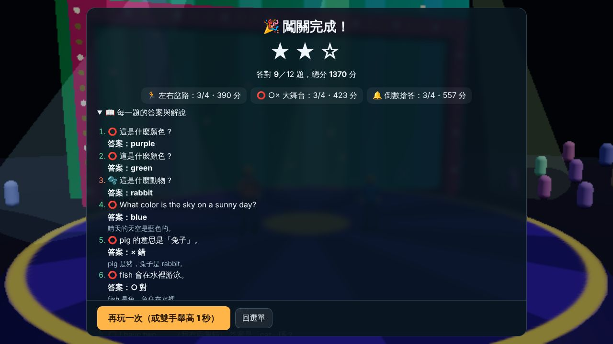

## 八、雲端沒辦法驗證、需要真機測的項目

1. **雙臂交叉（×）**：請在「輸入層測試頁」或遊戲 ○× 關，真人交叉手臂看是否會鎖定 ×。特別注意：坐著、手臂交叉很低（在肚子前）、只是雙手合十，是否都算？會不會在抱胸、整理衣服時誤觸？
2. **雙手舉高（○）與搶答**：學生搶答後手放下、再舉一隻手確認，這個流程順不順？會不會在放下手時誤觸確認？
3. **身體傾斜選三道門**：站直＝中間門。學生是否會不自覺歪一邊？鏡頭不正對時是否偏向某一邊？（輸入層會自動校正，但請實測）
4. **閱讀時間**：國語、唐詩這種字多的題目，三年級學生來得及讀嗎？
5. **投影與教室擺法**：投影到大螢幕時，最後一排看得清楚題目和選項卡嗎？鏡頭放在螢幕下方，學生站 2 公尺時是否全身入鏡、排隊的同學會不會被拍到？
6. **語音朗讀**：學校的平板／電腦有沒有中文語音？唸得清楚嗎？
7. **音效音量**：教室喇叭是否合適，答錯的聲音是否會讓學生覺得被嘲笑。
8. **平板效能**：右下角「格/秒」，25 以上算順。
9. **穿牆的蹲低**：站著蹲低時肩膀下降夠不夠被判斷成「蹲低」？會不會和「往左／右歪」混淆？
10. **平衡過橋**：真人傾斜時指針好不好控制？風會不會太強？（可以先用簡單難度）
11. **原地擺手**：真人擺手（站著、坐著）的「擺手力道」大約多少？請看賽跑關右邊的百分比，**50% 以上**才跑得贏簡單的喀喀；太難的話請告訴我數字。
12. **小跳**：學生是不是真的只小跳？教室地板、桌椅距離是否安全？
13. **團體模式的換人**：換人時間（走位、退到鏡頭外）實際要多久？輸入層每次換人會重新校正（約 1 秒站好不動），請觀察會不會誤判。
14. **兩個人同框**：排隊的同學不小心入鏡時，是否會出現「請只留一位玩家」、會不會追蹤到錯的人。
15. **投影大字**：在您教室的投影機上，最後一排看得清楚嗎？高對比模式是否需要。
16. **AI 工具**：您選用的 AI 工具照提示詞產生的 JSON，貼回來能不能直接讀進去（請回報讀不進去的例子）。
17. **IndexedDB**：學校電腦若有「關機還原」或定期清除瀏覽器資料，題庫會不見，請先確認並記得匯出備份。

## 九、之後怎麼加新的關卡類型（給資訊人員／開發者）

一個關卡類型 = **規則**（純邏輯，可以在 node 測試）＋ **畫面**。

1. 在 `src/quiz/levels/` 新增一個檔案，照 `run.js` 的樣子：繼承 `StepLevel`，寫 `startStep(step)`（每題開始）和 `answerUpdate(dt, input)`（每一格；決定好答案就回傳 `{ choice, bonus }`）。輸入只有「輸入格」（`src/quiz/input.js`：傾斜、舉手、交叉、蹲、事件…），不直接讀鏡頭或鍵盤。
2. 匯出一個描述物件：`id`、`title`、`icon`、`rule`（給學生看的規則）、`howto`（小人動畫卡）、`maxOptions`、`prefer`（喜歡哪些題型）、`prepare`（把題目轉成這一關要的樣子）、`create`。
3. 在 `src/quiz/levels/index.js` 的 `LEVELS`、`LEVEL_ORDER` 加上它。
4. 在 `src/quiz/views/` 寫畫面（`show`、`hide`、`onStep`、`update`、`anchors`），並加到 `views/index.js` 的 `VIEWS`、`LAYOUT`、`KEYS`。
5. 在 `tests/quiz.test.mjs` 加模擬學生的測試：至少要「知道答案的學生全對」「延遲 0.6 秒也對」「不動的玩家遊戲會結束」。
6. 確認「用現有動作就能玩」：只能用輸入層已有的事件，或在本資料夾用手的位置判斷的新姿勢（並做鍵盤模擬）。

## 十、檔案

| 位置 | 內容 |
|---|---|
| `quiz/index.html`、`quiz/quiz.css` | 遊戲頁 |
| `quiz/editor.html`、`quiz/editor.css` | 題庫編輯器 |
| `src/quiz/bank.js`、`csv.js` | 題庫格式：解析、檢查、匯出、轉成遊戲步驟 |
| `src/quiz/session.js` | 一輪遊戲：抽題、關卡順序、計分 |
| `src/quiz/levels/` | 各關卡規則 |
| `src/quiz/views/`、`stage.js` | 3D 舞台與各關卡畫面（three.js、陸地系列人偶） |
| `src/quiz/input.js` | 輸入格、雙臂交叉判斷、鍵盤模擬補動作 |
| `src/quiz/art.js` | 內建圖庫（程式畫的 SVG） |
| `src/quiz/store.js`、`library.js` | 本機儲存（IndexedDB）與題庫清單 |
| `src/quiz/sfx.js` | 合成音效與語音朗讀 |
| `src/quiz/match.js` | 團體模式：分組對戰、全班合作、接力 |
| `src/quiz/ai.js`、`docs/quiz-ai.md`、`data/quiz/schema.json` | AI 轉題的提示詞、讀取 AI 回覆、預留接口、題庫 JSON Schema |
| `src/quiz/classroom.js` | 教室擺法圖 |
| `src/quiz/game.js`、`editor.js`、`howto.js` | 遊戲流程、編輯器、怎麼玩動畫 |
| `data/quiz/` | 6 份原創範例題庫 |
| `tests/quiz.test.mjs`、`quiz-levels.test.mjs`、`quiz-group.test.mjs` | 自動測試（題庫與前 3 關、後 5 關與連擊復活、團體模式與 AI） |

## 十一、我覺得最值得做的方向與風險（給決策者）

**最值得做的方向**

1. **「老師 5 分鐘做好一份題庫」是這個產品最大的賣點**，比關卡數量更重要。老師最常有的是 Word 講義和 Excel 題目表，所以「貼上文字」和「CSV」要一直做到最順；下一步建議做「從學習單照片／PDF 轉文字」（仍然在本機，不上傳）和「題庫分享頁」（老師互相分享 .json）。
2. **把結算的「答錯清單」變成教學工具**：全班玩完後，列出「全班最多人答錯的 3 題」給老師講解，這是體感遊戲少見、但老師最需要的「形成性評量」。資料只在本機就做得到。
3. **團體模式是學校買單的理由**：一台筆電＋投影＋一個鏡頭就能整班玩，對設備有限的學校很實際。建議下一步做「每隊一台平板」的真正同時搶答（需要區網連線或改輸入層，要另外評估隱私）。
4. **和課程綁在一起賣**：每個年級、每個科目一套「原創題庫包」（像內建範例那樣），比賣遊戲本身更容易被學校採用。

**風險**

1. **鏡頭辨識在真實教室的穩定度**（背光、制服顏色、桌椅擋住下半身、排隊同學入鏡）。所有關卡都設計成「保持姿勢」而不是「瞬間反應」，但真機測試結果可能需要調整門檻；這是上線前最重要的驗證。
2. **著作權**：老師把課本、參考書內容做成題庫並互相分享，是最可能出問題的地方。編輯器已有提醒與勾選確認，但如果之後做「公開分享平台」，就需要檢舉下架機制與法律意見。
3. **AI 轉題**：AI 可能出錯，而且把教材送到外部 AI 服務牽涉資料使用條款。目前刻意只做提示詞；真的要串接，建議由學校或公司自己的後端代管、不記錄內容。
4. **兒少隱私**：目前完全不收資料（只有座號／暱稱存在本機）。若之後要做雲端成績、班級帳號，就要處理家長同意與個資法，成本會大幅增加。
5. **教室安全**：大部分動作都很小，但「閃避」的小跳和蹲、排隊動線仍要老師管理。建議出貨時附一張可列印的「教室擺法與安全守則」海報（可以用本文件的教室擺法圖）。
6. **體感遊戲的新鮮感會下降**：所以題庫（內容）要一直更新，而且關卡要保持「答題為主、動作為輔」，避免變成只比誰動得快。
