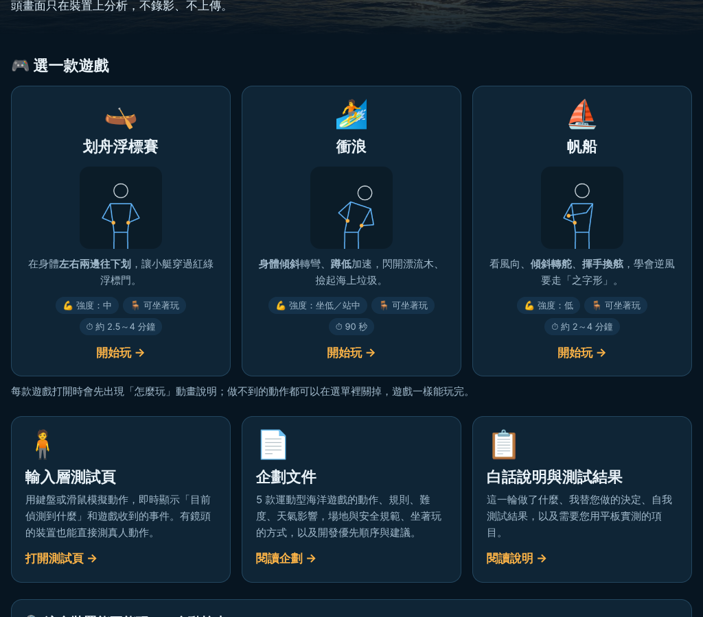
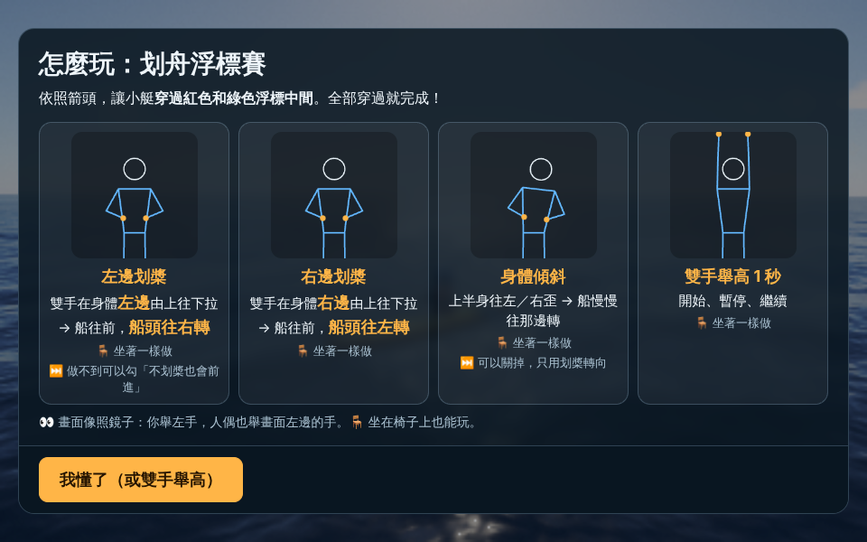
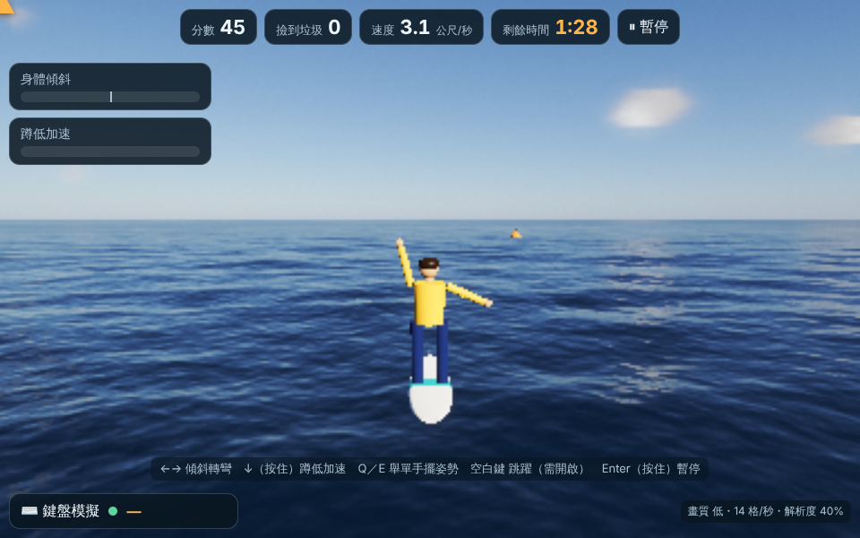
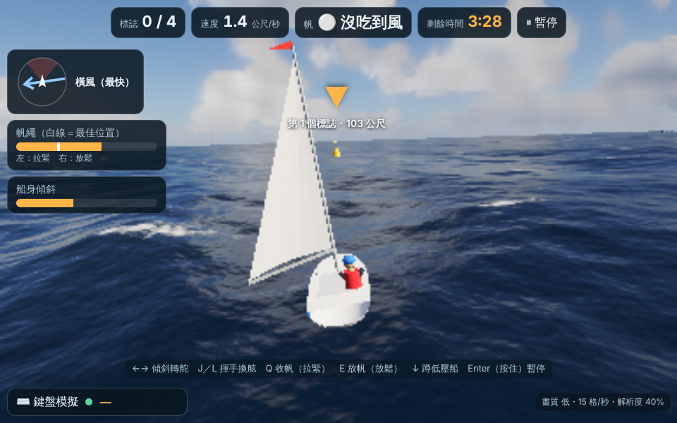
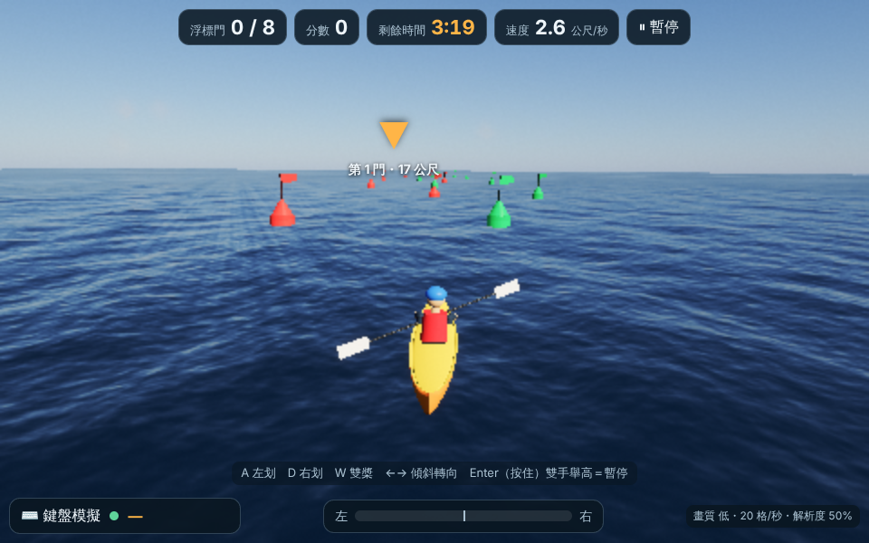
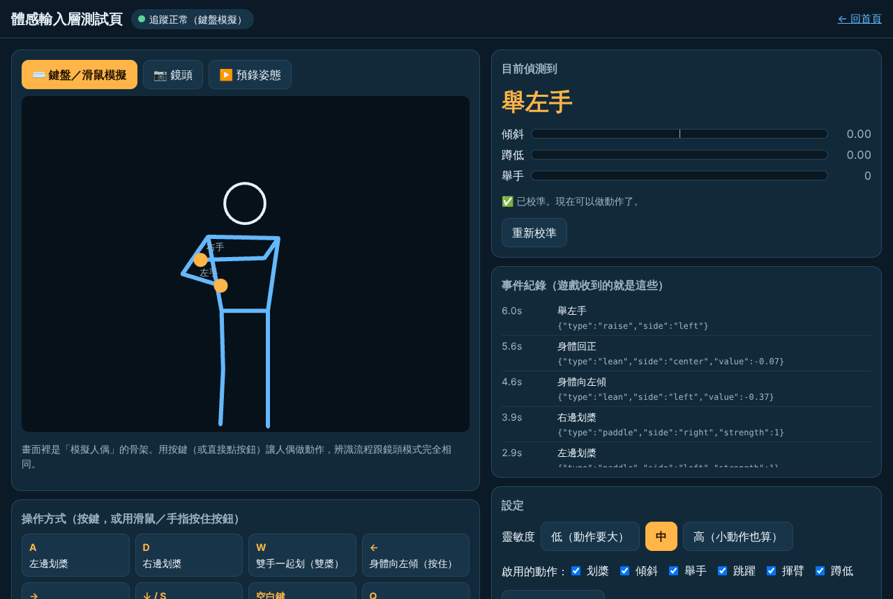

# 白話說明與自我測試結果

> 給老師看的「做了什麼、我替您做的決定、測了什麼、還要您用平板實測什麼」。最新一輪在最上面，第一輪的紀錄保留在最後。

## 第二輪：衝浪、帆船、首頁整合、模型自架

### 一、這一輪做了什麼

1. **兩款新遊戲（可玩）**
   - 🏄 **衝浪**：身體傾斜轉彎、蹲低（坐著就身體往前彎）加速、舉單手擺花式姿勢。閃開漂流木和礁石，**撿起海上垃圾**（寶特瓶、浮球）。撞到落水 2 秒後自動站回板上，分數不歸零。一場 90 秒。
   - ⛵ **帆船**：傾斜轉舵、揮手換舷、舉左手拉緊帆／舉右手放鬆帆、陣風時蹲低壓船。帆變**綠色**＝吃到風、**灰色**＝沒吃到風；左上角風向圖的紅色扇形是「開不動區」，逆風要走之字形。依序繞過黃色標誌後穿過終點門。
   - 兩款都有三級難度（＝三種天氣）、「坐著玩」開關、每個動作都能在選單關掉並由遊戲自動代替，也都遵守安全規範（看不到人自動暫停、雷電關閉、跳躍預設關閉）。
2. **三款共用同一個遊戲外殼**：選單、怎麼玩、暫停、結算、鏡頭跟隨、畫質分級都一樣，學生學會一款，其他兩款的操作方式就一樣。
3. **首頁整合**：首頁一進來就是「選一款遊戲」，三張卡片各有一個會動的小人示範主要動作，並標出強度、可坐著玩、一場多久。
4. **給學生看的「怎麼玩」畫面**：每次打開遊戲會先出現。每個動作一張卡片，小人會一直重複示範（小人就是鍵盤模擬用的那個模擬人偶，所以示範的動作就是鏡頭要看的動作），旁邊寫「做這個 → 遊戲裡會怎樣」，並標出「🪑 坐著怎麼做」「⏭️ 做不到可以關掉」。學生**雙手舉高 1 秒**就能關掉說明，不需要碰平板。被關掉的動作不會出現在說明裡。
5. **姿態模型改放在我們自己的網站**（詳見第三節）。首頁另外加了「📶 測試學校網路」按鈕。
6. **依企劃書的共同原則補強三款遊戲**：
   - 暫停後繼續會先倒數 3、2、1。
   - 新增「減少晃動」選項：鏡頭不跟著浪起伏，給容易暈的同學。
   - 一人一機：鏡頭同時看到兩個人時，會追蹤比較靠近的那位，並提示「鏡頭前有兩個人，請只留一位玩家」。
   - 用鏡頭玩時，右下角有「鏡頭看到的你」小窗，只畫骨架線條，不顯示影像。

### 二、我替您做的決定與理由

| 決定 | 理由 |
|---|---|
| 依您指定先做衝浪、帆船，**掌舵救援順延** | 企劃書原本排第 3 的是掌舵救援，但這一輪您指定衝浪與帆船，所以照您的指定。企劃書第 6 節已註明。 |
| **不新增動作事件**，用既有的 6 種組合 | 衝浪、帆船需要的動作（傾斜、蹲低、舉單手、揮手）輸入層都有了。事件越少，學生要記的越少，誤判也越少。各遊戲怎麼用這些事件，已寫進輸入層 README。 |
| 衝浪「撿貝殼」改成「**撿海上垃圾**」 | 貝殼不會浮在海面上；撿垃圾比較合理，也能順便談海洋保育。 |
| 衝浪板**不能轉回頭**（最多偏 65°） | 衝浪本來就是順著浪前進；限制方向也讓學生不會轉迷路。 |
| 帆船用「**舉左手＝拉緊、舉右手＝放鬆**」調帆，換舷用「**揮手**」自動完成 | 企劃書只寫「舉手收放帆繩」；我固定左緊右鬆，並且每舉一次調一格，比要求學生維持某個手臂角度更穩定、更容易判斷。換舷是比較難的操作，揮一下就自動完成，學生只要決定「什麼時候換」。 |
| 帆船挑戰級**航段改短** | 原本模擬玩家在 180 秒內完成不了（最後一段常變成長距離逆風）。改短並把終點設在最後一個標誌附近後，模擬玩家約 110～130 秒完成，留給學生的餘裕約 1.5 倍。 |
| 「怎麼玩」**每次開遊戲都出現** | 您不會在現場逐一解說；每次都出現能確保輪到的每位學生都看過。學生舉雙手 1 秒就能跳過，不浪費時間。 |
| 衝浪改用比較大的湧浪（從背後推來） | 原本的「風平浪靜」對衝浪來說太平，看不出在乘浪。 |

### 三、姿態模型改放在自己的網站：已經做了

**決定：做，並保留外部網站當備援。**

- **為什麼**：學校網路（防火牆、內容過濾）常常擋掉 jsdelivr、googleapis 這類外部網站。之前鏡頭模式一定要從這兩個網站下載模型；被擋的話，鏡頭模式會整個不能用，而且您在現場很難判斷原因。放在我們自己的網站，就和遊戲網頁同一個來源，網頁打得開，模型就下載得到。
- **怎麼運作**：先從本站載入；本站失敗時，會自動改從原本的外部網站下載（畫面會顯示「本站的模型檔載入失敗，改從備用網站下載…」）。
- **網站大小**：增加約 **24 MB**（`packages/taikan-kit/vendor/mediapipe/`）。
  - 每台平板第一次開鏡頭只會下載其中約 **15 MB**（瀏覽器會依裝置選一套），之後由瀏覽器快取，不會每次重新下載。
  - 兩套執行檔都留著，是為了舊 iPad（不支援較新的 SIMD 加速功能）也能用。
  - Vercel 免費方案對這個大小沒有問題。
- **授權**：
  - MediaPipe 程式：**Apache-2.0**，可自由使用、轉載。已附上授權全文（`LICENSE`），並記錄來源網址、版本、每個檔案的檢查碼（SHA-256）。
  - 姿態模型：官方「模型卡」寫的也是 **Apache License 2.0**。
  - 還不確定的地方：模型卡沒有標日期或版本，無法百分之百對應到這個檔案；模型檔內含的「偵測模型」也沒有另外寫授權。目前沒有理由認為不同，但這不是法律意見，詳見 `vendor/mediapipe/README.md`。
- **已驗證**：在雲端瀏覽器中**故意擋掉兩個外部網站**，模型一樣從本站載入並能執行；也驗證過「本站失敗 → 自動改用外部網站」的備援流程，以及舊裝置用的版本。

### 四、Codex 自動審查留言

- 上一個 PR（#1）上，Codex 只留了一則「審查進行中」的狀態摘要，**沒有任何具體建議**：沒有審查留言，也沒有審查結果。所以這一輪沒有需要修正或說明不採用的項目。
- 這一輪的新 PR 若出現 Codex 建議，我會逐條處理並在 PR 上回覆。

### 五、自我測試結果（在雲端做的）

| 測試 | 方法 | 結果 |
|---|---|---|
| 衝浪：規則與難度 | 模擬玩家（反應 0.4 秒，會閃障礙、撿垃圾、多數時間蹲低），三級各跑 20 次 | ✅ 每次都拿到 2 星以上；落水最多 3 次（挑戰級 4 次） |
| 衝浪：跳過動作 | 不蹲低（坐姿）、什麼都不做 | ✅ 都能玩完並得分；落水只是 2 秒暫停，不會結束遊戲 |
| 衝浪：物理 | 蹲低比站直快、轉彎不會轉回頭、花式動作要有速度且有冷卻 | ✅ 通過 |
| 帆船：規則與難度 | 模擬玩家（傾斜轉舵、逆風時揮手換舷、每 1.5 秒最多舉一次手調帆、陣風蹲低），三級各跑 20 條隨機航線 | ✅ 全部在時間內完成（簡單約 90 秒／240、普通約 115 秒／210、挑戰約 120 秒／180） |
| 帆船：跳過動作 | 自動調帆＋不壓船，各跑 10 條 | ✅ 全部完成 |
| 帆船：物理 | 正對著風開不動、橫風最快、帆調錯會變慢、換舷後角度剛好對稱、挑戰級一定要換舷 | ✅ 通過 |
| 划舟（改用共用外殼後） | 原有 8 項測試 | ✅ 通過 |
| 輸入層 | 原有 12 項＋新增「兩人同框」1 項 | ✅ 13/13 通過 |
| 實際瀏覽器操作（雲端軟體繪圖） | 三款：說明畫面 → 選單 → 倒數 → 遊戲 | ✅ 衝浪：傾斜轉彎、舉手花式、選項關掉的動作不出現在說明、暫停後倒數 3 秒再繼續。帆船：揮手換舷、調帆、風向圖、吃風提示。划舟：照常可玩 |
| 首頁 | 三張遊戲卡的小動畫、裝置檢查、網路測試按鈕 | ✅ 正常 |
| 模型自架 | 擋掉外部網站後載入本站模型並執行一次偵測 | ✅ 正常；備援流程也正常 |

### 六、雲端沒辦法驗證、需要您用平板實測的

1. **衝浪的「蹲低／身體往前彎」**：坐著往前彎時，肩膀下降夠不夠多、能不能觸發加速？請在衝浪裡看左上角的「蹲低加速」條會不會變長。不夠的話先把靈敏度調「高」，或勾「不用蹲低」。
2. **帆船的「舉單手」和「揮手」**：
   - 坐著舉單手時，手要舉過頭才算。學生會不會覺得累、會不會被誤判成雙手？
   - 揮手是否容易觸發？會不會在划手、整理頭髮時誤觸？
3. **「怎麼玩」動畫看不看得懂**：請觀察 2～3 位學生不經講解，能不能看懂小人示範的動作，特別是「鏡像」（舉左手時小人舉畫面左邊的手）。
4. **學校網路**：請在學校平板上打開首頁，按「📶 測試學校網路」。
   - 顯示 ✅ 就代表模型下載得到。
   - 顯示 ❌ 請截圖給我。
5. **平板順暢度**：三款各玩一場，看右下角「格/秒」（25 以上算順）。帆船的畫面最複雜，請特別注意。用鏡頭時最吃力，請在鏡頭模式下看。
6. **兩人同框提示**：請另一位同學走進畫面，看是否出現「請只留一位玩家」，玩家本人是否仍被正確追蹤。
7. **GPU 加速**：雲端只能測「CPU 模式」的姿態辨識；平板上會先試 GPU 加速。若鏡頭小窗的骨架很延遲，請回報平板型號。
8. **難度與時間**：衝浪 90 秒、帆船 2～4 分鐘，以及星星的門檻，是否適合五年級。

---

## 第一輪紀錄（划舟浮標賽、輸入層、企劃書）

> 這份是給老師看的「做了什麼、測了什麼、還要您幫忙實測什麼」。技術細節在〈輸入層說明〉和程式碼註解裡。

### 一、這次做了什麼（三件事）

### 1. 企劃文件
- 5 款遊戲：**划舟浮標賽、衝浪、掌舵救援、帆船、游泳**。每款都有動作、規則、三級難度、天氣影響、坐著玩的方式、可跳過的動作。
- 場地與安全規範、上課前檢查清單、40 分鐘課程安排、科技課教學點、開發優先順序與我的意見。
- 只有「划舟浮標賽」做成可玩原型，其他四款是企劃。

### 2. 體感輸入層（`packages/taikan-kit`，獨立資料夾）
- 鏡頭看到的動作 → 變成簡單的「動作事件」：**划槳、左右傾斜、舉手、跳躍、揮臂、蹲低**，另有「看不到人／太近／太遠」的提示。
- **不儲存、不上傳鏡頭影像**：影像只在平板記憶體裡即時分析；程式沒有任何上傳或錄影的功能。網路只用來第一次下載姿態模型（約 10 MB，之後會快取）。
- 沒有鏡頭也能用：**鍵盤／滑鼠模擬**、**預錄骨架檔**。模擬不是假裝送出事件，而是操作一個「模擬人偶」，走跟鏡頭完全相同的辨識流程。
- 可以整個資料夾搬到「體感野球」用（揮臂＝揮棒）。

### 3. 遊戲底座：划舟浮標賽
- 小艇和划槳的人浮在 open-water 的海面上，**跟著浪上下起伏、前後左右搖**；順浪會變快、逆浪會變慢。
- 鏡頭跟在船後面，轉彎時會稍微延遲跟上，看得出船在轉。
- 畫面上有：浮標門數、分數、剩餘時間、速度、指向下一道門的箭頭和距離、目前偵測到的動作、傾斜量、畫面順暢度（格/秒）。
- 遊戲流程：選單 → 3、2、1 倒數 → 比賽 → 結算（星星與分數）→ 再玩一次。**雙手舉高約 1 秒**＝開始／暫停／繼續。用鏡頭時，看不到人會自動暫停。
- 三種難度＝三種天氣：簡單（晴、無風）、普通（微風、側風推船）、挑戰（下雨起霧、浪大、門窄）。雷電一律關閉。
- 動作可跳過：「不划槳也會前進」、「不用傾斜」兩個開關；靈敏度三段。
- **畫質分級**：低（平板）、中、高（電腦）。平板會自動選「低」，並且自動調整解析度維持順暢。
- 遊戲**只接收動作事件**，不直接讀鍵盤。鍵盤模擬、鏡頭、預錄檔對遊戲來說都一樣。
- 保留 open-water 的 MIT 授權（`LICENSE`）與音效來源（`assets/audio/CREDITS.md`），首頁頁尾也有註明。

### 二、我替您做的決定與理由

| 決定 | 理由 |
|---|---|
| 姿態辨識用 **MediaPipe Pose Landmarker（lite）**，在平板上跑 | 免安裝、免伺服器、影像不出平板；iPad／Android 平板的瀏覽器都能用；lite 模型夠快。 |
| 只看**上半身**（肩、肘、腕、鼻） | 坐在桌前時腰腳常被擋住；上半身動作坐著站著都能做。 |
| 第一款做**划舟** | 動作最簡單、坐著就能玩、最不需要大空間，也最好驗證整條流程。 |
| **左邊划，船頭往右轉**（跟真實獨木舟一樣） | 可以當科技課的作用力教學點；另外傾斜可以直接轉向，不會讓學生卡住。 |
| 開始／暫停要**雙手舉高 1 秒** | 避免學生比賽中舉手、伸懶腰就誤暫停。 |
| 一場約 **2.5～4 分鐘** | 輪流玩時每人時間不會太長；時間依航道長度自動計算。 |
| 首頁放在網站根目錄，原本的海洋展示移到 `ocean.html` | Vercel 預覽打開就是首頁；原展示和它的工具程式都照常可用。 |
| 遊戲裡關掉雷電 | 避免強烈閃光（光敏感學生）。 |

### 三、自我測試結果（在雲端做的）

| 測試 | 方法 | 結果 |
|---|---|---|
| 輸入層：各動作是否正確觸發 | 自動測試 12 項（模擬人偶產生骨架 → 辨識器） | ✅ 12/12 通過：左右划槳（每秒 30 格與 15 格都對）、雙槳只算一次、傾斜左→回正→右、單手／雙手舉手、跳兩次落地不算蹲、蹲低開始結束、揮臂左右 |
| 輸入層：誤判 | 站著小幅亂動 8 次、加大抖動 | ✅ 0 個誤觸發 |
| 輸入層：其他 | 關閉的動作不送出、人離開畫面送出「看不到」再回來恢復、6 個預錄檔結果一致 | ✅ 通過 |
| 反應時間（模擬人偶） | 從手開始往下划到收到事件 | 划槳約 0.18 秒、傾斜約 0.2 秒、跳躍約 0.13 秒（真鏡頭另加約 0.05～0.1 秒） |
| 遊戲規則能不能過關 | 用「每 0.75 秒划一槳」的模擬玩家，三種難度各跑 20 條隨機航道 | ✅ 全部在時間內完成且通過七成以上的門；「不划槳自動前進＋傾斜」模式也全部過關 |
| 划槳轉向方向 | 左划→右轉、右划→左轉、雙槳直走 | ✅ 通過 |
| 實際瀏覽器跑遊戲 | 雲端無顯示卡的 Chromium（軟體模擬繪圖） | ✅ 選單、倒數、用鍵盤划槳前進、浮標與船浮在浪上、雙手舉高（Enter）暫停與繼續、時間到結算畫面都正常；沒有鏡頭時顯示「找不到鏡頭，可以先改用鍵盤模擬」 |
| 輸入層測試頁 | 同上，按鍵後的事件紀錄 | ✅ 左右划槳、傾斜、回正、舉左手都即時顯示 |
| 原本的海洋展示 | 搬到 `ocean.html` 後重新開啟 | ✅ 正常 |
| 畫質分級的相對負擔 | 同一解析度各跑 12 格（軟體繪圖，只能看比例） | 低 ≈ 2.0 秒／格、中 ≈ 2.4 秒／格、高 ≈ 11.7 秒／格（數字本身沒有意義，真平板會快幾十倍；重點是「低」約只有「高」的六分之一負擔） |

**截圖**（雲端軟體繪圖、低畫質、解析度 50%，所以比較模糊）：

### 四、雲端沒辦法驗證、需要您用平板實測的

雲端沒有鏡頭、沒有真的顯示卡，所以下面這些我**無法**驗證，請您實測時特別注意：

1. **鏡頭真人辨識**：門檻值是依人體比例和模擬人偶設的，還沒用真人調過。請先打開「輸入層測試頁」→「📷 鏡頭」，確認：
   - 左右划槳會不會漏掉或重複算？
   - 站著不動、講話、抓頭時會不會亂觸發？
   - 坐在椅子上做，是否一樣能觸發？
   - 不準時先調「靈敏度」，再按「⏺ 錄製骨架 10 秒」下載檔案給我（只有座標數字，沒有影像），我可以用它修正。
2. **平板效能**：遊戲右下角會顯示「格/秒」。**25 以上算順**；低於 20 請回報平板型號。鏡頭和海面同時跑時最吃力，請在「鏡頭模式」下看。
3. **iPad Safari／Android Chrome 的鏡頭權限**：第一次會跳出詢問；若被拒絕，要到瀏覽器設定裡重新允許。
4. **學校網路**：鏡頭模式需要連到 `cdn.jsdelivr.net` 和 `storage.googleapis.com` 下載模型。若學校網路擋住，鏡頭模式會停在「正在下載姿態模型」，請告訴我，我可以改成把模型放在我們自己的網站。
5. **教室光線**：背光（學生背後是窗戶）、昏暗時辨識會變差。
6. **距離與擺放**：建議 1.5～2.5 公尺、鏡頭約胸口高度，請確認在您的教室可行。
7. **聲音**：選單勾「海浪與風聲」後才會有聲音（瀏覽器規定要先點一下）。平板喇叭音量是否合適。
8. **難度與時間**：學生實際划的節奏、一場 2.5～4 分鐘是否剛好。

### 五、建議下一步

1. 先用 2～3 位學生在測試頁試鏡頭，錄幾段骨架檔回來調門檻。
2. 用學校的平板測順暢度，決定是否要再做「更低」的畫質。
3. 確認划舟好玩後，再開始做第二款「衝浪」（重用約七成程式）。
